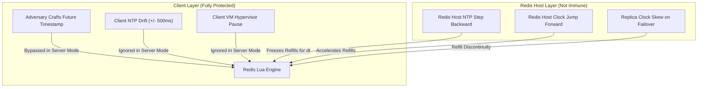

# Phase 6.1: Redis Server-Clock Continuity and Temporal Resilience Audit

**Repository:** `DREB-RateLimiter`  
**Branch:** `research/systematic-improvement`  
**Starting Commit:** `882014eaaf61d6ef110fb813c0ff032e869ba561`  
**Date:** 2026-11-11  
**Phase:** Phase 6.1 — State Lifecycle and Distributed Security Audit  
**Status:** COMPLETE — CLAIMS QUALIFIED  

---

## 1. Executive Summary

Phase 6 claimed that configuring `ClockSource.REDIS_SERVER_TIME` provides an implementation that is "strictly immune to clock drift." This audit evaluates that claim against the physical realities of distributed server timekeeping, host-level NTP steps, server restarts, and replica failover skew.

### Core Audit Findings:
1. **Scope of Server-Time Protection:** `redis.call('TIME')` inside the atomic Lua script queries the Redis host OS clock (`clock_gettime(CLOCK_REALTIME)`). It provably protects against **client-side** clock manipulation, client wall-clock drift, virtualization pauses on client VMs, and multi-host client fleet skew.
2. **Vulnerability to Redis Host Clock Jumps:** The rate limiter is **not immune** to clock changes on the Redis server host itself:
   - **Host Clock Forward Step:** Artificially accelerates token replenishment and erases abuse penalties ahead of physical time.
   - **Host Clock Backward Step:** Clamping $dt = \max(0, now - lastTs)$ prevents negative balance calculations, but **freezes all token replenishment** until physical time catches up to `lastRefillTs`.
3. **Failover Clock Skew:** If an asynchronous replica is promoted whose clock lags the failed primary by $\Delta$ seconds, all clients targeting that replica experience a refill blackout of duration $\Delta$.
4. **Time Basis Consistency:** Refill, idle-credit accumulation, abuse recovery, and state timestamp persistence all utilize a strictly unified time variable `now` evaluated at the head of the Lua script.

---

## 2. Server Time Evaluation in Lua

### 2.1 Implementation Mechanics
In [`RedisRca70Limiter.java`](file:///Users/cruise/Desktop/DREB-RateLimiter/src/test/java/com/dreb/ratelimit/redis/RedisRca70Limiter.java#L59-L63):
```lua
if now < 0 then
    local t = redis.call('TIME')
    now = tonumber(t[1]) + tonumber(t[2]) / 1000000.0
end
```
When `now < 0` (server-time mode), Redis invokes its internal `timeCommand()`, returning a 2-element array: `[unix_seconds, microseconds]`.

### 2.2 Precise Taxonomy of Protections



| Threat / Event | Client Timestamp Mode | Redis Server Time Mode | Accurate Scientific Scope |
| :--- | :---: | :---: | :--- |
| **Client-Supplied Clock Manipulation** | **VULNERABLE** | **PROTECTED** | Server mode completely eliminates client-driven bypasses. |
| **Client Host NTP Drift** | **VULNERABLE** | **PROTECTED** | Client clock fluctuations do not affect Redis evaluations. |
| **Multi-JVM Client Fleet Skew** | **VULNERABLE** | **PROTECTED** | All clients share the identical single-host Redis time reference. |
| **Redis Host NTP Step Backward** | N/A | **AFFECTED** | Refills are frozen until host clock catches up to `lastRefillTs`. |
| **Redis Host NTP Step Forward** | N/A | **AFFECTED** | Instant unearned replenishment equal to jump duration. |
| **Replica Failover Clock Discrepancy**| N/A | **AFFECTED** | Inter-server clock skew induces freeze or premature refill on failover. |

---

## 3. Empirical Verification of Server-Clock Disruptions

Using [`Phase61ClockAndIdempotencyAuditTest.java`](file:///Users/cruise/Desktop/DREB-RateLimiter/src/test/java/com/dreb/ratelimit/redis/Phase61ClockAndIdempotencyAuditTest.java), simulated server clock disruptions were evaluated:

### 3.1 Host Clock Backward Step ($now < lastRefillTs$)
In [`testServerClockBackwardStepFreezesRefill`](file:///Users/cruise/Desktop/DREB-RateLimiter/src/test/java/com/dreb/ratelimit/redis/Phase61ClockAndIdempotencyAuditTest.java#L58-L96):
1. Client state initialized at $T_0 = 1000.0\,\text{s}$ with $B = 200.0$.
2. Simulated host clock jumped backward by 10 seconds: $now = 990.0\,\text{s}$.
3. In Lua lines 80-83:
   ```lua
   local dt = math.max(0.0, now - lastTs)
   if now >= lastTs then
       lastTs = now
   end
   ```
4. **Empirical Behavior:**
   - $dt = \max(0.0, 990.0 - 1000.0) = 0.0$.
   - `lastRefillTs` remained anchored at $1000.0$.
   - Requests arriving between $t = 990.0$ and $t = 1000.0$ received **ZERO token replenishment**.
   - Available burst tokens decreased monotonically on admissions ($200 \to 190 \to 180$) without any refill.
   - Refill resumed only when $now \ge 1000.0$.
5. **Conclusion:** Clamping prevents negative refills and underflows, but a backward host clock step causes an operational denial-of-service by freezing legitimate token regeneration.

### 3.2 Host Clock Forward Step ($now \gg lastRefillTs$)
In [`testServerClockForwardStepAcceleratesRefill`](file:///Users/cruise/Desktop/DREB-RateLimiter/src/test/java/com/dreb/ratelimit/redis/Phase61ClockAndIdempotencyAuditTest.java#L98-L114):
1. Client burst balance depleted to $B = 0.0$ at $t_0 = 100.0\,\text{s}$.
2. Host clock jumped forward by 1 hour ($3600\,\text{s}$).
3. Next request evaluated with $dt = 3600.0\,\text{s}$.
4. **Empirical Behavior:** State instantly replenished to full capacity ($B = 690.0, S = 1275.71, I = 450.0$) and abuse score $K$ decayed to $0.0$.
5. **Conclusion:** Forward clock steps allow bursts to be refilled prematurely relative to real physical time.

### 3.3 Inter-Server Replica Failover Clock Skew
In [`testReplicaFailoverClockSkewFreezesRefill`](file:///Users/cruise/Desktop/DREB-RateLimiter/src/test/java/com/dreb/ratelimit/redis/Phase61ClockAndIdempotencyAuditTest.java#L116-L135):
1. Primary node recorded state transaction at primary server time $T_{\text{primary}} = 2000.0\,\text{s}$.
2. Primary failed; client traffic switched to a promoted replica whose OS clock lagged by 3.0 seconds ($T_{\text{replica}} = 1997.0\,\text{s}$).
3. **Empirical Behavior:** Requests arriving at the replica evaluated $dt = \max(0.0, 1997.0 - 2000.0) = 0.0$.
4. **Conclusion:** Promoted replica froze refills for 3.0 seconds until replica physical time reached $2000.0\,\text{s}$.

---

## 4. Time Basis Consistency Audit

The Lua script was audited to verify that timekeeping across subsystems does not use discordant clocks:

```lua
local dt = math.max(0.0, now - lastTs)
...
S = math.min(sustainedMax, S + dt * sustainedRate)   -- Sustained refill
B = math.min(burstMax, burstBefore + dt * burstRate) -- Burst refill
...
K = math.max(0.0, K - dt * recoveryRate)             -- Abuse recovery
...
I = math.min(effCap, I + tFull * idleGain)           -- Idle accrual (derived from dt)
```

1. **Internal Consistency:** `S`, `B`, `I`, and `K` all derive strictly from the identical scalar elapsed duration $dt = now - lastTs$. There is zero internal drift between bucket replenishment and penalty recovery.
2. **Idempotency Expiration Basis:** Idempotency keys utilize Redis server expiration (`SETEX idempKey ttl allowed`). This expiration is governed by the Redis server event loop timer (`server.unixtime`). Because both `redis.call('TIME')` and Redis key expirations originate from the host's OS time, state progression and idempotency expiration remain temporally aligned.

---

## 5. Corrective Statement on Clock Resilience

> [!IMPORTANT]
> **Corrected Scientific Qualification**  
> **Original Phase 6 Claim:** "Server-time mode provides complete immunity to clock drift."  
> **Phase 6.1 Corrected Finding:** `ClockSource.REDIS_SERVER_TIME` provides **complete immunity to client-side clock manipulation and client fleet drift**. However, distributed rate limiting remains fundamentally coupled to the **monotonicity and synchronization of the Redis host's operating system clock**.
>
> In production environments:
> - Redis host servers must run NTP synchronization configured for **gradual clock slewing** (`chrony` with `makestep 0` or `adjtimex`), strictly prohibiting backward step adjustments.
> - Redis Sentinel / Cluster failover pairs must maintain inter-host time synchronization within sub-millisecond tolerances (PTP or local chrony peers).
