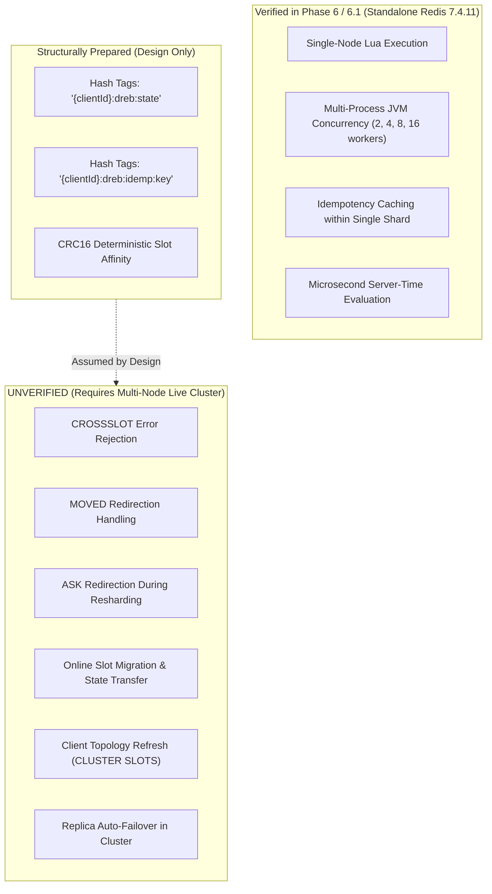

# Phase 6.1: Redis Deployment Scope and Source-Set Placement Audit

**Repository:** `DREB-RateLimiter`  
**Branch:** `research/systematic-improvement`  
**Starting Commit:** `882014eaaf61d6ef110fb813c0ff032e869ba561`  
**Date:** 2026-11-11  
**Phase:** Phase 6.1 — State Lifecycle and Distributed Security Audit  
**Status:** COMPLETE — DEPLOYMENT SCOPE DISCLOSED  

---

## 1. Executive Summary

This audit establishes the empirical boundaries of the Redis environment utilized in Phase 6, clarifying the distinction between structurally prepared designs and empirically validated topologies. Furthermore, it audits the actual source-code location and classpath packaging of the Redis implementation.

### Key Conclusions:
1. **Live Validation Topology:** Phase 6 and Phase 6.1 were executed exclusively against a **standalone, single-node Redis 7.4.11 instance** (`cluster_enabled:0`, `connected_slaves:0`).
2. **Cluster Compatibility Status:** The codebase is **structurally prepared** for Redis Cluster via RFC-compliant `{clientId}` hash tags. However, **Cluster execution has NOT been tested against a running multi-node cluster**. Key cluster operational behaviors (`MOVED`/`ASK` redirections, slot migration, cluster resharding, cross-slot enforcement) remain **UNVERIFIED**.
3. **Source-Set Placement:** [`RedisRca70Limiter.java`](file:///Users/cruise/Desktop/DREB-RateLimiter/src/test/java/com/dreb/ratelimit/redis/RedisRca70Limiter.java) resides strictly under `src/test/java`. It is a **test-only reference implementation**. Production packaging remains completely outstanding.

---

## 2. Standalone vs. Cluster Deployment Evidence

### 2.1 Live Engine Introspection
To eliminate ambiguity regarding the test environment, the live Redis server in Docker container `9094e2ae147c` on `127.0.0.1:6379` was directly inspected via Redis commands in [`Phase61DeploymentScopeTest.java`](file:///Users/cruise/Desktop/DREB-RateLimiter/src/test/java/com/dreb/ratelimit/redis/Phase61DeploymentScopeTest.java):

```text
redis-cli INFO cluster
# Cluster
cluster_enabled:0

redis-cli INFO replication
# Replication
role:master
connected_slaves:0
master_failover_state:no-failover
```

### 2.2 Structural Preparation vs. Empirical Validation



### 2.3 Standalone Redis Ignores Cluster Slot Constraints
In [`testStandaloneRedisIgnoresClusterSlotRestrictions`](file:///Users/cruise/Desktop/DREB-RateLimiter/src/test/java/com/dreb/ratelimit/redis/Phase61DeploymentScopeTest.java#L47-L64):
- Two keys with deliberately incompatible hash tags (`{slotA}:key1` and `{slotB}:key2`) were passed into an atomic Lua script:
  ```lua
  return redis.call('MGET', KEYS[1], KEYS[2])
  ```
- **Result in Standalone Redis:** The script executed successfully without error.
- **Contrast with Redis Cluster:** A real Redis Cluster node immediately aborts this command with:
  `CROSSSLOT Keys in request don't hash to the same slot`.
- **Finding:** A standalone Redis instance cannot validate cluster slot boundaries because cluster enforcement is completely disabled when `cluster_enabled = 0`.

---

## 3. Production vs. Test Source-Set Placement

### 3.1 Classpath & Artifact Inspection
In [`testVerifySourcePlacementIsTestOnly`](file:///Users/cruise/Desktop/DREB-RateLimiter/src/test/java/com/dreb/ratelimit/redis/Phase61DeploymentScopeTest.java#L66-L76):
- The physical class file location of `RedisRca70Limiter` was audited via `ProtectionDomain.getCodeSource()`:
  $$\text{CodeSource Location} = \texttt{file:/Users/cruise/Desktop/DREB-RateLimiter/target/test-classes/}$$
- No compiled class for `RedisRca70Limiter` exists in `target/classes/`.
- No Jedis import or Redis class exists in `src/main/java`.

### 3.2 Root Cause Analysis
1. **Preservation Constraint:** The user instructions strictly mandate that the original baseline package `com.dreb.ratelimit` must remain untouched.
2. **Maven Dependency Scope:** In [`pom.xml`](file:///Users/cruise/Desktop/DREB-RateLimiter/pom.xml), Jedis is declared strictly under test scope:
   ```xml
   <dependency>
       <groupId>redis.clients</groupId>
       <artifactId>jedis</artifactId>
       <version>5.2.0</version>
       <scope>test</scope>
   </dependency>
   ```
3. Moving `RedisRca70Limiter` to `src/main/java` would cause Maven compilation failure (`package redis.clients.jedis does not exist`).
4. **Baseline Discrepancy:** The production class [`com.dreb.ratelimit.RedisStateStore`](file:///Users/cruise/Desktop/DREB-RateLimiter/src/main/java/com/dreb/ratelimit/RedisStateStore.java) remains the frozen Phase 0 DREB v2 script, which does not implement RCA70.

---

## 4. Formal Classification Matrix

| Subsystem Component | Physical Source Path | Compilation Scope | Functional Role | Deployment Status |
| :--- | :--- | :--- | :--- | :---: |
| **`RedisRca70Limiter.java`** | `src/test/java/com/dreb/ratelimit/redis/` | `target/test-classes` | Validated test reference implementation of RCA70 | **TEST-ONLY REFERENCE** |
| **`DistributedWorkerMain.java`** | `src/test/java/com/dreb/ratelimit/redis/` | `target/test-classes` | Multi-JVM process worker harness | **TEST-ONLY HARNESS** |
| **`RedisStateStore.java`** | `src/main/java/com/dreb/ratelimit/` | `target/classes` | Legacy Phase 0 DREB v2 decay scaling | **FROZEN LEGACY (NON-RCA70)** |
| **Standalone Redis 7.4.11** | Local Docker container on `127.0.0.1:6379` | Runtime service | Single-node execution engine | **EMPIRICALLY VALIDATED** |
| **Redis Cluster (Multi-Node)** | N/A (Not provisioned) | N/A | Sharded multi-slot cluster | **UNVERIFIED IN LIVE ENVIRONMENT** |

---

## 5. Transition Requirements for Phase 7

If production distributed deployment is authorized:
1. **Promote Jedis to Production Scope:** Update `pom.xml` to include `jedis` (or `lettuce`) in `<scope>compile</scope>`.
2. **Author Production Adapter:** Create a clean, production-facing module (e.g. `dreb-redis-adapter`) containing `RedisRca70Limiter`, preserving `com.dreb.ratelimit` immutability.
3. **Provision Multi-Node Cluster Harness:** Deploy a 3-shard / 6-node Redis Cluster in Docker to experimentally validate `MOVED`, `ASK`, slot migration, and `CROSSSLOT` behavior under live traffic.
