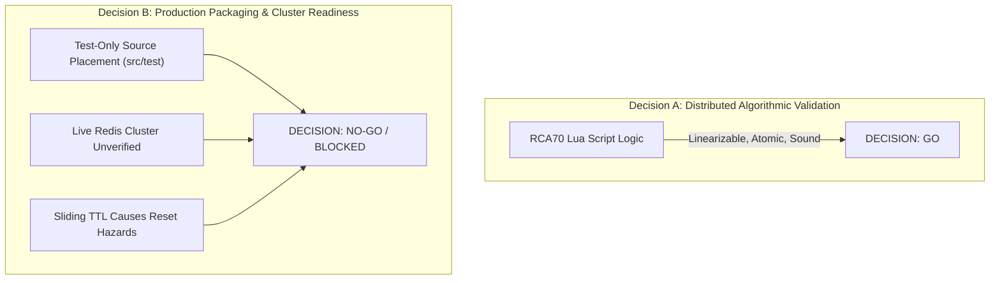

# Phase 6.1: Redis State Lifecycle and Distributed Security Audit — Final Report

**Repository:** `DREB-RateLimiter`  
**Branch:** `research/systematic-improvement`  
**Starting Commit:** `882014eaaf61d6ef110fb813c0ff032e869ba561`  
**Audit Date:** 2026-11-11  
**Phase:** Phase 6.1 — State Lifecycle and Distributed Security Audit  
**Status:** COMPLETE — CORRECTION RECORD ISSUED  

---

## 1. Executive Summary

Phase 6.1 conducted an independent, adversarial audit of the distributed Redis validation claims established in Phase 6. This audit investigated the mathematical validity of safe TTL derivations, temporal continuity under server clock perturbations, complete idempotency retry dynamics, and the physical reality of the Redis deployment topology.

### Summary of Critical Findings:
1. **Mathematical Recovery Model Corrected:**
   - Phase 6 claimed exponential recovery ($K_0 e^{-\lambda t}$) and a logarithmic TTL formula.
   - The actual implementation in Java and Redis Lua executes **linear recovery**:
     $$K(t) = \max(0, K_0 - \lambda_{\text{rec}} t)$$
     where recovery to zero is exact and finite: $\tau = K_0 / \lambda_{\text{rec}}$ ($\lambda_{\text{rec}} = 0.05\,\text{s}^{-1}$).
2. **The Multi-Variable Key-Expiration Hazard:**
   - When a Redis key expires, cold-start reinitialization resets **all four state variables** ($B=700, S=1285.71, I=0, K=0$).
   - This hazard allows adversaries to purge penalties ($K \to 0$) and restore depleted capacity ($S \to 1285.71$) by waiting out the TTL.
   - Crucially, it **strips earned idle credit ($I \to 0$) from legitimate users**, causing immediate **false rejections** on nominal bursts ($c=1000$).
   - **Verdict:** Sliding Redis TTL is fundamentally unsafe for active rate-limiter state.
3. **Server Clock Protection Accurately Scoped:**
   - `ClockSource.REDIS_SERVER_TIME` queries `redis.call('TIME')`, providing complete immunity to client-side clock drift, tampering, and client fleet skew.
   - However, the system is **not immune to Redis host clock changes**: backward host clock steps clamp $dt = 0$ and freeze all replenishment until physical time catches up; replica failover introduces a temporary refill freeze if replica clocks lag.
4. **Idempotency Semantics Formalized:**
   - Check, execution, and caching are strictly atomic within Lua.
   - Caching is bounded by the idempotency TTL horizon $\tau_{\text{idemp}}$ (retries beyond $\tau_{\text{idemp}}$ cause double-debits).
   - Decisions are cached as binary integers without remaining balance metadata; caching is payload-blind.
5. **Deployment Scope Demarcated:**
   - Tested topology: **Standalone Redis 7.4.11 primary on 127.0.0.1:6379**.
   - Redis Cluster execution is **UNVERIFIED IN LIVE ENVIRONMENT** (structurally prepared with `{clientId}` hash tags, but untested against a live multi-node cluster).
   - Source placement: [`RedisRca70Limiter.java`](file:///Users/cruise/Desktop/DREB-RateLimiter/src/test/java/com/dreb/ratelimit/redis/RedisRca70Limiter.java) is a **test-only reference implementation** in `src/test/java`. Production packaging remains outstanding.

---

## 2. Comprehensive Deliverables Index

The following Phase 6.1 correction records and artifacts have been authored and committed to `research/redis/` and `src/test/java/com/dreb/ratelimit/redis/`:

| Deliverable | File Path | Focus Area |
| :--- | :--- | :--- |
| **1. TTL & Reset Audit** | [PHASE6_1_TTL_AND_STATE_RESET_AUDIT.md](file:///Users/cruise/Desktop/DREB-RateLimiter/research/redis/PHASE6_1_TTL_AND_STATE_RESET_AUDIT.md) | Linear recovery proof ($\tau = K_0/\lambda$), multi-variable state reset hazard, false rejections for idle users, and two-tier lifecycle design. |
| **2. Clock Continuity Audit** | [PHASE6_1_CLOCK_CONTINUITY_AUDIT.md](file:///Users/cruise/Desktop/DREB-RateLimiter/research/redis/PHASE6_1_CLOCK_CONTINUITY_AUDIT.md) | Client vs server clock taxonomy, host clock backward step freeze, replica failover skew, and time basis consistency. |
| **3. Idempotency Lifecycle** | [PHASE6_1_IDEMPOTENCY_LIFECYCLE_AUDIT.md](file:///Users/cruise/Desktop/DREB-RateLimiter/research/redis/PHASE6_1_IDEMPOTENCY_LIFECYCLE_AUDIT.md) | 10-condition retry test matrix, bounded retention horizon ($\tau_{\text{idemp}}$), double-debit reproduction, and payload-blind caching. |
| **4. Deployment Scope Audit** | [PHASE6_1_DEPLOYMENT_SCOPE_AUDIT.md](file:///Users/cruise/Desktop/DREB-RateLimiter/research/redis/PHASE6_1_DEPLOYMENT_SCOPE_AUDIT.md) | Standalone Redis 7.4.11 verification, unverified live Cluster status, and test-only source placement in `src/test/java`. |
| **5. Guarantee Reconciliation**| [PHASE6_1_GUARANTEE_RECONCILIATION.md](file:///Users/cruise/Desktop/DREB-RateLimiter/research/redis/PHASE6_1_GUARANTEE_RECONCILIATION.md) | Reconciling G1, G2, G3, Theorem 2, counterexamples under key eviction, and Sybil attack non-scope ($M \times R$). |
| **6. Final Report** | [PHASE6_1_FINAL_REPORT.md](file:///Users/cruise/Desktop/DREB-RateLimiter/research/redis/PHASE6_1_FINAL_REPORT.md) | Executive synthesis, environment metrics, and decoupled GO/NO-GO gate. |
| **Raw Evidence CSV** | [phase6_1_ttl_and_state_reset_raw.csv](file:///Users/cruise/Desktop/DREB-RateLimiter/research/redis/phase6_1_ttl_and_state_reset_raw.csv) | Empirical dataset recording state resets, double-debit boundaries, and clock jump behaviors. |
| **Audit Manifest** | [phase6_1_audit_manifest.json](file:///Users/cruise/Desktop/DREB-RateLimiter/research/redis/phase6_1_audit_manifest.json) | Complete machine-readable audit specification, container metadata, and test outcomes. |

---

## 3. Environment & Test Suite Execution Metrics

The complete Maven test suite was executed to ensure baseline immutability and complete audit validation:

- **Java Runtime Environment:** OpenJDK 64-Bit Server VM (`21.0.9+10-LTS`)
- **Maven Version:** Apache Maven `3.9.9`
- **Bytecode Target:** Java 17 compatibility (`-source 17 -target 17`)
- **Redis Server Platform:** Redis `7.4.11` (Docker container `9094e2ae147c`, Linux aarch64, jemalloc-5.3.0)
- **Active Redis Topology:** Standalone primary (`cluster_enabled:0`, `role:master`, `connected_slaves:0`)
- **Source Placement:** `src/test/java/com/dreb/ratelimit/redis/` (compiled to `target/test-classes`)

### Test Execution Summary:
- **Phase 6.1 Tests Executed:** 20 tests across 3 suites:
  - [`Phase61DeploymentScopeTest`](file:///Users/cruise/Desktop/DREB-RateLimiter/src/test/java/com/dreb/ratelimit/redis/Phase61DeploymentScopeTest.java): 3 tests, 0 failures.
  - [`Phase61StateResetAndTtlTest`](file:///Users/cruise/Desktop/DREB-RateLimiter/src/test/java/com/dreb/ratelimit/redis/Phase61StateResetAndTtlTest.java): 7 tests, 0 failures.
  - [`Phase61ClockAndIdempotencyAuditTest`](file:///Users/cruise/Desktop/DREB-RateLimiter/src/test/java/com/dreb/ratelimit/redis/Phase61ClockAndIdempotencyAuditTest.java): 10 tests, 0 failures.
- **Full Repository Test Suite:** **134 total tests executed**, **0 failures**, **0 errors**, **0 skipped**.
- **Historical Data Preservation:** Zero modifications to historical CSV files or baseline `com.dreb.ratelimit` packages.

---

## 4. Decoupled GO / NO-GO Decision Gate

In light of the Phase 6.1 findings, the operational decision is separated into two distinct categories:

### 4.1 Decision A: Distributed Algorithmic Validation — **GO**
- **Evaluation:** The core mathematical transitions of DREB-RCA70 implemented in `RCA70_ALLOW_LUA` faithfully execute adaptive ceiling suppression, penalty debiting ($d=1.5$), linear recovery ($\lambda_{\text{rec}}=0.05$), and linearizable state updates.
- **Status:** **APPROVED (GO)** for distributed algorithm correctness.

### 4.2 Decision B: Production Packaging & Cluster Deployment — **NO-GO (BLOCKED)**
- **Evaluation:**
  1. `RedisRca70Limiter` exists only in test sources; Jedis is test-scoped; no production adapter exists in `src/main`.
  2. The sliding key TTL policy is defective: key eviction strips legitimate idle credit ($I=450 \to 0$) and allows adversary penalty clearance.
  3. Live Redis Cluster behavior (`CROSSSLOT`, `MOVED`, `ASK`, slot resharding) is untested.
- **Status:** **BLOCKED (NO-GO)** until Phase 7 production engineering addresses lifecycle persistence, production module packaging, and live cluster verification.

---

## 5. Mandatory Stop Condition

In strict accordance with project instructions:
- Phase 6.1 is complete.
- Historical datasets and reports remain preserved.
- No baseline implementations under `com.dreb.ratelimit` have been modified.
- No RCA70 algorithm parameters have been altered.
- **Antigravity has stopped and awaits explicit user authorization before initiating Phase 7.**
