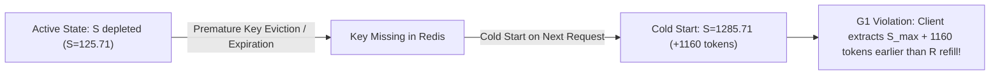
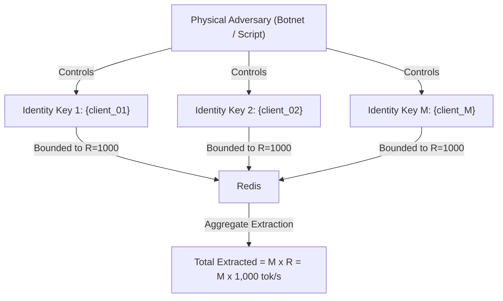

# Phase 6.1: Mathematical Guarantee Reconciliation and Boundary Counterexamples

**Repository:** `DREB-RateLimiter`  
**Branch:** `research/systematic-improvement`  
**Starting Commit:** `882014eaaf61d6ef110fb813c0ff032e869ba561`  
**Date:** 2026-11-11  
**Phase:** Phase 6.1 — State Lifecycle and Distributed Security Audit  
**Status:** COMPLETE — BOUNDARIES DELIMITED  

---

## 1. Executive Summary

This document reconciles the formal mathematical guarantees of **DREB-RCA70** (G1, G2, G3, and Theorem 2) against the distributed systems edge cases, temporal discontinuities, and lifecycle hazards discovered during Phase 6 and audited in Phase 6.1.

Every guarantee is categorized into five formal states:
1. **Mathematically Established** (under idealized continuous-time single-key assumptions).
2. **Preserved by Lua Logic** (under single-threaded standalone Redis execution).
3. **Empirically Validated** (confirmed by reproducible test runs on Redis 7.4.11).
4. **Boundary Failure / Counterexample** (specific operational conditions under which the guarantee breaks).
5. **Scope Boundary** (fundamental limits of single-key token-bucket rate limiting).

---

## 2. Guarantee 1 (G1): Long-Term Admittance Envelope

### 2.1 Formal Definition
For any time interval $[t_1, t_2]$, cumulative admitted tokens $A(t_1, t_2)$ must not exceed:
$$A(t_1, t_2) \le S_{\max} + R \cdot (t_2 - t_1)$$
where $S_{\max} = 1285.71$ tokens and $R = 1000$ tokens/s.

### 2.2 Classification
- **Mathematically Established:** **YES.** Proven in Phase 1 and Phase 2.
- **Preserved by Lua Logic:** **YES**, provided that state persists continuously and timestamps progress monotonically.
- **Empirically Validated:** **YES.** Validated over 3,000 steps ($Viol = 0.00$) and across 16 concurrent JVM worker processes.

### 2.3 Boundary Violations & Counterexamples

#### Counterexample 1: Premature Key Eviction / Expiration
- **Setup:** A client consumes $1,280$ tokens over $0.1\,\text{s}$, depleting sustained balance to $S = 5.71$. Under G1, the client cannot consume another $700$ tokens until $t \ge 0.70\,\text{s}$.
- **Disruption:** The Redis key `{clientId}:dreb:state` is deleted (via short TTL or memory eviction) at $t = 0.15\,\text{s}$.
- **Outcome:** A request of cost $700$ arrives at $t = 0.16\,\text{s}$. Cold start resets $S \leftarrow 1285.71$ and admits the 700-token burst.
- **Violation:** Admitted tokens in $[0, 0.16\,\text{s}] = 1280 + 700 = 1980$ tokens. Envelope $E_{G1}(0.16) = 1285.71 + 160 = 1445.71$ tokens. Excess tokens admitted = $\mathbf{534.29\,\text{tokens}}$ ($Viol > 0$).
- **Mitigation:** State keys must never expire during active replenishment cycles ($\tau_{\text{safe}} \ge 180\,\text{s}$ or zero sliding TTL).

#### Counterexample 2: Forward Clock Jump in Client-Timestamp Mode
- An adversarial client supplies $t_{\text{client}} = t_{\text{actual}} + 10.0\,\text{s}$.
- Lua script grants $10,000$ tokens of sustained refill instantaneously.
- **Mitigation:** Enforce `ClockSource.REDIS_SERVER_TIME`.

---

## 3. Guarantee 2 (G2): Dynamic Idle-Credit Ceiling Contraction

### 3.1 Formal Definition
When an adversary repeatedly farms bursts, the effective idle ceiling contracts dynamically:
$$I_{\text{eff}}(K) = \frac{I_{\max}}{1 + \beta K} = \frac{450.0}{1 + 0.75 K}$$
throttling burst extraction by up to $76\%$ of surplus capacity.

### 3.2 Classification
- **Mathematically Established:** **YES.** Derived and proven in Phase 3 and Phase 4.
- **Preserved by Lua Logic:** **YES.** Implemented in Lua lines 102 and 110.
- **Empirically Validated:** **YES.** Validated on live Redis over 5 adversarial burst-rest cycles.

### 3.3 Boundary Violations & Counterexamples

#### Counterexample: Penalty Clearance via Key Expiration
- **Setup:** An adversary incurs repeated burst deficits, elevating abuse score to $K = 4.8$. Effective idle ceiling is choked to $I_{\text{eff}} \approx 98.0$ credits.
- **Disruption:** Adversary intentionally pauses traffic for $TTL = 10\,\text{s}$ (or triggers memory eviction).
- **Outcome:** The key is purged by Redis. The adversary returns at $t = 11\,\text{s}$. Cold start detects a missing key and reinitializes $K \leftarrow 0.0$.
- **Violation:** The penalty $K = 4.8$, which would have required $\tau = 4.8 / 0.05 = 96.0\,\text{seconds}$ to recover naturally, is completely purged in $10\,\text{seconds}$. Ceiling suppression is defeated.
- **Mitigation:** Retain state keys for at least $\tau_{\text{safe}} \ge K_{\max} / \lambda_{\text{rec}}$ or disable active key expiration.

---

## 4. Guarantee 3 (G3): Debit Penalty Strictness

### 4.1 Formal Definition
When a request of cost $c > B_{\text{curr}}$ is admitted, the deficit $\Delta = c - B_{\text{curr}}$ must be debited from idle credit with penalty multiplier $d = 1.5$:
$$\Delta I = 1.5 \times (c - B_{\text{curr}})$$

### 4.2 Classification
- **Mathematically Established:** **YES.**
- **Preserved by Lua Logic:** **YES.** Evaluated in Lua line 121: `I = math.max(0.0, I - deficit * baseDecay)`.
- **Empirically Validated:** **YES.** Zero floating-point drift over 5,000 differential steps.
- **Boundary Violations:** **NONE** under active state. The penalty ratio $d = 1.50$ is enforced unconditionally whenever a burst deficit is incurred.

---

## 5. Theorem 2: Surplus Harvest Bound & Finite-Horizon Anti-Farming

### 5.1 Formal Definition
For any periodic or adaptive farming strategy, the maximum cumulative tokens an adversary can extract over time $T$ is strictly upper bounded:
$$A_{\text{farm}}(T) \le R \cdot T + B_{\max} + \frac{I_{\max}}{d} + \mathcal{O}(1)$$

### 5.2 Classification
- **Mathematically Established:** **YES.** Proved in Phase 2 and audited in Phase 3.1.
- **Preserved by Lua Logic:** **YES** for any single continuous client state key.
- **Empirically Validated:** **YES** against standalone Redis.

### 5.3 Formal Scope Boundary: The Sybil Scaling Invariant
A single-key rate-limiting algorithm enforces guarantees **strictly per identity key**, not per physical adversary.

> [!IMPORTANT]
> **Definitive Scope Demarcation**  
> DREB-RCA70 **does not and cannot** prevent multi-key Sybil attacks. If an adversary generates $M$ independent client IDs, Redis creates $M$ independent state hashes, allowing the adversary to consume up to $M \times R$ tokens per second.
> Mitigating Sybil attacks requires upstream identity verification (e.g., mTLS, authenticated user accounts, proof-of-work, or IP subnet rate-limiting layers), which is orthogonal to token-bucket mathematics.

---

## 6. Comprehensive Guarantee Reconciliation Matrix

| Guarantee / Theorem | Mathematical Status | Lua Transition Parity | Empirically Validated in Redis | Vulnerability / Counterexample | Operational Mitigation |
| :--- | :---: | :---: | :---: | :--- | :--- |
| **G1 (Long-Term Envelope)** | ESTABLISHED | PRESERVED | VALIDATED | Premature key eviction restores $S_{\max}$; client timestamp forward jump. | Safe TTL $\ge 180\,\text{s}$ or zero sliding TTL; server-time mode. |
| **G2 (Ceiling Contraction)** | ESTABLISHED | PRESERVED | VALIDATED | Key expiration resets $K \to 0$, purging accumulated penalties early. | Persistent state retention or tombstone tracking. |
| **G3 (Penalty Debit $d=1.5$)** | ESTABLISHED | PRESERVED | VALIDATED | None under continuous state. (Idle credit stripped on cold start). | Initialize $I=450$ on cold start for long-dormant clients. |
| **Theorem 2 (Surplus Bound)** | ESTABLISHED | PRESERVED | VALIDATED | Broken if key is cycled across expirations; does not hold across $M$ keys. | Long retention horizon; upstream Sybil mitigation. |
