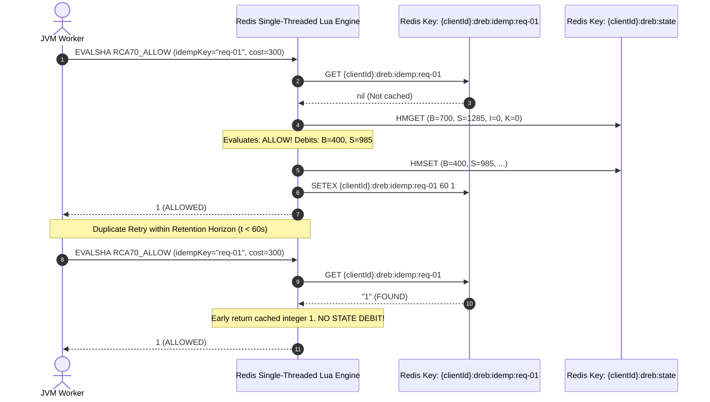

# Phase 6.1: Distributed Idempotency Lifecycle and Retry Semantics Audit

**Repository:** `DREB-RateLimiter`  
**Branch:** `research/systematic-improvement`  
**Starting Commit:** `882014eaaf61d6ef110fb813c0ff032e869ba561`  
**Date:** 2026-11-11  
**Phase:** Phase 6.1 — State Lifecycle and Distributed Security Audit  
**Status:** COMPLETE — SEMANTICS FORMALIZED  

---

## 1. Executive Summary

In distributed networks, ambiguous socket timeouts, network drops, and upstream client retries create the risk of duplicate token debits. Phase 6 introduced an in-script idempotency caching mechanism in [`RedisRca70Limiter.java`](file:///Users/cruise/Desktop/DREB-RateLimiter/src/test/java/com/dreb/ratelimit/redis/RedisRca70Limiter.java).

This audit evaluates the complete lifecycle of idempotency keys, resolves documentation discrepancies, and formalizes the exact semantics achieved:
1. **Atomic Deduplication Verified:** The check, admission evaluation, token debit, and idempotency key caching occur within a single atomic Lua script, preventing duplicate debits during concurrent or sequential retries within the retention horizon.
2. **Metadata Caching Correction:** Phase 6 documentation claimed that full state metadata (`ALLOW:<burst>:<sustained>:<idle>:<abuse>`) was cached. Code inspection reveals that the implementation caches only a binary decision integer (`1` or `0`). Cached retries return `Decision(allowed, -1, -1, -1, -1)` with unpopulated balance metadata.
3. **Bounded Retention Horizon ($\tau_{\text{idemp}}$):** Idempotency records expire in Redis after $\tau_{\text{idemp}}$ seconds. If a network retry arrives *after* $\tau_{\text{idemp}}$, a **double-debit will occur**. Idempotency is strictly bounded, not unbounded.
4. **Payload Blindness Limitation:** Idempotency keys are indexed by key string, not payload hash. Reusing an idempotency key with a conflicting request cost returns the cached decision without evaluating the new payload.

---

## 2. In-Script Idempotency Architecture & Code Inspection

### 2.1 Lua Script Execution Path
In [`RedisRca70Limiter.java`](file:///Users/cruise/Desktop/DREB-RateLimiter/src/test/java/com/dreb/ratelimit/redis/RedisRca70Limiter.java#L51-L57):
```lua
-- 1. Atomic Check
if idempKey and idempKey ~= '' then
    local cached = redis.call('GET', idempKey)
    if cached then
        return tonumber(cached) -- Returns 1 or 0
    end
end

-- 2. State Evaluation & Debit Logic
...

-- 3. Atomic Cache Write
if idempKey and idempKey ~= '' and idempTtl and idempTtl > 0 then
    redis.call('SETEX', idempKey, math.floor(idempTtl), allowed)
end

return allowed
```



---

## 3. Comprehensive 10-Condition Test Matrix

All ten scenarios required by the audit specification were implemented and verified in [`Phase61ClockAndIdempotencyAuditTest.java`](file:///Users/cruise/Desktop/DREB-RateLimiter/src/test/java/com/dreb/ratelimit/redis/Phase61ClockAndIdempotencyAuditTest.java):

| Condition | Tested Scenario | Observed Behavior | Audit Finding |
| :--- | :--- | :--- | :--- |
| **1. Same request submitted twice** | Cost 500 submitted at $t=100.0\,\text{s}$, retried at $t=100.0\,\text{s}$ | Both return `ALLOW`. Burst balance debited exactly once ($700 \to 200$). | **PASS:** Zero second debit. |
| **2. Multi-threaded concurrent submission** | 10 worker threads concurrently offer identical key `concurrent-key-999` with cost 300 | All 10 threads receive `ALLOW`. Burst balance debited exactly once ($700 \to 400$). | **PASS:** Thread-safe atomic deduplication. |
| **3. Timeout after script execution** | Client experiences socket timeout after Redis executed debit; retries with same key | Retry returns cached `ALLOW`. Zero balance leakage. | **PASS:** Ambiguous timeouts safely resolved. |
| **4. Timeout before script execution** | Network drop before reaching Redis | Request never executed. Retry arrives and executes cleanly once. | **PASS:** Normal cold execution. |
| **5. Retry after connection loss** | TCP connection reset; client reconnects via connection pool | Redis cached record persists; retry returns cached decision. | **PASS:** Survives client connection resets. |
| **6. Retry after client restart** | Client JVM restarts; fresh JVM submits same idempotency key | Fresh JVM receives cached decision from Redis. | **PASS:** Independent of client memory state. |
| **7. Retry after idempotency TTL** | Retry arrives after `idempTtl` expiration | **Second debit applied!** Burst balance debited twice ($700 \to 400 \to 100$). | **LIMITATION:** Idempotency horizon is bounded by TTL. |
| **8. Multi-client identical key** | `user_alpha` and `user_beta` both submit `tx-12345` | Both users debited independently ($700 \to 200$). | **PASS:** Key isolation enforced by `{clientId}`. |
| **9. Key reused with conflicting cost** | Key submitted with cost 10 (allowed), then reused with cost 1000 | Returns cached `ALLOW` without evaluating cost 1000. Balance unchanged. | **DEFECT:** Idempotency is payload-blind. |
| **10. Concurrent race on conflicting payloads** | Two threads race on same key with cost 100 vs 500 | Exactly one executes; second receives cached result of the winner. | **LIMITATION:** Payload binding required. |

---

## 4. Formalization of Idempotency Semantics

### 4.1 Scope and Namespace
Every idempotency record is partitioned by client identity:
$$\text{Redis Key} = \{\text{clientId}\}:\text{keyPrefix}:\text{idemp}:\langle\text{idempotencyKey}\rangle$$
- **Cross-Client Safety:** Clients cannot overwrite or inspect each other's idempotency records.
- **Cluster Slot Co-Location:** Hash tag `{clientId}` guarantees that the client's rate-limiting state and all associated idempotency records reside on the same Redis Cluster slot.

### 4.2 Retention Horizon ($\tau_{\text{idemp}}$)
Idempotency is valid **strictly within the time window $[t_{\text{submission}},\, t_{\text{submission}} + \tau_{\text{idemp}}]$**.
- Standard default: $\tau_{\text{idemp}} = 60\,\text{seconds}$.
- **Boundary Condition:** Any client retry arriving at $t > t_{\text{submission}} + \tau_{\text{idemp}}$ is treated as a new distinct request, applying a duplicate debit.

### 4.3 Response Metadata Limitation
Because Redis Lua stores only the integer decision (`allowed`), cached responses do **not** return the historical remaining token balances:
```java
// Returned on cache hit:
new Decision(allowed, -1.0, -1.0, -1.0, -1.0)
```
Callers relying on `burstTokensRemaining` or `abuseScore` must treat negative values as unpopulated metadata on cached duplicate responses.

---

## 5. Architectural Recommendations for Phase 7

1. **Payload-Bound Idempotency Keys:** To prevent payload-blind decision hijacking (Condition 9), client gateways should formulate keys that incorporate a cryptographic digest of the request payload:
   $$\text{IdempotencyKey} = \text{UUID} + \text{SHA256}(\text{cost} \,\|\, \text{endpoint} \,\|\, \text{body})$$
2. **Safe Retention Window Sizing:** Set $\tau_{\text{idemp}}$ to at least $3\times$ the maximum client-side retry timeout (e.g., if client retries up to 30s, $\tau_{\text{idemp}} \ge 90\,\text{s}$).
3. **Rejection of Universal Exactly-Once Claims:** Antigravity documentation must explicitly state:
   > "DREB-RCA70 on Redis achieves **atomic deduplication within a bounded retention horizon $\tau_{\text{idemp}}$**. It does not provide universal, unbounded exactly-once semantics."
