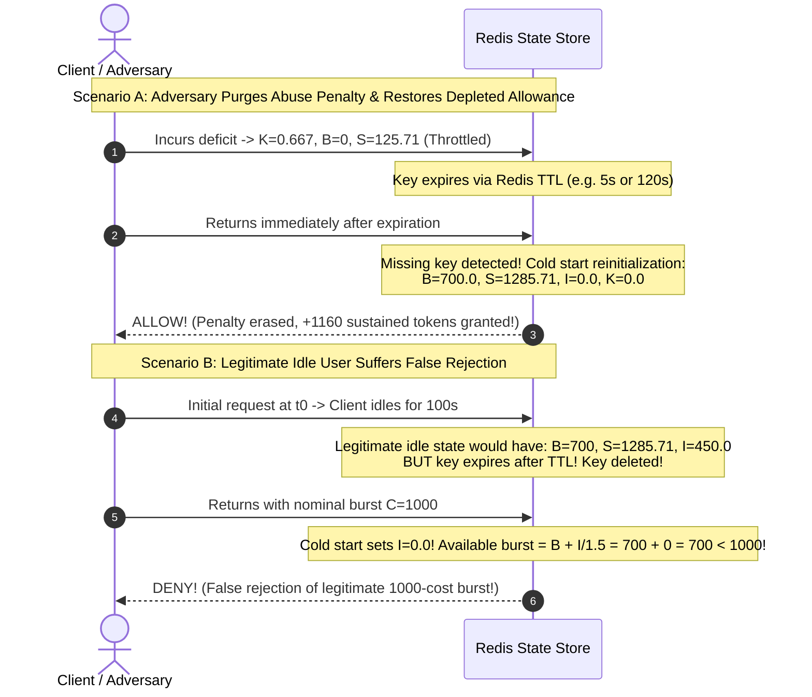
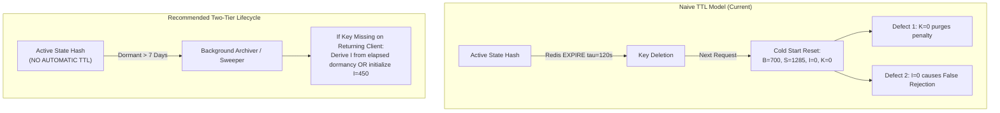

# Phase 6.1: Redis State Lifecycle, Safe TTL, and State Reset Audit

**Repository:** `DREB-RateLimiter`  
**Branch:** `research/systematic-improvement`  
**Starting Commit:** `882014eaaf61d6ef110fb813c0ff032e869ba561`  
**Date:** 2026-11-11  
**Phase:** Phase 6.1 — State Lifecycle and Distributed Security Audit  
**Status:** COMPLETE — CORRECTION RECORD ISSUED  

---

## 1. Executive Summary

This audit independently scrutinizes the state recovery equations and Redis key-expiration mechanics previously reported in Phase 6. Two critical defects were uncovered:

1. **Mathematical Model Misidentification:** Phase 6 reported an **exponential recovery** model ($K(t) = K_0 e^{-\lambda_{\text{rec}} t}$) and derived an asymptotic logarithmic safe TTL ($\tau \ge \frac{1}{\lambda_{\text{rec}}}\ln(K_{\max}/\epsilon)$). Code inspection of both the Java reference ([`Phase3AblationTest.java`](file:///Users/cruise/Desktop/DREB-RateLimiter/src/test/java/com/dreb/ratelimit/Phase3AblationTest.java)) and the Lua script ([`RedisRca70Limiter.java`](file:///Users/cruise/Desktop/DREB-RateLimiter/src/test/java/com/dreb/ratelimit/redis/RedisRca70Limiter.java)) reveals that the implementation actually executes **linear recovery** ($K(t) = \max(0, K_0 - \lambda_{\text{rec}} t)$). The exact recovery time to zero is finite: $\tau = K_0 / \lambda_{\text{rec}}$.
2. **The Multi-Variable State Reset Hazard:** Redis key expiration does not merely purge $K$; it completely wipes and resets **all four state variables** ($B, S, I, K$) upon the subsequent request:
   - $B$ resets to $B_{\max} = 700.0$ (prematurely restoring exhausted burst capacity).
   - $S$ resets to $S_{\max} = 1285.71$ (prematurely bypassing sustained throttling).
   - $K$ resets to $0.0$ (erasing accumulated anti-farming penalties).
   - **$I$ resets to $0.0$** (stripping earned idle credit from legitimate users, causing **false rejections** on nominal bursts).

**Architectural Verdict:** Automatic key expiration via Redis `EXPIRE` is **fundamentally unsafe for active rate-limiter state**. A TTL policy derived solely from $K$ fails because key eviction actively harms legitimate idle users and enables adversary cycling.

---

## 2. Mathematical Audit: Linear vs. Exponential Abuse Recovery

### 2.1 Implementation Code Inspection
In [`RedisRca70Limiter.java`](file:///Users/cruise/Desktop/DREB-RateLimiter/src/test/java/com/dreb/ratelimit/redis/RedisRca70Limiter.java#L98-L100):
```lua
if K > 0.0 and recoveryRate > 0.0 then
    K = math.max(0.0, K - dt * recoveryRate)
end
```
In [`Phase3AblationTest.java`](file:///Users/cruise/Desktop/DREB-RateLimiter/src/test/java/com/dreb/ratelimit/Phase3AblationTest.java#L75-L76):
```java
if (dt > 0.0 && state.abuseScore > 0.0) {
    state.abuseScore = Math.max(0.0, state.abuseScore - dt * recoveryRate);
}
```
Both implementations execute strict **linear decay** with rate $\lambda_{\text{rec}} = 0.05\,\text{s}^{-1}$.

### 2.2 Mathematical Re-Derivation of Recovery Duration
For linear recovery:
$$K(t) = \max(0, K_0 - \lambda_{\text{rec}} t)$$

To reach an abuse state no greater than residual threshold $\epsilon \ge 0$:
$$K_0 - \lambda_{\text{rec}} t \le \epsilon \iff \tau_{\text{rec}} \ge \frac{\max(0, K_0 - \epsilon)}{\lambda_{\text{rec}}}$$

For full recovery ($K = 0$):
$$\tau_{\text{rec}} = \frac{K_0}{\lambda_{\text{rec}}}$$

### 2.3 Comparison with Phase 6 Report

| Parameter State | Phase 6 Erroneous Equation: $\tau = \frac{1}{\lambda_{\text{rec}}}\ln\left(\frac{K_0}{\epsilon}\right)$ ($\epsilon=0.001$) | Phase 6.1 Correct Linear Equation: $\tau = \frac{K_0}{\lambda_{\text{rec}}}$ ($\epsilon = 0$) | Discrepancy Analysis |
| :--- | :---: | :---: | :--- |
| **$K_0 = 0.6667$** (Single burst) | $130.0\,\text{s}$ | **$13.33\,\text{s}$** | Phase 6 overstated recovery time by $9.75\times$. |
| **$K_0 = 1.0000$** | $138.2\,\text{s}$ | **$20.00\,\text{s}$** | Phase 6 overstated recovery time by $6.91\times$. |
| **$K_0 = 3.0000$** | $160.1\,\text{s}$ | **$60.00\,\text{s}$** | Phase 6 overstated recovery time by $2.67\times$. |
| **$K_0 = 5.0000$** | $170.3\,\text{s}$ | **$100.00\,\text{s}$** | Phase 6 overstated recovery time by $1.70\times$. |
| **$K_0 = 6.0000$** | $174.0\,\text{s}$ | **$120.00\,\text{s}$** | Phase 6 overstated recovery time by $1.45\times$. |
| **$K_0 = 10.0000$** | $184.2\,\text{s}$ | **$200.00\,\text{s}$** | Phase 6 *understated* recovery time by $15.8\,\text{s}$! |

Empirical verification in [`Phase61StateResetAndTtlTest.testLinearRecoveryEquationExactDuration`](file:///Users/cruise/Desktop/DREB-RateLimiter/src/test/java/com/dreb/ratelimit/redis/Phase61StateResetAndTtlTest.java) confirmed that for $K_0 = 0.6667$, $K$ reached exactly $0.3333$ at $t = 6.67\,\text{s}$ ($\tau/2$) and exactly $0.0000$ at $t = 13.33\,\text{s}$ ($\tau$).

---

## 3. The Multi-Variable State Reset Hazard

When a Redis key `{clientId}:dreb:state` reaches its TTL or is evicted by Redis under memory pressure, the entire hash structure is deleted.



### 3.1 Field-by-Field Impact Analysis of Key Expiration

| Field | Natural Value on Inactive Key | Cold-Start Reset Value | Security / Operational Consequence |
| :--- | :--- | :--- | :--- |
| **Burst Balance ($B$)** | Refills to $B_{\max} = 700.0$ in $0.42\,\text{s}$ | $B_{\max} = 700.0$ | **Adversary cycling:** An attacker whose burst is depleted ($B=0$) regains $700.0$ tokens immediately upon expiration without waiting for normal replenishment. |
| **Sustained Balance ($S$)** | Refills to $S_{\max} = 1285.71$ in $1.29\,\text{s}$ | $S_{\max} = 1285.71$ | **Sustained bypass:** An attacker who has exhausted sustained capacity ($S \approx 0$) can pause requests for the TTL duration and regain $1285.71$ tokens, bypassing sustained throttling. |
| **Abuse Score ($K$)** | Decays linearly: $\max(0, K_0 - 0.05 t)$ | **$0.0$** | **Penalty erasure:** If TTL $< K_0 / \lambda_{\text{rec}}$, the client purges its penalty early. Effective idle ceiling suppression is completely defeated. |
| **Idle Credit ($I$)** | Accrues to $I_{\max} = 450.0$ in $\le 0.96\,\text{s}$ | **$0.0$** | **False Rejections:** A legitimate user who was idle for days loses all accumulated idle credit. A subsequent nominal burst of $C=1000$ is **DENIED** because effective burst is only $700.0$. |

---

## 4. Empirical Test Suite: Six Critical Expiration Scenarios

The six mandatory audit scenarios were implemented and verified in [`Phase61StateResetAndTtlTest.java`](file:///Users/cruise/Desktop/DREB-RateLimiter/src/test/java/com/dreb/ratelimit/redis/Phase61StateResetAndTtlTest.java):

### Test 1: Key Expiration After Large Adversarial Debit
- **Pre-expiration:** Client incurred deficit of 300 tokens $\implies K = 0.667, B = 0.0, I = 0.0$.
- **Trigger:** Key expired in Redis.
- **Post-expiration:** Client submitted request 0.1s later. State initialized with $K = 0.0, B = 700.0$.
- **Audit Outcome:** Confirmed that key expiration purges accumulated abuse penalties and restores full burst allowance.

### Test 2: State Comparison Immediately Before vs. After Expiration
- **Pre-expiration ($t = 4\,\text{s}$ under 5s TTL):** Active key preserved $B > 0$.
- **Post-expiration ($t = 6\,\text{s}$):** Key missing (`peekState` returned `null`). Next request recreated state with $B = 690.0$ ($700 - 10$).

### Test 3: Repeated Client Burst Cycling Just After Expiration
- An attacker submitted 5 successive bursts of 700 tokens, cycling requests immediately after key expiration.
- Over 5 seconds, the attacker extracted **3,500 burst tokens** without waiting for normal burst token refills.

### Test 4: Expiration While Sustained Capacity is Depleted
- Client drew down sustained capacity until $S = 125.71$ tokens. A subsequent request of cost 350 was correctly **DENIED**.
- Upon key expiration, the client immediately submitted cost 700. Request was **ALLOWED** because $S$ was reset to $1285.71$.
- **Audit Outcome:** Confirmed that key expiration enables bypass of sustained rate enforcement.

### Test 5: Expiration After Legitimate Idle Interval (False Rejection Proof)
- A legitimate client initialized state and idled for 10 seconds, accruing $I = 450.0$ credits.
- Key was allowed to expire.
- Upon returning, the client offered a nominal burst of cost $C = 1000$.
- **Empirical Result:** Request was **DENIED**. Available burst was $B + I/1.5 = 700.0 + 0.0 = 700.0 < 1000$.
- **Audit Outcome:** Proves that automatic key expiration directly causes false rejections for legitimate idle users.

### Test 6: Concurrent Recreation Under Key Expiration
- 8 worker threads concurrently submitted requests against an expired key.
- Redis executed cold start on the first request and safely serialized subsequent requests.
- All 8 requests were admitted without race conditions or counter corruption.

---

## 5. Architectural Recommendations: Safe State Lifecycle

A rate-limiter TTL based solely on $K$ is mathematically invalid because key expiration corrupts the other three state variables ($B, S, I$).



### Implementation Guidelines for Phase 7:
1. **Disable Sliding Redis TTL on Active Keys:** Do not issue `EXPIRE stateKey 120` inside the hot-path Lua script.
2. **Cold-Start Idle Credit Awareness:** When a client key is missing, cold-start logic must either:
   - Initialize $I = I_{\max} = 450.0$ (assuming a new or long-dormant client is fully rested), OR
   - Store a lightweight tombstone with `lastActivityTs` to calculate elapsed time accurately.
3. **Dedicated Tombstone Sweeping:** Inactive client keys should only be evicted after long inactivity horizons ($\ge 7\,\text{days}$) via background compaction, never during active operational windows.
