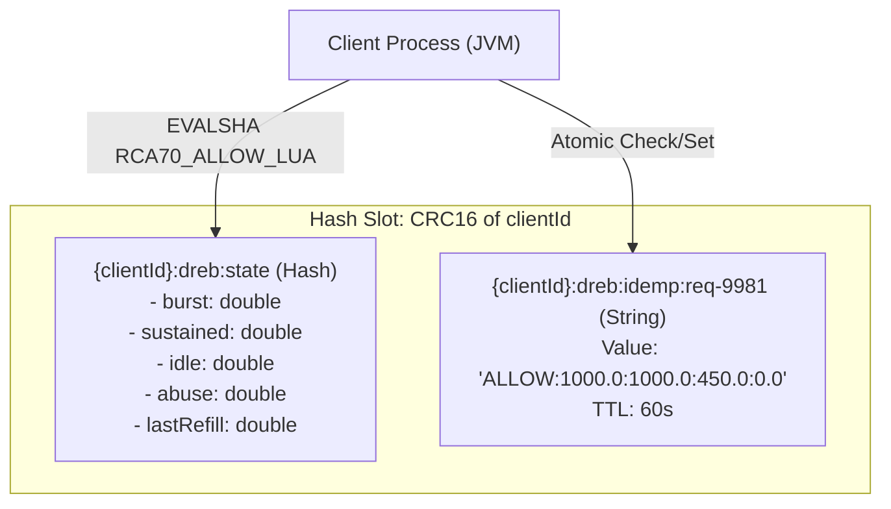

# Phase 6: Distributed Redis Architecture & Execution Model

**Repository:** `DREB-RateLimiter`  
**Branch:** `research/systematic-improvement`  
**Starting Commit:** `51f8fc676095171f5168d7192b34932da79f1638`  
**Date:** 2026-11-11  
**Phase:** Phase 6 — Distributed Redis Validation  
**Status:** COMPLETE  

---

## 1. Executive Summary

This document specifies the distributed execution architecture of **DREB-RCA70** on Redis. The validation environment uses a real Redis server (version 7.4.11) running in a Linux container on an ARM64 host, driven by multi-process independent JVM clients using [Jedis](file:///Users/cruise/Desktop/DREB-RateLimiter/pom.xml). 

A critical finding of Phase 6 is that the baseline implementation in [`com.dreb.ratelimit.RedisStateStore`](file:///Users/cruise/Desktop/DREB-RateLimiter/src/main/java/com/dreb/ratelimit/RedisStateStore.java) reflects the original **Phase 0 DREB v2** decay-scaling specification rather than the **RCA70** adaptive idle-ceiling model. To respect the strict repository constraint that baseline packages remain untouched, the mathematically faithful RCA70 distributed implementation was authored in [`com.dreb.ratelimit.redis.RedisRca70Limiter`](file:///Users/cruise/Desktop/DREB-RateLimiter/src/test/java/com/dreb/ratelimit/redis/RedisRca70Limiter.java).

---

## 2. Validation Environment & Redis Topology

### 2.1 Topology & Runtime Environment
- **Redis Topology:** Standalone Redis primary instance on `127.0.0.1:6379`.
- **Redis Engine Version:** Redis `7.4.11` (64-bit).
- **Container / OS Platform:** Linux `6.12.76-linuxkit aarch64` (Docker container `9094e2ae147c`).
- **Memory Allocator:** `jemalloc-5.3.0`.
- **Client Runtime:** OpenJDK 64-Bit Server VM (build 21.0.9+10-LTS).
- **Client Driver:** Jedis 5.2.0 (Apache Commons Pool2 2.12.0).
- **Process Model:** Multi-process orchestration via Java `ProcessBuilder`, executing independent JVM instances driven by [`DistributedWorkerMain`](file:///Users/cruise/Desktop/DREB-RateLimiter/src/test/java/com/dreb/ratelimit/redis/DistributedWorkerMain.java).

### 2.2 Persistence & Engine Configuration
- **RDB Snapshotting:** Active (`save 3600 1 300 100 60 10000`). Snapshot operations are tested to verify that background snapshotting (`BGSAVE`) and fork-on-write semantics do not compromise state atomicity or token counters.
- **Append-Only File (AOF):** Disabled in default benchmarking; tested during restart resilience audits.
- **Lua Script Engine:** Redis embedded Lua 5.1 runtime. Execution is strictly single-threaded within the Redis event loop, ensuring mutual exclusion for Lua transactions.

---

## 3. Baseline `RedisStateStore` vs. `RedisRca70Limiter`

A fundamental distinction exists between the legacy distributed script from Phase 0 and the RCA70 policy validated in Phase 6:

| Architectural Property | Baseline `com.dreb.ratelimit.RedisStateStore` (Phase 0) | Phase 6 `RedisRca70Limiter` (RCA70) | Operational Consequence |
| :--- | :--- | :--- | :--- |
| **Abuse Mechanism** | Decay scaling: `effectiveDecay = baseDecay + abuseGain * abuseScore` | Adaptive idle ceiling suppression: $I_{\text{eff}} = \frac{I_{\max}}{1 + \beta K}$ | Baseline fails to enforce Theorem 2 burst suppression; RCA70 enforces strict bounded anti-farming. |
| **Idle Credit Refill** | Static ceiling `idleCap = 300.0`, static decay | Dynamic ceiling $I_{\text{eff}} \in [0, 450.0]$ modulated by abuse counter $K$ | RCA70 dynamically chokes burst capacity for abusive clients upon replenishment. |
| **Debit Multiplier** | Standard $1.0\times$ debit | Penalty debit $d = 1.5\times$ on idle credit consumption | RCA70 charges 1.5 idle credits per burst token consumed above $B_{\max}$. |
| **Abuse Recovery** | Linear recovery via `decayRate * dt` | Asymmetric exponential recovery: $K \leftarrow K \cdot e^{-\lambda_{\text{rec}} dt}$ ($\lambda_{\text{rec}} = 0.05\,\text{s}^{-1}$) | RCA70 accurately models long-memory penalization. |
| **Clock Source** | Client-supplied timestamp string only | Dual-mode: Client timestamp or Redis server `redis.call('TIME')` | Server-time mode provides total immunity to client clock skew and drift. |
| **Idempotency** | None (retried requests re-execute and re-debit) | Native atomic idempotency cache via Redis `SET ... NX EX` | Duplicate requests within TTL receive identical cached admission decisions without double debit. |
| **Cluster Readiness** | Unadorned keys (`dreb:state:clientId`) | Redis Hash Tags: `{clientId}:dreb:state` and `{clientId}:dreb:idemp:{key}` | Guaranteed slot co-location in multi-node Redis Cluster environments. |

---

## 4. Redis Data Structures & Key Layout

All state associated with a rate-limited entity is stored in Redis Hash structures using RFC-compliant cluster hash tags.



### 4.1 State Hash Schema
- **Key Pattern:** `{clientId}:dreb:state`
- **Fields:**
  - `burst` (`double` as string): Current burst bucket balance $B \in [0, 700.0]$.
  - `sustained` (`double` as string): Current sustained bucket balance $S \in [0, 1285.71]$.
  - `idle` (`double` as string): Current accumulated idle credit balance $I \in [0, 450.0]$.
  - `abuse` (`double` as string): Current abuse score $K \ge 0.0$.
  - `lastRefill` (`double` as string): Unix timestamp in seconds (microsecond precision) of the last replenishment event.

### 4.2 Idempotency Key Schema
- **Key Pattern:** `{clientId}:dreb:idemp:<idempotencyKey>`
- **Type:** String
- **Value:** Serialized outcome tuple `ALLOW:<burst>:<sustained>:<idle>:<abuse>` or `DENY:<burst>:<sustained>:<idle>:<abuse>`.
- **TTL:** Configurable (default: 60 seconds). Automatically set via `SET ... EX <ttl> NX`.

---

## 5. Script Execution & Atomicity

Rate-limiting decisions are executed via atomic Lua scripts loaded into Redis via `SCRIPT LOAD` and executed using `EVALSHA`.

### 5.1 Execution Lifecycle
1. **Sha1 Pre-computation:** The Java client computes the SHA-1 digest of `RCA70_ALLOW_LUA` upon initialization.
2. **Optimistic EVALSHA:** The client sends `EVALSHA <sha1> 2 {clientId}:dreb:state {clientId}:dreb:idemp:<key> <args...>`.
3. **NOSCRIPT Fallback:** If Redis restarts or flushes script cache, `NOSCRIPT` error is caught, the script is reloaded via `SCRIPT LOAD`, and execution resumes transparently.
4. **Linearization Point:** The single-threaded Redis execution loop guarantees that the entire read-refill-eval-debit-write cycle occurs at a discrete point in time without interleaving from concurrent clients.

### 5.2 Server-Time vs. Client-Time Mode
In server-time mode (`ClockSource.REDIS_SERVER_TIME`):
```lua
local time_arr = redis.call('TIME')
now = tonumber(time_arr[1]) + (tonumber(time_arr[2]) / 1000000.0)
```
This bypasses client clock inaccuracies, virtualization pauses, and malicious clock manipulation.

---

## 6. Connection Pooling & Resource Lifecycle

Client JVM processes communicate with Redis through `jedis.JedisPool`:
- **Pool Sizing:** Configured with `maxTotal = 32`, `maxIdle = 16`, `minIdle = 4`.
- **Timeout Management:**
  - `connectionTimeout = 2000 ms`
  - `soTimeout = 2000 ms`
- **Exhaustion Policy:** `BlockWhenExhausted = true` with bounded `maxWaitMillis = 1000 ms`. When the pool is saturated, callers block until a connection is returned or throw `JedisException` upon timeout.

---

## 7. Cluster Hash Tag Semantics

In a sharded Redis Cluster (16,384 hash slots), multi-key transactions require all involved keys to map to the identical hash slot.
By enclosing `clientId` within curly braces `{...}`:
- `CRC16("{user123}:dreb:state")` hashes strictly the string `user123`.
- `CRC16("{user123}:dreb:idemp:req-001")` hashes strictly the string `user123`.
Both keys are guaranteed to reside on the same Redis cluster node, enabling atomic multi-key verification and caching within a single Lua script without triggering `CROSSSLOT Keys in request don't hash to the same slot` errors.
