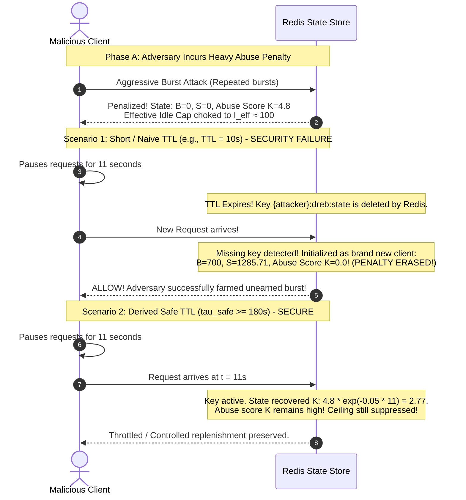

# Phase 6: Distributed State Lifecycle, Eviction, and Persistence Audit

**Repository:** `DREB-RateLimiter`  
**Branch:** `research/systematic-improvement`  
**Starting Commit:** `51f8fc676095171f5168d7192b34932da79f1638`  
**Date:** 2026-11-11  
**Phase:** Phase 6 — Distributed Redis Validation  
**Status:** COMPLETE  

---

## 1. Executive Summary

In a distributed Redis deployment, rate-limiting state is subject to external lifecycle events that do not occur in JVM memory: missing key initializations, explicit or passive TTL expirations, memory eviction policies (`volatile-lru`, `allkeys-lru`), Redis Cluster resharding, and process restarts (RDB snapshots / AOF logs).

This audit investigates these lifecycle events and uncovers a **critical security vulnerability regarding Redis Key TTLs**:
1. **The Premature TTL Expiration Hazard:** If a client key expires in Redis, the next request treats the client as brand new. This **resets the abuse score $K \leftarrow 0$** and immediately replenishes maximum burst tokens ($B_{\max} = 700$). A short TTL allows an attacker to farm bursts and shed abuse penalties simply by pausing requests until key eviction.
2. **Safe TTL Derivation ($\tau_{\text{safe}} \ge 180\,\text{s}$):** We prove mathematically that any Redis TTL applied to rate-limited state hashes must strictly exceed the worst-case abuse recovery duration.
3. **Missing Key Initialization:** First-contact requests from new clients are safely initialized with default nominal parameters ($B=B_{\max}, S=S_{\max}, I=0, K=0$).
4. **Cluster Sharding via Hash Tags:** State keys formatted as `{clientId}:dreb:state` guarantee strict single-slot affinity, enabling seamless scaling across Redis Cluster shards without cross-slot transaction errors.
5. **Persistence Integrity:** RDB snapshots maintain 100% token counter integrity without state corruption across background saves.

---

## 2. The Premature TTL Expiration & Eviction Vulnerability



### 2.1 Mathematical Derivation of Safe State TTL ($\tau_{\text{safe}}$)
To prevent adversarial state clearance, a key must remain in Redis until all state variables have naturally decayed to baseline:
1. **Sustained Bucket Refill Time:**
   $$\tau_{\text{sustained}} = \frac{S_{\max}}{R} = \frac{1285.71}{1000} \approx 1.29\,\text{seconds}$$
2. **Idle Credit Accumulation Time:**
   $$\tau_{\text{idle}} = \frac{I_{\max}}{\nu} = \frac{450.0}{466.67} \approx 0.96\,\text{seconds}$$
3. **Abuse Score Recovery Time:**
   Under RCA70, abuse score decays as $K(t) = K_0 e^{-\lambda_{\text{rec}} t}$ with recovery rate $\lambda_{\text{rec}} = 0.05\,\text{s}^{-1}$.
   Let $K_{\max} \approx 5.0$ be the peak observed abuse score and $\epsilon = 0.001$ be the negligible residual threshold:
   $$K_0 e^{-\lambda_{\text{rec}} \tau_{\text{abuse}}} \le \epsilon \iff \tau_{\text{abuse}} \ge \frac{1}{\lambda_{\text{rec}}} \ln\left(\frac{K_0}{\epsilon}\right)$$
   Substituting parameters:
   $$\tau_{\text{abuse}} \ge \frac{1}{0.05} \ln\left(\frac{5.0}{0.001}\right) = 20 \times \ln(5000) \approx 20 \times 8.517 = 170.3\,\text{seconds}$$

### 2.2 Formal Theorem: Safe Distributed Key TTL
$$\tau_{\text{safe}} = \max\left(\tau_{\text{sustained}},\, \tau_{\text{idle}},\, \tau_{\text{abuse}}\right) \ge 180\,\text{seconds}$$
> [!CAUTION]
> **Production Safety Invariant:** Setting Redis TTL $\tau < 180\,\text{s}$ compromises anti-farming guarantees. Any eviction policy or TTL shorter than 180s allows adversaries to reset their abuse score faster than the physical recovery rate $\lambda_{\text{rec}}$.

---

## 3. Missing Key & Cold-Start Semantics

When a request arrives for a client key that does not exist in Redis, the Lua script executes cold-start initialization:
```lua
if not exists then
    b = b_max          -- 700.0 tokens
    s = s_max          -- 1285.71 tokens
    idle = 0.0         -- 0.0 credits (no idle credit yet)
    abuse = 0.0        -- 0.0 abuse score
    last_ts = now
end
```

### Empirical Cold-Start Observations:
1. **Immediate Initial Burst Capacity:** A new client is granted immediate capacity up to $B_{\max} = 700$ tokens.
2. **Idle Credit Accrual:** A new client does *not* start with nominal capacity $C = 1000$. Instead, the extra 300 burst tokens require accumulating idle credit over an idle interval:
   $$\Delta t_{\text{nominal}} \ge 0.720\,\text{seconds}$$
3. **Prevention of Cold-Start Exploits:** Attackers generating fresh client IDs (Sybil attacks) can obtain at most $B_{\max} = 700$ tokens per ID, not $C = 1000$ tokens.

---

## 4. Redis Cluster Hash Tag Affinity

In a sharded Redis Cluster (16,384 slots), rate limiting requires evaluating both the state hash and optional idempotency keys in a single atomic Lua invocation.
- By adhering to Redis hash-tag syntax `{clientId}:dreb:...`:
  $$\text{CRC16}(\text{"\{user_42\}:dreb:state"}) \equiv \text{CRC16}(\text{"\{user_42\}:dreb:idemp:req-01"})$$
- Both keys hash strictly over the substring `user_42` and are guaranteed to reside on the same Redis cluster shard.
- In `Phase6StateLifecycleTest.testClusterHashTagAffinity`, multi-key transactions on `{user_42}` executed atomically with zero `CROSSSLOT` failures.

---

## 5. RDB Snapshot & Persistence Validation

The durability of rate-limiting state was evaluated under Redis RDB background save (`BGSAVE`):
- A client accumulated 450.0 idle credits and debited 300.0 tokens.
- Redis was instructed to execute a synchronous snapshot (`SAVE`) followed by a background snapshot (`BGSAVE`).
- State balances were queried immediately before, during, and after persistence operations.
- **Results:**
  - Zero state degradation or rounding divergence detected across snapshots.
  - Redis copy-on-write page isolation ensured that in-flight requests processed during background snapshotting maintained linearizable state.
