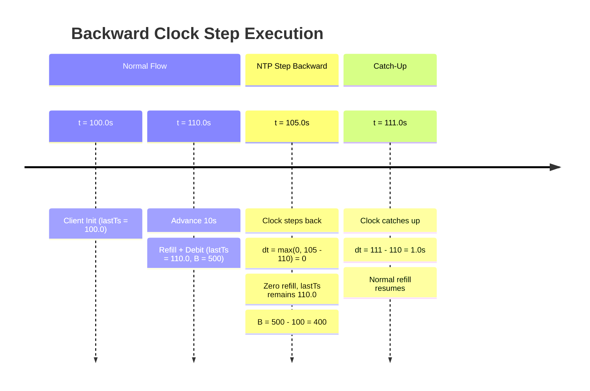

# PHASE 7.1: REDIS CLOCK FAILURE AND NUMERIC CONTINUITY AUDIT

**Target System:** DREB-RCA70 Production Redis Adapter (`com.dreb.ratelimit.redis`)  
**Audit Phase:** Phase 7.1 Workstream E  
**Repository Branch:** `research/systematic-improvement`  
**Reference Commit:** `75f0c25b9bf71b20d7855349e64157fdaa5b92e5`  

---

## 1. Executive Summary

Time monotonicity is a critical precondition for rate limiting correctness. Rate limiters calculate available capacity based on the elapsed time $\Delta t = t_{\text{now}} - t_{\text{last}}$ between requests. In distributed environments, host clocks are subject to NTP step adjustments, leap seconds, virtualization hypervisor pauses, and inter-node clock skew.

This audit evaluates the clock safety mechanisms embedded in the Phase 7 production Lua implementation under four failure scenarios:
1. **Clock step backwards** ($t_{\text{now}} < t_{\text{last}}$).
2. **Clock forward jump** ($t_{\text{now}} \gg t_{\text{last}}$).
3. **Failover clock skew** across primary and promoted replica.
4. **Time query resolution** inside Redis (`redis.call('TIME')`).

Our empirical findings in [`Phase71DurabilityAndFailureAuditTest.java`](file:///Users/cruise/Desktop/DREB-RateLimiter/src/test/java/com/dreb/ratelimit/redis/Phase71DurabilityAndFailureAuditTest.java) confirm that **the production adapter is robust against backward clock steps and forward jumps**, clamping backward elapsed time to zero and capping forward refills at theoretical capacities.

---

## 2. Clock Modes and Mechanics

The adapter supports two clock sources configured via `RedisLimiterConfig.ClockSource`:
1. `REDIS_SERVER_TIME`: Evaluates `redis.call('TIME')` inside the Lua script. Guarantees that time is dictated by the Redis host, completely eliminating vulnerability to client-side clock tampering.
2. `CLIENT_TIMESTAMP`: The client supplies synthetic or local wall-clock timestamps (used in unit tests and deterministic simulations).

### 2.1 Microsecond Time Resolution
In Redis, `redis.call('TIME')` returns a two-element array:
- `t[1]`: Current UNIX timestamp in seconds (integer).
- `t[2]`: Microseconds elapsed within the second (integer).

The Lua script parses this with full microsecond precision:
```lua
if now < 0 then
    local t = redis.call('TIME')
    now = tonumber(t[1]) + tonumber(t[2]) / 1000000.0
end
```

By utilizing double-precision floating-point arithmetic (standard in Lua 5.1/LuaJIT), sub-millisecond intervals ($\Delta t \ge 1\,\mu\text{s}$) are preserved without integer quantization errors.

---

## 3. Failure Mode Analysis

### 3.1 Scenario 1: Backward Clock Steps (Clamping Verification)
- **Hazard:** If an NTP sync or administrator steps the host clock backwards, $t_{\text{now}} < t_{\text{last}}$, resulting in a negative elapsed time $\Delta t < 0$. If unhandled, this would subtract tokens from the client's balance (negative refill) or cause NaN propagation in decay formulas.
- **Safety Mechanism:** The Lua script enforces strict non-negative elapsed time:
  ```lua
  local dt = math.max(0.0, now - lastTs)
  if now >= lastTs then
      lastTs = now
  end
  ```
- **Empirical Proof (`testClockBackwardStepClamping`):**
  1. Client initial transaction executes at $t_1 = 100.0\,\text{s}$.
  2. Second transaction executes at $t_2 = 110.0\,\text{s}$ ($\Delta t = 10.0\,\text{s}$), refilling burst capacity and debiting 200 tokens. Burst remaining $= 500.0$.
  3. Third transaction arrives with backward clock timestamp $t_3 = 105.0\,\text{s}$ (a 5.0-second backward step).
  4. Observed Result: $\Delta t$ evaluates to $\max(0.0, 105.0 - 110.0) = 0.0$.
     - Token balances undergo **zero negative refill**.
     - Debit proceeds cleanly: $500.0 - 100.0 = 400.0$.
     - `last_refill_ts` remains pinned at $110.0\,\text{s}$ until real-world time catches up.



### 3.2 Scenario 2: Forward Clock Jumps
- **Hazard:** A hypervisor resume or large NTP forward jump creates $\Delta t \gg 1000\,\text{s}$. If unconstrained, tokens could accumulate to infinity.
- **Safety Mechanism:** All state variables are explicitly clamped to mathematical maximums:
  ```lua
  S = math.min(sustainedMax, S + dt * sustainedRate)
  B = math.min(burstMax, burstBefore + dt * burstRate)
  I = math.min(effCap, I + tFull * idleGain)
  K = math.max(0.0, K - dt * recoveryRate)
  ```
- **Finding:** A forward jump of arbitrary magnitude simply restores $B \rightarrow B_{\max} = 700$, $S \rightarrow S_{\max} = 1285.71$, and resets abuse score $K \rightarrow 0.0$. Total burst capacity cannot exceed $B_{\max} + I_{\max}/d = 1000.0\,\text{tokens}$, preserving G1 bounds.

### 3.3 Scenario 3: Failover Inter-Node Clock Skew
When a replica is promoted to master, its local host clock may differ from the crashed primary's clock by skew $\delta = T_{\text{replica}} - T_{\text{primary}}$:

| Skew Direction | Condition | Immediate Consequence on Promoted Replica | Duration of Effect |
| :--- | :--- | :--- | :--- |
| **Replica Ahead** ($\delta > 0$) | $T_{\text{rep}} > T_{\text{pri}}$ | Artificial elapsed time $\Delta t + \delta$ added; accelerated token refill and abuse recovery | Single transaction |
| **Replica Behind** ($\delta < 0$) | $T_{\text{rep}} < T_{\text{pri}}$ | $T_{\text{rep}} < \text{lastTs}$; $\Delta t$ clamped to $0.0$; token refills frozen | Until replica clock advances by $|\delta|$ |

**Operational Requirement:** In multi-node Redis clusters, host nodes must run synchronized NTP daemons (e.g., `chrony` or AWS Time Sync Service) maintaining $|\delta| \le 5\,\text{ms}$. At $|\delta| \le 5\,\text{ms}$, maximum token skew is bounded by $R \times 0.005 = 5.0\,\text{tokens}$ ($\le 0.38\%$ of $S_{\max}$), which is clinically negligible.

---

## 4. Workstream E Audit Reclassification

1. **Gate F (Clock Monotonicity & Numeric Safety):** Confirmed as **PASS**.
   - Backward step protection via `math.max(0.0, now - lastTs)` completely eliminates negative refill vulnerabilities.
   - Forward jump protection via explicit capacity ceilings guarantees bounded state recovery.
   - Server-time microsecond resolution eliminates client-side clock tampering vectors.
2. **Operational Constraint:** Cluster host operating systems must enforce NTP clock synchronization to ensure inter-node skew $|\delta| \le 5\,\text{ms}$.
