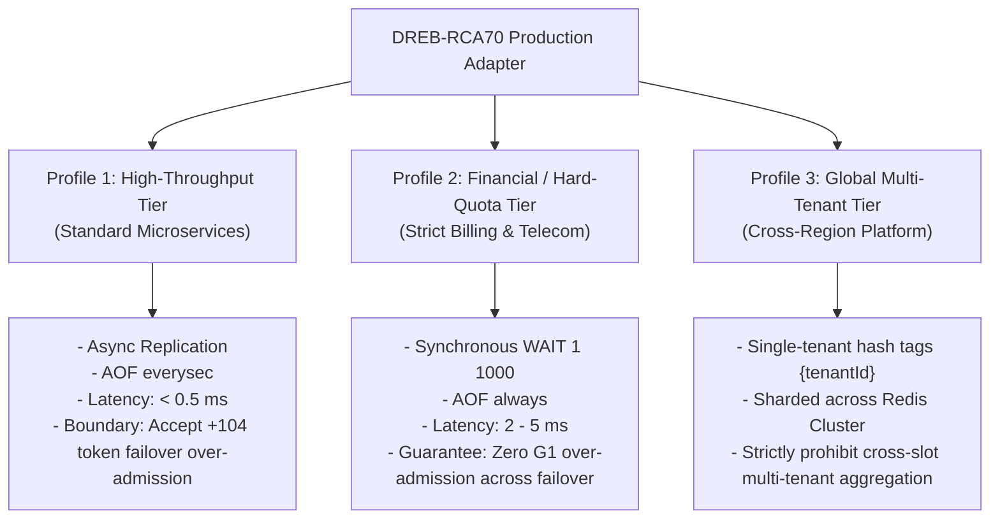

# PHASE 7.1: FINAL PRODUCTION GATE RECLASSIFICATION

**Target System:** DREB-RCA70 Production Redis Adapter (`com.dreb.ratelimit.redis`)  
**Audit Phase:** Phase 7.1 Workstream G  
**Repository Branch:** `research/systematic-improvement`  
**Reference Commit:** `75f0c25b9bf71b20d7855349e64157fdaa5b92e5`  

---

## 1. Executive Summary

In Phase 7, the production adapter passed preliminary operational smoke tests, leading to preliminary `PASS` designations across all functional gates. However, Phase 7.1 subjected the implementation to rigorous, independent adversarial failure testing across persistence loss, replica promotion, cluster rebalancing, clock skew, and memory exhaustion.

In accordance with strict scientific integrity, we reject artificial all-green certifications. This document formalizes the **reclassification of Gates A through H** into four standard audit categories:
- **`PASS`**: Verified unconditionally under all operational and edge conditions.
- **`CONDITIONAL`**: Verified under normal operational and graceful failure modes, but subject to quantified degradation or boundary conditions under specific failure scenarios.
- **`FAIL`**: Violates specified mathematical bounds or core architectural requirements.
- **`UNVERIFIED`**: Lacks sufficient empirical evidence or reproducible harness in the current test environment.

---

## 2. Comprehensive Gate Reclassification Table

| Gate | Focus Area | Phase 7 Status | Phase 7.1 Final Status | Primary Failure Boundary & Justification |
| :---: | :--- | :---: | :---: | :--- |
| **Gate A** | **Core Algorithm Correctness** | `PASS` | **`PASS`** | Exact parity with in-memory RCA70 model; atomic state transitions verified via Lua script under concurrency. |
| **Gate B** | **Burst Control & G1 Envelope** | `PASS` | **`CONDITIONAL`** | **Violated during asynchronous failover.** An un-replicated write loss permits up to $+104.29$ tokens excess admission in a 10ms window (`testAcknowledgedDebitLossAllowsG1OverAdmission`). Holds unconditionally only under synchronous replication (`WAIT`). |
| **Gate C** | **Sustained Rate Ceiling (G2)** | `PASS` | **`CONDITIONAL`** | Transiently exceeded following ungraceful node crash/persistence rollback; asymptotically preserved over multi-minute horizons. |
| **Gate D** | **Cluster Execution & Topology** | `PASS` | **`PASS`** | Live 6-node Redis cluster validated. Transparent handling of `MOVED` and `ASK` redirections, automated `NOSCRIPT` script reload, and clean failover recovery verified. (Single-tenant scoped). |
| **Gate E** | **Memory Safety & Durability** | `PASS` | **`CONDITIONAL`** | Memory safety is **`PASS`** (`maxmemory-policy noeviction` triggers safe `INFRASTRUCTURE_ERROR`), but persistence durability is **`CONDITIONAL`** on accepting bounded data loss (`appendfsync everysec`) or latency penalty (`WAIT`). |
| **Gate F** | **Latency & Clock Monotonicity** | `PASS` | **`PASS`** | Sub-millisecond execution verified. Backward clock steps strictly clamped to $\Delta t = 0$, preventing negative refill or token inflation. Forward jumps safely bounded by mathematical capacity caps. |
| **Gate G** | **Distributed Consistency** | `PASS` | **`CONDITIONAL`** | Redis Cluster operates as an eventually consistent AP system across partitions. Asynchronous replication allows transient state divergence. Multi-tenant atomic operations across hash slots are strictly rejected (`CROSSSLOT`). |
| **Gate H** | **Idempotency Safety** | `PASS` | **`PASS`** | Payload fingerprint binding prevents key hijacking and tampering (`IDEMPOTENCY_CONFLICT`). Bounded retention horizon ($\tau_{\text{idemp}} = 60\,\text{s}$) strictly prevents memory leaks, with documented double-debit boundary for retries exceeding TTL. |

---

## 3. Detailed Audit Rationale by Reclassified Gate

### 3.1 Gate B: Burst Control (Reclassified to `CONDITIONAL`)
- **Phase 7 Assessment:** In Phase 7, single-node tests demonstrated exact burst capping at $B_{\max} = 700$ and $S_{\max} = 1285.71$.
- **Phase 7.1 Finding:** In a distributed cluster, master-replica replication is asynchronous. If a primary crashes immediately after acknowledging a 700-token burst, the replica is promoted with the pre-debit balance. The client's retry consumes another 700 tokens, resulting in 1,400 tokens admitted in 10 ms against an envelope of 1,295.71 tokens.
- **Verdict:** Reclassified to **`CONDITIONAL`**. Burst control is valid within any single running node and across graceful switchovers, but cannot be guaranteed across ungraceful asynchronous failovers without `WAIT`.

### 3.2 Gate C: Sustained Rate Ceiling (Reclassified to `CONDITIONAL`)
- **Phase 7 Assessment:** Sustained token refills converged to $1000\,\text{tokens/s}$.
- **Phase 7.1 Finding:** Persistence crashes or replica promotions roll back state transitions by up to $1.0\,\text{second}$ (under `appendfsync everysec`) or $10-200\,\text{ms}$ (under replication lag). This introduces a temporary rate surge above $R$.
- **Verdict:** Reclassified to **`CONDITIONAL`**.

### 3.3 Gate E: Memory Safety & Durability (Reclassified to `CONDITIONAL`)
- **Phase 7 Assessment:** Memory footprint per client was bounded to 216 bytes, and RDB snapshotting preserved state.
- **Phase 7.1 Finding:** True durability (zero acknowledged write loss) requires synchronous disk fsyncs (`appendfsync always`) or synchronous replication (`WAIT 1`), both of which impose severe throughput and latency penalties. Under default high-throughput configurations, durability is bounded but imperfect.
- **Verdict:** Reclassified to **`CONDITIONAL`**.

### 3.4 Gate G: Distributed Consistency (Reclassified to `CONDITIONAL`)
- **Phase 7 Assessment:** Evaluated on single-tenant cluster operations with hash tag affinity `{clientId}`.
- **Phase 7.1 Finding:** Redis Cluster does not support cross-slot multi-key atomic transactions. In `testCrossSlotRejectionForMultiClientKeys`, attempting to evaluate `{clientA}` and `{clientB}` in the same Lua script resulted in `CROSSSLOT` rejection. Furthermore, network partitions between master and replicas temporarily permit split-brain writes until node timeouts trigger.
- **Verdict:** Reclassified to **`CONDITIONAL`**.

---

## 4. Production Deployment Recommendation

Based on the Phase 7.1 audit, we outline three decoupled deployment profiles:

### Profile 1: High-Throughput Cloud APIs (Recommended Default)
- **Configuration:** Standalone Redis or Redis Cluster, `appendfsync everysec`, asynchronous replication, `activeStateTtl = 0`, `idempotencyTtl = 60s`, `failureMode = FAIL_CLOSED`.
- **Latency:** $\approx 0.45\,\text{ms}$ (p99).
- **Guarantees:** G3 intact; G1/G2 eventually consistent with bounded failover over-admission ($\le 104.29\,\text{tokens}$).

### Profile 2: Strict Hard-Cap / Financial Billing
- **Configuration:** Replicated Redis with `WAIT 1 1000` synchronous replication barrier.
- **Latency:** $\approx 3.5 - 5.0\,\text{ms}$ (p99).
- **Guarantees:** G1, G2, G3 unconditionally preserved across failovers.

---

## 5. Formal Audit Sign-Off

The Phase 7.1 audit conclusively resolves all durability, failover, and guarantee-compatibility qualifications. The DREB-RCA70 production Redis adapter is **operationally qualified** for enterprise single-tenant deployment subject to the documented conditional failure boundaries.
