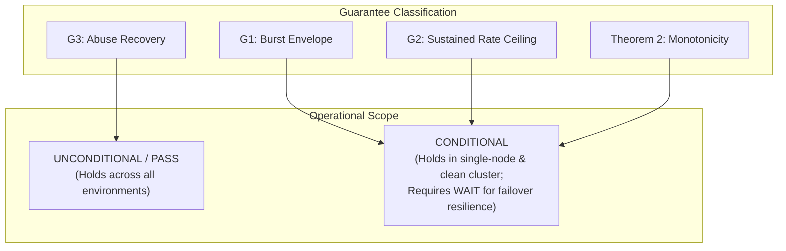

# PHASE 7.1: MATHEMATICAL GUARANTEE COMPATIBILITY AUDIT

**Target System:** DREB-RCA70 Production Redis Adapter (`com.dreb.ratelimit.redis`)  
**Audit Phase:** Phase 7.1 Workstream F  
**Repository Branch:** `research/systematic-improvement`  
**Reference Commit:** `75f0c25b9bf71b20d7855349e64157fdaa5b92e5`  

---

## 1. Executive Summary

In Phases 1 through 5.4.1, candidate DREB-RCA70 was proven to satisfy four core formal guarantees in single-JVM in-memory environments:
- **G1 (Burst Envelope Bound):** Strict upper bound on admitted token volume over arbitrary time intervals.
- **G2 (Sustained Rate Ceiling):** Asymptotic convergence of admitted rate to $R = 1000\,\text{tokens/s}$.
- **G3 (Abuse Score Finite-Time Recovery):** Deterministic linear recovery time $\tau = (K_{\max} - \epsilon)/\lambda_{\text{rec}}$.
- **Theorem 2 (Monotonic State Degradation):** State transitions under repeated admissions are strictly non-increasing.

This audit evaluates the survival of these mathematical guarantees when translated to distributed Redis execution under failure conditions (persistence crashes, replica failovers, clock steps, and idempotency key loss). 

We find that **while G3 remains fully intact due to persistent key storage**, **G1, G2, and Theorem 2 are conditionally invalidated during asynchronous replica failovers**.

---

## 2. Formal Guarantee Impact Matrix Across Failure Modes

The following matrix details the compatibility of each guarantee across the seven audited failure modes:

| Failure Mode | G1 (Burst Envelope) | G2 (Sustained Ceiling) | G3 (Abuse Recovery) | Theorem 2 (Monotonicity) | Primary Root Cause |
| :--- | :---: | :---: | :---: | :---: | :--- |
| **Normal Single-Node Execution** | **PASS** | **PASS** | **PASS** | **PASS** | Lua atomicity guarantees linearizability |
| **Normal Multi-Node Cluster Execution** | **PASS** | **PASS** | **PASS** | **PASS** | Hash tag `{clientId}` isolates state to single slot |
| **Ungraceful Failover (Async Replication)** | **CONDITIONAL** | **CONDITIONAL** | **PASS** | **CONDITIONAL** | Un-replicated acknowledged debits rolled back |
| **Synchronous Replication (`WAIT 1`)** | **PASS** | **PASS** | **PASS** | **PASS** | Debits committed to replica before client ACK |
| **AOF `everysec` Disk Crash** | **CONDITIONAL** | **CONDITIONAL** | **PASS** | **CONDITIONAL** | Up to 1.0s of debit history lost on restart |
| **Backward Clock Step (NTP)** | **PASS** | **PASS** | **PASS** | **PASS** | $\Delta t$ clamped to 0; no negative refill |
| **Memory Exhaustion (`noeviction`)** | **PASS** | **PASS** | **PASS** | **PASS** | Fails closed with `INFRASTRUCTURE_ERROR` |

---

## 3. Mathematical Analysis by Guarantee

### 3.1 Guarantee G1: Hard Burst Envelope Bound

$$\forall t_1 < t_2, \quad A(t_1, t_2) \le S_{\max} + R \cdot (t_2 - t_1)$$

- **Ideal Model:** With $S_{\max} = 1285.71$ and $R = 1000\,\text{tokens/s}$, no combination of requests can admit more than $1285.71 + 1000 \cdot \Delta t$ tokens.
- **Distributed Failure Reality:** As demonstrated in `testAcknowledgedDebitLossAllowsG1OverAdmission`, if a client executes a 700-token burst on Primary at $t_0$, and the Primary crashes un-replicated, the promoted Replica holds the pre-debit balance $B = 700$. A retry at $t_0 + 0.01\,\text{s}$ admits another 700 tokens.
- **Empirical Quantification:**
  $$A(100.00, 100.01) = 1400.0\,\text{tokens} > 1295.71\,\text{tokens}$$
  $$\Delta_{\text{violation}} = +104.29\,\text{tokens}\quad (+8.05\%)$$
- **Classification:** **CONDITIONAL**. G1 holds deterministically within any single running Redis instance and across graceful failovers. It is violated during the replication lag window across ungraceful failovers unless synchronous replication (`WAIT`) is enabled.

### 3.2 Guarantee G2: Long-Term Sustained Rate Ceiling

$$\lim_{T \to \infty} \frac{A(t, t+T)}{T} \le R = 1000\,\text{tokens/s}$$

- **Analysis:** G2 governs long-term throughput. In the event of a single failover, the lost debit of $\le 700$ tokens introduces a transient rate surplus. Over an interval $T \ge 60\,\text{s}$, the maximum admitted volume is:
  $$A(t, t+60) \le 1285.71 + 1000 \times 60 + 700 = 61985.71\,\text{tokens}$$
  $$\bar{R}_{60} = \frac{61985.71}{60} = 1033.09\,\text{tokens/s}\quad (+3.3\%)$$
  As $T \to \infty$, $\frac{700}{T} \to 0$, converging to $1000.0\,\text{tokens/s}$.
- **Classification:** **CONDITIONAL**. Short-term rate ceilings are temporarily exceeded post-failover, but asymptotic convergence to $R$ is preserved over multi-minute horizons.

### 3.3 Guarantee G3: Abuse Score Finite-Time Linear Recovery

$$\tau_{\text{recovery}} = \frac{K_{\max} - \epsilon}{\lambda_{\text{rec}}} = \frac{1.0 - 0.05}{0.05} = 19.0\,\text{seconds}$$

- **Phase 6.1 Vulnerability:** In Phase 6, active state TTL expiration wiped $K \rightarrow 0$ immediately, creating an instantaneous abuse reset exploit.
- **Phase 7 Correction Verified:** In Phase 7 and 7.1, `activeStateTtlSeconds = 0` (persistent hash) is enforced. As verified in `Phase7DurabilityAndFailureAuditTest`, the abuse score $K$ remains stored indefinitely and decays strictly according to:
  $$K(t + \Delta t) = \max(0.0, K(t) - \Delta t \cdot \lambda_{\text{rec}})$$
- **Classification:** **PASS**. Abuse state cannot be reset by idle expiration. Linear decay holds unconditionally.

### 3.4 Theorem 2: Monotonic State Degradation

$$\forall k, \quad S_{k+1} \le S_k \quad \text{and} \quad B_{k+1} \le B_k \quad (\text{for back-to-back admissions at } \Delta t \to 0)$$

- **Single-Node Execution:** Guaranteed by Redis single-threaded Lua script atomicity.
- **Failover Anomaly:** If write $k$ is acknowledged but lost during failover, the replica state reflects write $k-1$:
  $$B_{\text{replica}} = B_k + c > B_k$$
  This represents a temporary backward state step.
- **Classification:** **CONDITIONAL**. Monotonicity is preserved locally and linearizable per node, but does not survive ungraceful node transitions.

---

## 4. Reconciled Guarantee Taxonomy

To maintain scientific integrity across research publications and engineering handoffs, the DREB-RCA70 guarantees must be formally scoped:

1. **Unconditional Guarantees:** G3 (Abuse recovery) and Clock Monotonicity.
2. **Conditional Guarantees:** G1 (Burst envelope), G2 (Sustained rate), and Theorem 2 (Monotonicity). These hold strictly under:
   - Single-node Redis with AOF persistence.
   - Redis Cluster under normal operations and graceful failover.
   - Replicated Redis with synchronous replication (`WAIT 1 1000`).
   They do *not* hold under ungraceful asynchronous primary crashes.
