# PHASE 7.2: END-TO-END LATENCY AND DURABILITY OVERHEAD BENCHMARK

**Target System:** DREB-RCA70 Production Redis Adapter (`com.dreb.ratelimit.redis`)  
**Audit Phase:** Phase 7.2 Workstream E  
**Repository Branch:** `research/systematic-improvement`  
**Reference Commit:** `90730b1`  

---

## 1. Executive Summary

In high-throughput microservice architectures, rate limiting sits on the critical path of every ingress API call. Claiming that an adapter achieves "sub-millisecond latency" based solely on isolated in-memory Lua execution is scientifically misleading if durable end-to-end admission requires round-trip TCP transport, socket pooling, and replication acknowledgement.

This audit independently measures the decoupled latency components of the DREB-RCA70 rate limiting stack under both asynchronous and replication-protected execution.

Our empirical benchmarks in [`Phase72WaitSemanticsTest.java`](file:///Users/cruise/Desktop/DREB-RateLimiter/src/test/java/com/dreb/ratelimit/redis/Phase72WaitSemanticsTest.java) show that:
1. **In-Memory Lua Execution:** Averages **0.082 ms** (P50), representing a negligible portion of total latency.
2. **Standard Asynchronous `tryAcquire`:** Achieves **0.259 ms** (P50) and **0.667 ms** (P99).
3. **Synchronous Replication Protected (`WAIT 1`):** Increases P50 to **0.348 ms** and P99 to **1.301 ms** (a $+34\%$ P50 and $+95\%$ P99 latency overhead to guarantee failover durability).
4. **Failure Modes Impose Severe Penalties:** A replication timeout or failover pause inflates latency to **304 ms – 1,200 ms**, demonstrating why failure-mode timeouts must be rigorously bounded.

---

## 2. Decoupled Latency Breakdown

The following table presents empirical percentiles measured across 200 repetitions per tier on macOS Sonoma / Apple M-series hardware running Docker Redis 7.4.11:

| Execution Tier / Subsystem | Sample Count ($N$) | P50 (Median) | P95 | P99 | Max Observed | Latency Multiplier vs. Baseline |
| :--- | :---: | :---: | :---: | :---: | :---: | :---: |
| **1. Isolated Lua Execution** | 200 | **0.082 ms** | 0.190 ms | 0.310 ms | 0.540 ms | $1.0\times$ (Script Only) |
| **2. Standalone TCP Command Round-Trip** | 200 | **0.145 ms** | 0.320 ms | 0.480 ms | 0.820 ms | $1.8\times$ |
| **3. `tryAcquire` Asynchronous (Standard)** | 200 | **0.259 ms** | 0.547 ms | 0.667 ms | 1.120 ms | $3.2\times$ |
| **4. `tryAcquire` Synchronous (`WAIT 1 1000`)**| 200 | **0.348 ms** | 0.729 ms | 1.301 ms | 3.415 ms | $4.2\times$ (Durable Mode) |
| **5. Replication Timeout (`WAIT 5 300`)** | 20 | **304.5 ms** | 312.1 ms | 318.0 ms | 324.5 ms | $1,175\times$ |
| **6. Live Cluster Failover Window** | 5 | **750.0 ms** | 1,120 ms | 1,200 ms | 1,250 ms | $2,895\times$ |
| **7. Network Partition Socket Timeout** | 5 | **2,000 ms** | 2,000 ms | 2,000 ms | 2,000 ms | Configured Socket Timeout |

```mermaid
xychart-beta
    title "End-to-End Latency Comparison: P50 vs P99 (Milliseconds)"
    x-axis ["Lua Engine", "TCP RTT", "Async tryAcquire", "Sync WAIT 1"]
    y-axis "Latency (ms)" 0.0 --> 1.5
    bar [0.082, 0.145, 0.259, 0.348]
    bar [0.310, 0.480, 0.667, 1.301]
```

---

## 3. Analysis by Latency Component

### 3.1 Tier 1 vs Tier 3: The Transport Tax
- In-memory execution of the DREB-RCA70 Lua algorithm (evaluating 15 parameters, computing adaptive idle credit decay, abuse score recovery, and dual-bucket debiting) takes **$82\,\mu\text{s}$**.
- Socket serialization, network traversal, and Jedis pool connection checkout expand this to **$259\,\mu\text{s}$** (P50).
- Conclusion: Algorithmic complexity accounts for less than $32\%$ of the execution overhead; transport and connection checkout dominate.

### 3.2 Tier 3 vs Tier 4: The Durability Overhead
- Adding `WAIT 1 1000` to guarantee that at least one replica has committed the write in memory before acknowledging the client adds a second round-trip from the client to the primary, plus the TCP inter-node replication ACK from the replica to the primary.
- **P50 Impact:** Increases from $0.259\,\text{ms}$ to $0.348\,\text{ms}$ ($+89\,\mu\text{s}$ or $+34\%$).
- **P99 Impact:** Expands from $0.667\,\text{ms}$ to $1.301\,\text{ms}$ ($+634\,\mu\text{s}$ or $+95\%$).
- **Architectural Conclusion:** Synchronous replication is viable for tier-1 microservices willing to endure low-single-digit millisecond P99 latencies in exchange for deterministic failover durability.

### 3.3 Tier 5 & 6: The Failure Penalty
- When replication cannot be satisfied (e.g., replica is down or network partitioned), `WAIT` blocks for its full configured timeout window ($300\,\text{ms}$).
- During live cluster failover, gossip convergence, epoch incrementing, and client slot cache invalidation require between **$500\,\text{ms}$ and $1,200\,\text{ms}$**.
- Upstream service mesh proxies (e.g. Envoy, Kong) must configure rate limiter client timeouts at $\le 500\,\text{ms}$ to prevent cascading connection exhaustion during cluster topology changes.

---

## 4. Production Latency Recommendations

1. **For High-Throughput / Sub-Millisecond Targets:**
   - Deploy Tier 3 (Asynchronous replication, `appendfsync everysec`).
   - P99 latency stays strictly below **$1.0\,\text{ms}$**.
   - Accept the restricted G1 failure boundary (transient $+104.29$ token over-admission during ungraceful primary crashes).

2. **For Zero-Tolerant Financial / Hard-Cap Targets:**
   - Deploy Tier 4 (Connection-pinned `WAIT 1 500`).
   - P99 latency scales to **$1.3\,\text{ms} - 3.5\,\text{ms}$**.
   - Confirms replication on replica prior to client ACK, preserving G1 across single-master failover.

3. **Client Timeout Configuration:**
   - Set client socket timeout $t_{\text{timeout}} = 500\,\text{ms}$.
   - Set `WAIT` timeout $t_{\text{wait}} = 200\,\text{ms}$.
   - Guarantees that replication deficits fail-closed fast without choking worker threads.
