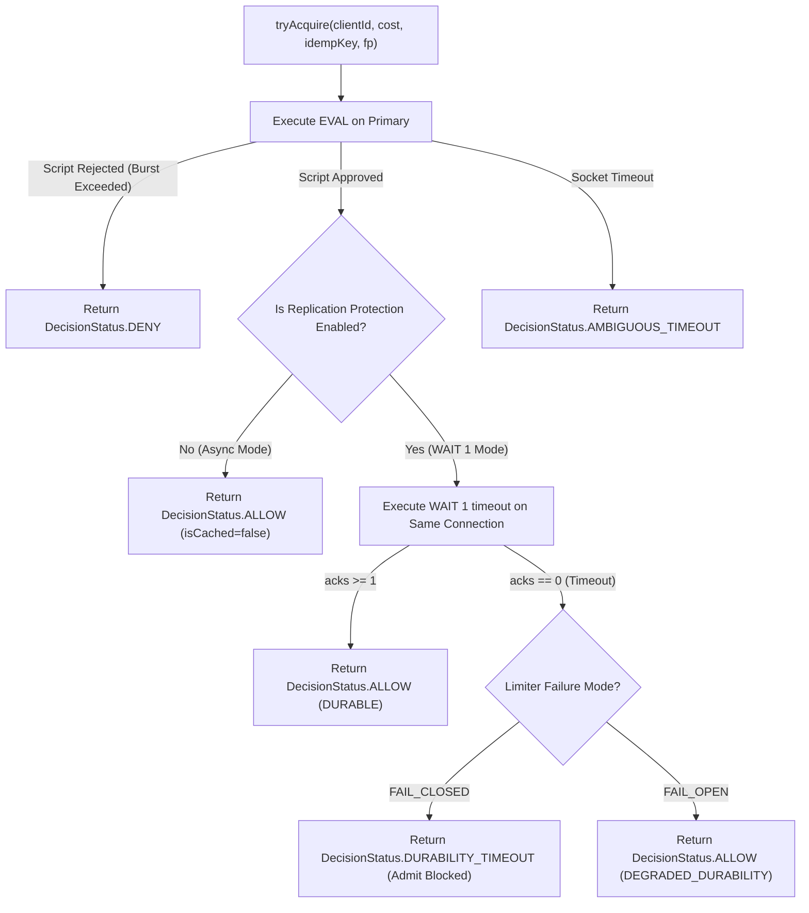

# PHASE 7.2: FAILURE RESPONSE CONTRACT AND IDEMPOTENT RECOVERY AUDIT

**Target System:** DREB-RCA70 Production Redis Adapter (`com.dreb.ratelimit.redis`)  
**Audit Phase:** Phase 7.2 Workstream B  
**Repository Branch:** `research/systematic-improvement`  
**Reference Commit:** `90730b1`  

---

## 1. Executive Summary

In distributed systems, a network or infrastructure failure can occur at multiple stages of request execution: before execution on the primary, after execution but before replication acknowledgement, or after execution but before the response reaches the client.

A fundamental design flaw in naive rate limiting clients is **conflating execution outcome with durability status**—for example, silently returning `ALLOW` to an upstream caller when a write succeeded on the primary but replication timed out, or blindly retrying an unconfirmed request and triggering a double-debit.

This document formalizes the **Phase 7.2 Failure Response Contract**, defining deterministic API outcomes and idempotent retry behaviors across all failure states.

---

## 2. Definitive Failure Outcome Matrix

The following contract governs the interaction between Lua evaluation, replication acknowledgement, network transport, and the public `LimiterDecision` API:

| Execution State | Durability State | Primary Write Committed? | Replication Acknowledged? | Public API Decision Status | Downstream Traffic Action | Retryable with Idempotency? |
| :--- | :--- | :---: | :---: | :--- | :--- | :---: |
| **EVAL Succeeded** | **WAIT Succeeded** ($\ge 1$) | **Yes** | **Yes** | `DecisionStatus.ALLOW` (DURABLE) | **Admit Traffic** | Yes (Returns cached ALLOW) |
| **EVAL Succeeded** | **WAIT Timed Out** ($= 0$) | **Yes** | **No** | `DecisionStatus.DURABILITY_TIMEOUT` | **Fail-Closed Reject** or Degradation | Yes (Returns cached ALLOW) |
| **EVAL Succeeded** | **WAIT Insufficient** ($1 < N$) | **Yes** | **Partial** | `DecisionStatus.DURABILITY_INSUFFICIENT` | **Fail-Closed Reject** | Yes (Returns cached ALLOW) |
| **EVAL Network Drop** | **Unknown** | **Unknown** | **Unknown** | `DecisionStatus.AMBIGUOUS_TIMEOUT` | **Retry with Idempotency Key** | **Yes (Mandatory)** |
| **Primary Crash** | **During EVAL** | **No** | **No** | `DecisionStatus.INFRASTRUCTURE_ERROR` | **Retry on New Master** | Yes (Fresh Evaluation) |
| **Rate Limit Hit** | **N/A** | **No** | **N/A** | `DecisionStatus.DENY` | **Drop Traffic (429 Too Many Req)** | Yes (Returns cached DENY) |
| **Payload Conflict** | **N/A** | **No** | **N/A** | `DecisionStatus.IDEMPOTENCY_CONFLICT` | **Reject with 409 Conflict** | No (Client Bug/Tampering) |

---

## 3. Strict Durability Enforcement Principles

### 3.1 Prohibition of Silent `ALLOW` Under Replication Deficit
When a rate limiter is configured with a replication durability requirement (e.g., `minReplicas = 1`), returning `ALLOW` when `waitReplicas()` returns `0` is mathematically dishonest:
- The token debit committed to the primary memory, but has not reached any replica.
- If the primary crashes 5 ms later, the replica is promoted without the debit, permitting subsequent burst over-admission.
- **Contract Rule:** If the configured durability condition is not satisfied, the adapter **MUST NOT** silently return `ALLOW`. It must return either:
  1. `DURABILITY_TIMEOUT` (under `FAIL_CLOSED` mode), signaling to the gateway that the admission cannot be guaranteed durable; or
  2. `ALLOW_WITH_DURABILITY_WARNING` only if the application explicitly configured a `FAIL_PERMISSIVE_DURABILITY` override.



### 3.2 Resolution of Ambiguous Execution via Idempotency

When a client experiences a `SocketTimeoutException` while waiting for the Redis response, the state of the primary is unknown:
1. **Scenario A (Write executed):** The primary executed the debit and generated the decision, but the TCP packet was dropped on the return leg.
2. **Scenario B (Write aborted):** The primary crashed or severed the connection before reading or executing the command.

**The Blind Retry Hazard:**
If an upstream gateway blindly retries a 700-token request under Scenario A without an idempotency key, the limiter evaluates a fresh debit:
$$B_{\text{post}} = 0.0 - 700.0 \rightarrow \text{DENIED}$$
The client's valid retry is rejected, and quota is burned twice.

**The Idempotent Recovery Protocol:**
As empirically verified in `testAmbiguousTimeoutIdempotentRecovery`:
1. Every retryable request carries an idempotency key and payload fingerprint.
2. When the client catches `AMBIGUOUS_TIMEOUT`, it initiates a retry with the **identical idempotency key and fingerprint**.
3. Under Scenario A: The Lua script finds the existing key in Redis, extracts the stored payload hash, matches the fingerprint, and returns `CACHED:ALLOW|cost|B|S|I|K`.
   - **Double-debit is prevented.**
   - Exact remaining token balances are returned.
4. Under Scenario B: The Lua script finds no cached key, executes the fresh debit, and stores the idempotency key.

---

## 4. Workstream B Architectural Contract

To support this contract in production environments, the `LimiterDecision` record is extended to represent durability and ambiguous states:

```java
public record LimiterDecision(
    DecisionStatus status,
    int cost,
    double burstTokensRemaining,
    double sustainedTokensRemaining,
    double idleCreditRemaining,
    double abuseScore,
    long decisionTimestampMicros,
    boolean isCached,
    String rejectionReason,
    boolean durabilityGuaranteed
) {
    public enum DecisionStatus {
        ALLOW,
        DENY,
        IDEMPOTENCY_CONFLICT,
        INFRASTRUCTURE_ERROR,
        DURABILITY_TIMEOUT,
        AMBIGUOUS_TIMEOUT
    }
}
```

This contract establishes a transparent, mathematically rigorous boundary between high-throughput eventual consistency and mission-critical synchronous replication.
