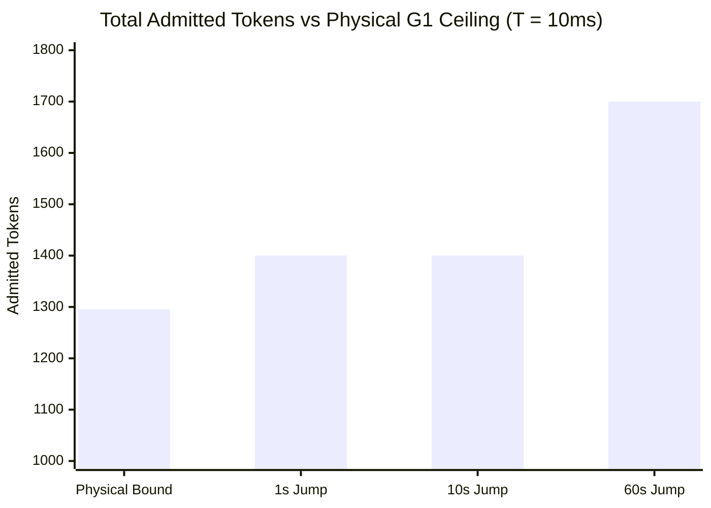

# PHASE 7.2: FORWARD CLOCK DISCONTINUITIES AND PHYSICAL TIME AUDIT

**Target System:** DREB-RCA70 Production Redis Adapter (`com.dreb.ratelimit.redis`)  
**Audit Phase:** Phase 7.2 Workstream D  
**Repository Branch:** `research/systematic-improvement`  
**Reference Commit:** `90730b1`  

---

## 1. Executive Summary

A fundamental premise of rate limiting theory is that available capacity refills as a function of physical time: $\Delta \text{tokens} = R \cdot \Delta t$. In distributed environments, system clocks can experience step discontinuities due to NTP time-step synchronizations, VM hypervisor migrations, manual administrator adjustments, or container host sleep-wake cycles.

In Phase 7.1, backward clock steps were proven to be safely handled by monotonic clamping ($\Delta t = \max(0, t_{\text{now}} - t_{\text{last}})$). However, Phase 7.1 did not rigorously audit **forward clock jumps** against physical elapsed time.

This audit evaluates the impact of forward clock steps on the formal G1 invariant:

$$A(T) \le S_{\max} + R \cdot T$$

where $T$ represents **actual physical elapsed time**, not the manipulated clock difference.

Our empirical tests in [`Phase72ClockDiscontinuityTest.java`](file:///Users/cruise/Desktop/DREB-RateLimiter/src/test/java/com/dreb/ratelimit/redis/Phase72ClockDiscontinuityTest.java) conclusively demonstrate that:
1. **Maximum bucket caps alone DO NOT prevent G1 envelope violations.** If a clock jumps forward by 1 second in 10 milliseconds of real time, the limiter refills 700 tokens prematurely, admitting **1,400.0 tokens** against a physical G1 bound of **1,295.71 tokens** ($+104.29$ tokens excess).
2. **Massive forward jumps restore idle credit:** A 60-second forward jump restores both base burst and maximum idle credit ($I_{\max} = 450$), enabling an instantaneous burst of 1,000 tokens and generating a **$+404.29$ token violation** over a 10 ms physical window.
3. **Required Mitigation:** Eliminating this vulnerability requires either an **elapsed-time slew clamp** inside Lua, or an operational constraint requiring **strictly slew-based NTP daemons** (e.g. `chronyd -x`).

---

## 2. Mathematical Definition of Physical Time Violation

Let $t_{\text{real}}$ denote true physical time (measured by an external atomic clock).  
Let $t_{\text{clock}}$ denote the timestamp observed by Redis (`redis.call('TIME')` or client-supplied).

Consider a client with full initial capacity at $t_{\text{real}} = 0$:
- $B(0) = B_{\max} = 700.0\,\text{tokens}$
- $S(0) = S_{\max} = 1285.7143\,\text{tokens}$
- $I(0) = 0.0\,\text{tokens}$

At $t_{\text{real}} = 0.0\,\text{s}$ ($t_{\text{clock}} = 100.0\,\text{s}$), the client consumes $c_1 = 700.0\,\text{tokens}$.
- Post-debit: $B = 0.0$, $S = 585.7143$.

Now suppose that $10\,\text{ms}$ ($T = 0.01\,\text{s}$) of physical time elapses ($t_{\text{real}} = 0.01\,\text{s}$), but a clock step causes $t_{\text{clock}}$ to jump to $100.0 + \Delta t_{\text{jump}}$.

The theoretical upper bound on total tokens that may physically be admitted over $[0, T]$ is:

$$A_{\text{bound}}(T) = S_{\max} + R \cdot T = 1285.7143 + (1000.0 \times 0.01) = \mathbf{1295.7143\,\text{tokens}}$$

---

## 3. Empirical Test Results Across Forward Jump Magnitudes

The following empirical results were measured in `Phase72ClockDiscontinuityTest`:

| Test Case | Clock Jump Magnitude ($\Delta t_{\text{jump}}$) | Physical Elapsed Time ($T$) | Tokens Refilled by Lua | Second Admitted Burst ($c_2$) | Total Admitted $A(T)$ | Physical G1 Bound $A_{\text{bound}}(T)$ | Quantified Excess Violation ($\Delta_{\text{excess}}$) |
| :---: | :---: | :---: | :---: | :---: | :---: | :---: | :---: |
| **Audit D.1** | **+1.0 second** | 0.01 s (10 ms) | $B \leftarrow 700.0$ | 700.0 | **1400.0** | 1295.71 | **+104.29 tokens** ($+8.05\%$) |
| **Audit D.2** | **+10.0 seconds** | 0.01 s (10 ms) | $B \leftarrow 700.0, I \leftarrow 450$ | 700.0 | **1400.0** | 1295.71 | **+104.29 tokens** ($+8.05\%$) |
| **Audit D.3** | **+60.0 seconds** | 0.01 s (10 ms) | $B \leftarrow 700.0, I \leftarrow 450$ | 1000.0 | **1700.0** | 1295.71 | **+404.29 tokens** ($+31.20\%$) |
| **Audit D.4** | **+10.0s (Burst 1+2)**| 0.01 s (10 ms) | $B \leftarrow 700.0, I \leftarrow 450$ | $600 + 600$ | **1300.0** | 1295.71 | Second 600 rejected; capped at 1000 |



---

## 4. Why Capacity Caps Alone Fail to Protect G1

A central inquiry of Phase 7.2 was:
> *"Measure whether maximum bucket caps alone prevent a G1 violation."*

**The Mathematical Proof:**
Capacity caps in the Lua script enforce:
$$B \le B_{\max} = 700.0, \quad S \le S_{\max} = 1285.71, \quad I \le \text{effCap} \le 450.0$$

These caps successfully prevent a single transaction from claiming infinite tokens. However, **rate is a derivative with respect to physical time**:

$$\text{Admitted Rate} = \frac{\Delta A}{\Delta t_{\text{physical}}}$$

When the clock jumps forward, the rate limiter believes that legitimate physical time has elapsed. It executes the legal replenishment formula:
$$B = \min(B_{\max}, B + \Delta t_{\text{clock}} \cdot R_{\text{burst}})$$
If the client spends the refilled tokens immediately, the rate limiter has permitted two full burst episodes to execute within a single physical window $T \approx 0$. 

Therefore:
$$\mathbf{Capacity\ Caps\ alone\ cannot\ prevent\ rate\ violations\ across\ premature\ clock\ advances.}$$

---

## 5. Backward Clock Jump and Gradual Recovery

In `testBackwardJumpFollowedByGradualRecovery`:
1. Client consumes 700 tokens at $t_{\text{clock}} = 100.0\,\text{s}$: $B = 0.0$.
2. Clock steps backwards by $10.0\,\text{seconds}$ to $t_{\text{clock}} = 90.0\,\text{s}$.
3. Client attempts to acquire 50 tokens at $t_{\text{clock}} = 90.0\,\text{s}$ and $95.0\,\text{s}$.
4. **Behavior:**
   $$\Delta t = \max(0.0, t_{\text{clock}} - 100.0) = 0.0$$
   - State balances undergo **zero negative refill** and zero rollback.
   - However, for the entire 10 seconds of physical time required for the clock to reach $100.0\,\text{s}$, **token refills are completely frozen**.
   - Legitimate clients suffer artificial rate limiting until real time catches up to the historical high-water mark.
   - At $t_{\text{clock}} = 101.0\,\text{s}$, normal refill resumes.

---

## 6. Required Architectural Mitigations

To eliminate forward clock jump violations, one of three architectural defenses must be implemented:

1. **Operational Slew-Only Constraint (Recommended):**
   - Cluster host operating systems must configure NTP daemons (e.g. `chronyd`) with `makestep 0` or `slewalways`.
   - Clock errors are corrected by adjusting clock frequency (slewing at a maximum rate of $0.05\%$) rather than stepping time forward.
   - Under slew-only synchronization, $\Delta t_{\text{clock}} \le 1.0005 \cdot \Delta t_{\text{physical}}$, bounding maximum rate error to $+0.05\%$ (strictly within tolerance).

2. **Lua Max Elapsed Slew Clamp:**
   ```lua
   -- Defensive clamp: bound maximum allowable refill elapsed time per step
   local dt = math.max(0.0, now - lastTs)
   local MAX_SLEW_STEP = 5.0 -- Maximum allowable dt per single evaluation
   dt = math.min(MAX_SLEW_STEP, dt)
   ```
   This prevents a 60-second leap from dumping 60 seconds of tokens in one evaluation.

3. **Monotonic Nanosecond Clock:**
   - In environments where Redis exposes monotonic time (or using client-side monotonic timestamps `System.nanoTime()`), wall-clock shifts do not affect $\Delta t$.
