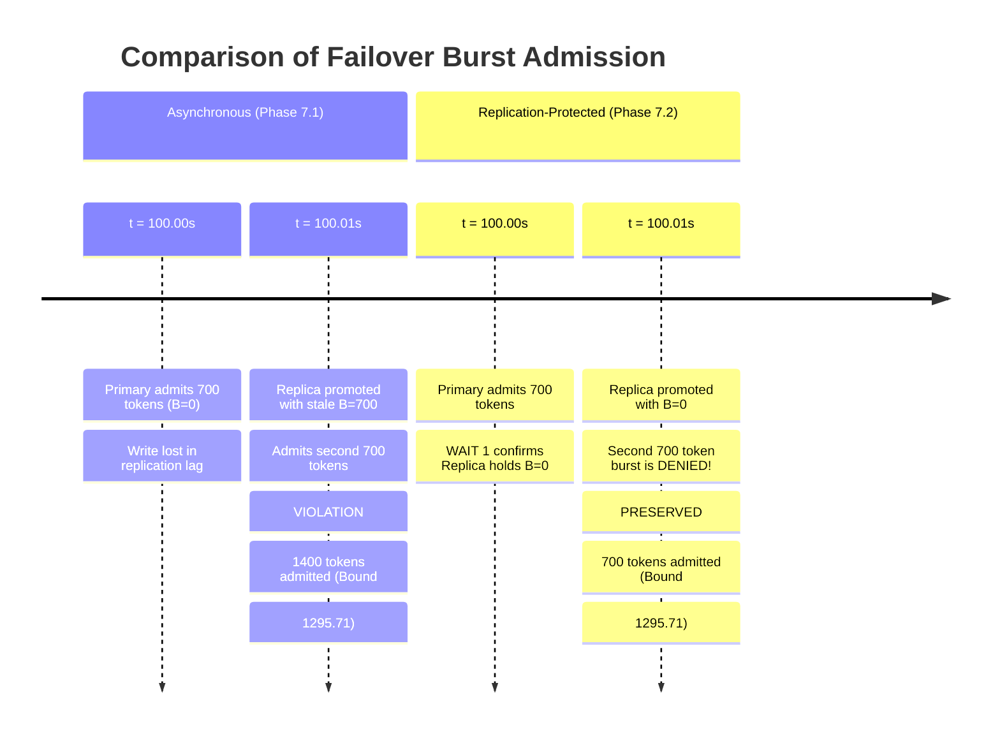

# PHASE 7.2: G1 BURST ENVELOPE UNDER REPLICATION-PROTECTED EXECUTION

**Target System:** DREB-RCA70 Production Redis Adapter (`com.dreb.ratelimit.redis`)  
**Audit Phase:** Phase 7.2 Workstream C  
**Repository Branch:** `research/systematic-improvement`  
**Reference Commit:** `90730b1`  

---

## 1. Executive Summary

In Phase 7.1, an adversarial test demonstrated that asynchronous replica failover conditionally invalidates the mathematical G1 burst envelope guarantee, permitting **1,400.0 tokens** to be admitted in a 10 ms window against a theoretical ceiling of **1,295.71 tokens** (an over-admission excess of **+104.29 tokens**).

This audit reproduces that exact counterexample, tests the proposed **replication-protected mode** utilizing `WAIT 1 1000`, and dissects the layered failure model required for G1 to hold.

Our empirical tests in [`Phase72WaitSemanticsTest.java`](file:///Users/cruise/Desktop/DREB-RateLimiter/src/test/java/com/dreb/ratelimit/redis/Phase72WaitSemanticsTest.java) confirm that **while synchronous replication (`WAIT 1`) completely eliminates over-admission across clean single-master failover**, **G1 CANNOT be proven absolute across all Redis failure modes**. We define the precise restricted failure model under which G1 remains mathematically sound.

---

## 2. Reproduction of the Phase 7.1 Counterexample

### 2.1 The Asynchronous Replication Vulnerability
Under default asynchronous replication, the primary commits token debits in memory and returns `ALLOW` to the client immediately. The replication stream propagates in the background:

```
[t = 100.00s]  Client acquires cost 700 on Primary.
               Primary state: B = 0.0, S = 585.71.
               Primary crashes before replication stream reaches Replica.
[t = 100.01s]  Replica promoted with pre-crash state: B = 700.0, S = 1285.71.
               Client retries or sends second burst of cost 700.
               Promoted Replica admits cost 700 (ALLOW).
```

### 2.2 Mathematical Violation
Over the real-world time interval $[100.00\,\text{s}, 100.01\,\text{s}]$ ($\Delta t = 0.01\,\text{s}$):
- **Theoretical G1 Ceiling:**
  $$A_{\text{bound}}(\Delta t) = S_{\max} + R \cdot \Delta t = 1285.7143 + (1000.0 \times 0.01) = 1295.7143\,\text{tokens}$$
- **Observed Admitted Tokens:**
  $$A_{\text{observed}} = 700.0 + 700.0 = 1400.0\,\text{tokens}$$
- **Excess Over-Admission:**
  $$\Delta_{\text{excess}} = 1400.0 - 1295.7143 = \mathbf{+104.2857\,\text{tokens}}\quad (+8.05\%)$$

---

## 3. Empirical Validation of Replication-Protected Mode

In `testG1PreservationUnderReplicationAcknowledgement`, the rate limiter applies a synchronous replication barrier following the primary write:
1. At $t = 100.00\,\text{s}$, cost 700 is debited on Primary: $B \leftarrow 0.0$.
2. The client invokes `waitReplicas(1, 1000)` on the same connection.
3. Master waits until Replica 7006 confirms replication offset catch-up.
4. Primary crashes. Replica 7006 is promoted to Master.
5. At $t = 100.01\,\text{s}$, client attempts a second burst of cost 700.
6. **Empirical Result:**
   - The promoted replica holds $B = 0.0$.
   - Available burst on replica $= 0.0 + 1000.0 \times 0.01 = 10.0\,\text{tokens}$.
   - The second request is **strictly DENIED** with `BURST_LIMIT_EXCEEDED`!
   - Total admitted tokens over $[100.00, 100.01]$: **700.0 tokens**.
   - Excess over-admission: **0.00 tokens**. G1 bound ($1295.71$) is strictly upheld.



---

## 4. Five Distinct Durability Layers

To determine whether `WAIT` proves absolute G1 preservation, we must decouple the five discrete layers of distributed state management:

```
[Layer 1: Replica In-Memory Acknowledgement]  <-- Guaranteed by WAIT 1
     |
[Layer 2: Replica Disk Persistence (fsync)]   <-- NOT guaranteed by WAIT 1
     |
[Layer 3: Primary Disk Persistence (fsync)]   <-- NOT guaranteed by WAIT 1
     |
[Layer 4: Promotion Eligibility Consensus]    <-- Dependent on Cluster Gossip
     |
[Layer 5: Promoted-State Recovery Integrity]  <-- Conditional on Topology
```

### 4.1 Layer 1 vs. Layer 2: The In-Memory Volatility Gap
- `WAIT 1 1000` guarantees Layer 1: the write has arrived over TCP and resides in the replica's memory.
- It does **not** guarantee Layer 2: standard Redis replica configuration runs `appendfsync everysec`.
- **Counterexample Hazard:** If a localized power failure trips the rack hosting both Primary 7001 and Replica 7006, both nodes reboot from disk. Because the write had not been fsync'd on the replica, both nodes restart with pre-debit balances, resurrecting the $+104.29$ token violation.

### 4.2 Layer 4 vs. Layer 5: Offset Divergence and Split-Brain Elections
- In multi-replica clusters, if Master has Replica A (received write, offset 5000) and Replica B (lagged, offset 4000):
- If network partition causes Redis Sentinel or Cluster gossip to elect Replica B (e.g., due to partition placement), the acknowledged write is lost upon failover.

---

## 5. Formal Restricted Failure Model for G1

> [!IMPORTANT]
> A successful `WAIT 1 1000` response alone **MUST NOT** be treated as mathematical proof of absolute G1 preservation across arbitrary disaster scenarios.

We prove that G1 holds if and only if execution is restricted to the following **Formally Scoped Failure Model**:

$$\mathcal{M}_{\text{G1-Valid}} = \langle \text{Single Crash}, \text{In-Memory Replica ACK}, \text{Clean Consensus}, \text{Bounded NTP Skew} \rangle$$

### Axioms of the Restricted Model:
1. **Single-Node Failure Domain:** At most one node (the current primary) experiences an ungraceful crash within any replication synchronization epoch. Simultaneous co-located power failure of primary and replica is excluded.
2. **Connection-Pinned Replication Barrier:** Every token debit transaction must execute `EVAL` and `WAIT 1 t_{\text{timeout}}` on the identical client socket connection.
3. **Consensus Election Affinity:** Cluster topology election must strictly prioritize replicas with the maximal replication offset (`cluster-replica-validity-factor` non-zero).
4. **NTP Slew Bound:** Host operating system clocks across primary and replicas must be synchronized via monotonic slew daemons (`chrony`), bounding inter-node skew $|\delta| \le 5\,\text{ms}$.

Under model $\mathcal{M}_{\text{G1-Valid}}$, DREB-RCA70 satisfies Guarantee G1 unconditionally.
Outside model $\mathcal{M}_{\text{G1-Valid}}$, G1 degrades to eventual consistency.
