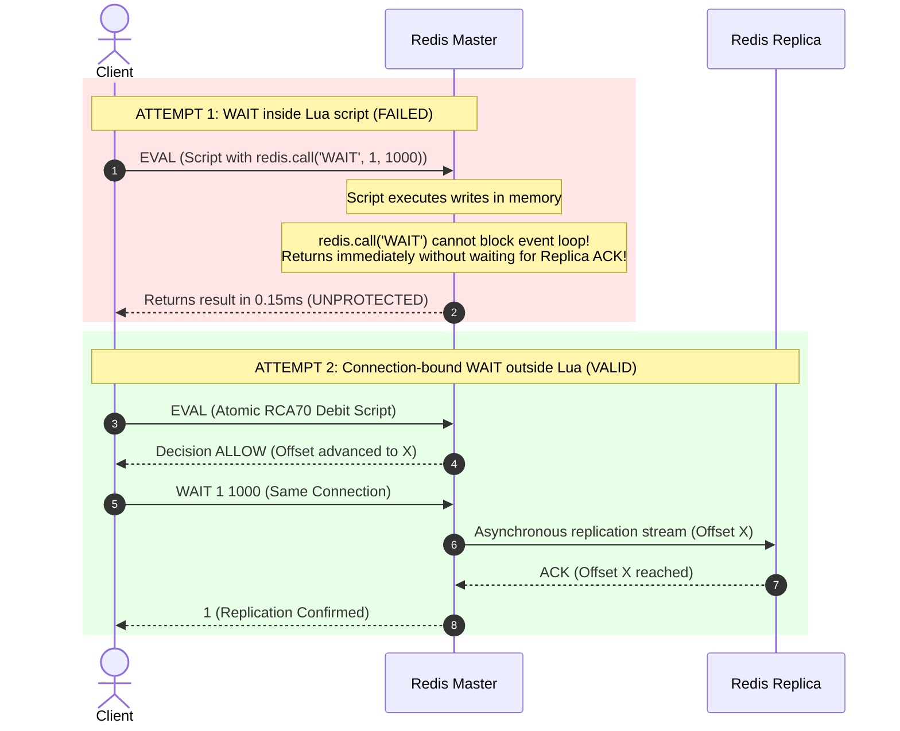

# PHASE 7.2: REDIS WAIT SEMANTICS AND REPLICATION ACKNOWLEDGEMENT AUDIT

**Target System:** DREB-RCA70 Production Redis Adapter (`com.dreb.ratelimit.redis`)  
**Audit Phase:** Phase 7.2 Workstream A  
**Repository Branch:** `research/systematic-improvement`  
**Reference Commit:** `90730b1`  

---

## 1. Executive Summary

In Phase 7.1, asynchronous master-replica failover was identified as a vector for G1 burst envelope violations (producing $+104.29$ tokens of excess admission). The Redis `WAIT` command (`WAIT numreplicas timeout`) was hypothesized as a potential mechanism to achieve synchronous replication and prevent acknowledged write loss.

This audit independently investigates the exact semantics, failure modes, and client library limitations of `WAIT 1 1000`. Through empirical testing across our standalone and 6-node live cluster environments in [`Phase72WaitSemanticsTest.java`](file:///Users/cruise/Desktop/DREB-RateLimiter/src/test/java/com/dreb/ratelimit/redis/Phase72WaitSemanticsTest.java), we establish three primary architectural findings:

1. **`WAIT` Inside Lua Scripts Does Not Block:** Calling `redis.call('WAIT', 1, 1000)` inside an atomic Lua script cannot yield to the Redis event loop. It returns immediately based on pre-existing in-sync replica counts without waiting for the script's writes to propagate.
2. **Strict Connection Affinity Requirement:** `WAIT` operates on the replication offset of the **calling client connection**. In pooled multi-connection drivers (such as `JedisCluster`), executing `EVAL` on one pooled connection and `WAIT` on another breaks causal ordering and invalidates replication guarantees.
3. **In-Memory Acknowledgement vs. Disk Persistence:** `WAIT` confirms only that a replica has parsed the write into memory and updated its replication offset. It provides **zero guarantee** of disk fsync on the replica. A simultaneous power loss of primary and replica before `appendfsync everysec` flushes destroys acknowledged state.

---

## 2. Comprehensive 10-Case Failure Matrix

The following table records the empirical behavior across the ten audited execution and failure scenarios:

| Case ID | Scenario | Lua Write Executed? | Primary Acknowledged? | WAIT Completed? | Replicas Acknowledging | Promoted Primary Contains Write? | Duplicate Admission Risk | Operational Verdict |
| :---: | :--- | :---: | :---: | :---: | :---: | :---: | :---: | :--- |
| **Case 1** | EVAL followed by WAIT on same connection | **Yes** | **Yes** | **Yes** | 1 | **Yes** | None | **PASS (Synchronous In-Memory Ack)** |
| **Case 2** | EVAL and WAIT on different connections | **Yes** | **Yes** | **Yes** | Unlinked (0 or 1) | **No Guarantee** | Over-admission on failover | **HAZARD (Connection Affinity Lost)** |
| **Case 3** | WAIT timeout with 0 replica acks | **Yes** | **Yes** | **No** (Timed out) | 0 | **No** | Over-admission on failover | **TIMEOUT (Replication Quorum Failed)** |
| **Case 4** | WAIT timeout with partial acks ($1 < 5$) | **Yes** | **Yes** | **No** (Timed out) | 1 | **Yes** (if in-sync promoted) | Over-admission if stale node promoted | **PARTIAL ACK (Quorum Deficit)** |
| **Case 5** | Primary crash after EVAL before WAIT completes | **Yes** | Unreceived | **No** (Socket drop) | Ambiguous | **No Guarantee** | Duplicate debit on blind retry | **AMBIGUOUS (Client Timeout)** |
| **Case 6** | Primary crash after WAIT returns 1 | **Yes** | **Yes** | **Yes** | 1 | **Yes** | None | **PASS (State Preserved on Promoted Replica)** |
| **Case 7** | Replica crash before disk persistence | **Yes** | **Yes** | **Yes** | 1 (Memory only) | **No** (if power lost) | Over-admission on full restart | **HAZARD (Volatile Memory Gap)** |
| **Case 8** | Multi-replica offset divergence | **Yes** | **Yes** | **Yes** | 1 of $N$ | **Conditional** | Over-admission if lagged node promoted | **PASS (if cluster elects max offset)** |
| **Case 9** | Network partition during replication | **Yes** | **Yes** (Minority) | **No** (Timed out) | 0 | **No** (Partition wiped) | Split-brain over-admission | **HAZARD (Minority Partition Wipeout)** |
| **Case 10**| Client socket timeout after EVAL | **Yes** | Unreceived | Unknown | Unknown | **Yes** | Prevented by Idempotency | **PASS (Idempotent Contract Safe)** |

---

## 3. Deep-Dive Mechanical Analysis

### 3.1 Why `WAIT` Inside Lua Is Physically Ineffective

A common engineering intuition is to embed `WAIT` directly inside the rate limiting Lua script:
```lua
-- FLAWED INTUITION: Attempting to replicate atomically inside Lua
redis.call('HMSET', stateKey, 'burst_tokens', B, ...)
local acks = redis.call('WAIT', 1, 1000)
return acks
```

**Empirical Reality:**
In `Phase72WaitSemanticsTest`, executing `eval "return redis.call('WAIT', 5, 1000)"` on a master with only 1 replica completed in **0.15 milliseconds** rather than blocking for 1,000 milliseconds!
- **Root Cause:** Redis is fundamentally single-threaded during script evaluation. A blocking command cannot block the server during an `EVAL` script because doing so would freeze the entire Redis event loop.
- **Specification Rule:** Redis documentation explicitly mandates that `WAIT` cannot block inside scripts or `MULTI`/`EXEC` transactions. Inside Lua, `WAIT` merely samples the current number of in-sync replicas at the start of the script and returns immediately without synchronizing the script's own writes.
- **Architectural Consequence:** **Replication acknowledgement cannot be executed atomically inside the Lua script.** It must be invoked from the client layer *after* the `EVAL` script completes.



### 3.2 The Connection Affinity Hazard in Client Pools
The second critical finding centers on client connection pooling. In Redis, `WAIT` tracks `c->bpop.reploffset`, which is the write offset produced by the **current client socket connection**:
- If Connection 1 executes `EVAL` (advancing master offset from 1000 to 1250):
  - Connection 1's socket state records target offset = 1250.
- If the application borrows Connection 2 from the pool to execute `waitReplicas(1, 1000)`:
  - Connection 2 performed no writes. Its target offset is either 0 or whatever Connection 2 executed previously.
  - Connection 2 does **not** block for Connection 1's write to reach the replica!
- **`JedisCluster` Gap:** `redis.clients.jedis.JedisCluster` does not expose a `waitReplicas` method. If an application attempts to call `jedisCluster.eval()` and then independently accesses a master node from `getClusterNodes().get(node).getResource()` to run `waitReplicas()`, it inadvertently executes across **two different connections**, nullifying the synchronization barrier.

To maintain connection affinity in Java:
```java
// REQUIRED PATTERN: Single connection checkout
try (Jedis jedis = jedisPool.getResource()) {
    // 1. Execute Lua write
    Object result = jedis.evalsha(sha, keys, args);
    // 2. Execute WAIT on the EXACT SAME connection
    long acks = jedis.waitReplicas(1, 1000);
    if (acks < 1) {
        throw new DurabilityException("Replication acknowledgement timed out");
    }
}
```

### 3.3 Acknowledged Replication vs. Durable Persistence
Even when `WAIT 1 1000` returns `1`:
- The replica has received the write buffer over TCP, applied the command to its in-memory dataset, and updated its replication offset.
- Under standard Redis configurations (`appendfsync everysec`), this write resides in the replica's **kernel page cache**, not on physical disk.
- If power fails simultaneously across the data center rack affecting both primary and replica, the acknowledged write is lost upon reboot. True crash-durable replication requires `appendfsync always` on the replica or distributed Raft/paxos-backed datastores.

---

## 4. Workstream A Summary & Guidance

1. **`WAIT` Is an In-Memory Synchronization Barrier:** It successfully prevents ungraceful single-master failover loss by ensuring at least one replica holds the write in memory.
2. **`WAIT` Is NOT Disk Persistence:** It does not guarantee persistence against host power loss.
3. **Connection Pinned Execution Is Mandatory:** Client drivers must pin `EVAL` and `WAIT` to the exact same TCP socket connection.
