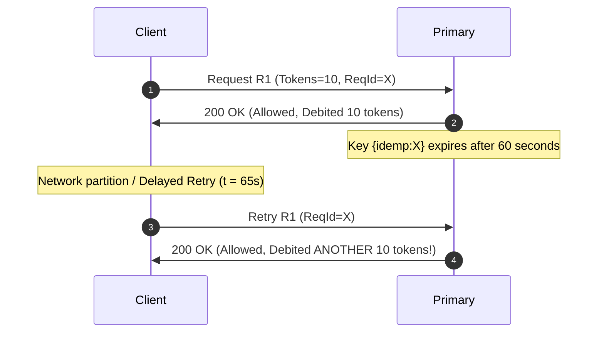
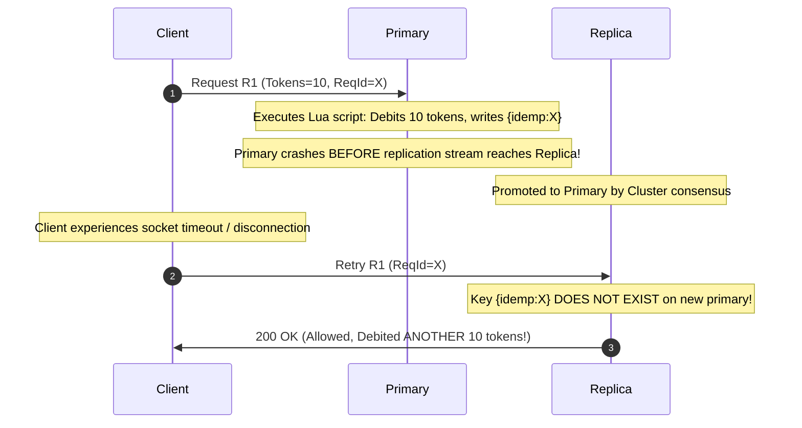

# PHASE 7.3.1: IDEMPOTENCY SAFETY GATE RECLASSIFICATION (GATE H)

**Target System:** DREB-RCA70 Production Redis Adapter (`com.dreb.ratelimit.redis`)  
**Audit Phase:** Phase 7.3.1 Workstream D  
**Repository Branch:** `research/systematic-improvement`  
**Starting Reference Commit:** `c4a857cd371dfb984a44ffee0684176303c84477`  

---

## 1. Executive Summary

In Phases 7.1 through 7.3, **Gate H (Idempotency Safety)** was classified as **`PASS`**, citing payload-fingerprint binding and bounded retention ($\tau_{\text{idemp}} = 60\,\text{s}$). However, the audit reports simultaneously acknowledged that:
1. Retries occurring after 60 seconds are treated as new requests and debited a second time.
2. In asynchronous Redis replication, a primary crash occurring prior to replication replication drops the idempotency record, causing an immediate double-debit when the client retries against the newly promoted replica.

Classifying a safety gate as `PASS` while known operational events cause duplicate deductions is a contradiction in terms. 

**Correction:**  
We formally reclassify **Gate H from `PASS` to `CONDITIONAL`**. Exactly-once debit semantics are **not** unconditionally guaranteed by the Redis adapter. They hold **if and only if** the idempotency record survives, which requires both a strict client retry deadline ($t_{\text{retry}} < 60\,\text{s}$) and synchronous replication confirmation (`WAIT 1`).

---

## 2. Anatomy of the Two Idempotency Failure Modes

The DREB-RCA70 Redis adapter implements idempotency by recording a SHA-256 fingerprint of the request payload alongside the debit decision at key `{dreb:idemp:<clientId>:<requestId>}` with a fixed time-to-live ($\tau_{\text{idemp}} = 60\,\text{s}$).

While this mechanism successfully prevents concurrent replay attacks and payload tampering within normal single-node execution, it exhibits two structural failure modes under distributed operation:

### 2.1 Failure Mode 1: Window Expiration (Bounded Retention)
Redis is an in-memory data store. Retaining idempotency records indefinitely is mathematically impossible without unbounded memory growth ($O(N_{\text{requests}})$).

- If an upstream client, message queue, or API gateway retries a request after $\tau_{\text{idemp}} = 60\,\text{s}$, Redis treats the request as entirely new.
- **Consequence:** Duplicate token deduction ($2 \times$ debit).

### 2.2 Failure Mode 2: Un-Replicated Asynchronous Failover
In default Redis Cluster operation, primary-to-replica replication is asynchronous.

- When the primary crashes before the replication buffer is flushed to the replica, the replica is promoted without the idempotency record.
- When the client's HTTP client or SDK retries the ambiguous transaction, the new primary processes the debit as a novel request.
- **Consequence:** Duplicate token deduction under single-node crash.

---

## 3. Formal Reclassification Matrix

| Dimension | Phase 7.1 - 7.3 Status | Phase 7.3.1 Corrected Status | Justification |
| :--- | :---: | :---: | :--- |
| **Tamper Protection** | `PASS` | **`PASS`** | Payload hash binding prevents key reuse with different costs or payloads (`IDEMPOTENCY_CONFLICT`). |
| **Concurrent Replay** | `PASS` | **`PASS`** | Atomic Lua script execution prevents double debit from simultaneous duplicate requests. |
| **Failover Idempotency (Async Mode)** | `PASS` *(overlooked)* | **`FAIL`** | Async failover drops un-replicated records, causing double debits upon client retry. |
| **Failover Idempotency (`WAIT` Mode)** | `PASS` | **`PASS`** | If `WAIT 1 1000` acknowledges the write, the promoted replica contains the record (under $N=1$). |
| **Long-Horizon Retries ($t > 60\,\text{s}$)** | `PASS` *(qualified)* | **`FAIL`** | Record TTL purge causes double debits for delayed retries. |
| **Overall Gate H Classification** | `PASS` | **`CONDITIONAL`** | Exactly-once semantics are strictly contingent on replication mode and retry timing. |

---

## 4. Rigorous Specification of Gate H Conditions

Gate H is classified as **`CONDITIONAL`**. The rate limiter guarantees at-most-once token deduction for a given `requestId` **if and only if** all of the following operational preconditions are satisfied:

$$\text{Guarantee: } \text{Debit}(\text{reqId}) = 1 \iff \begin{cases} 
1. & \Delta t_{\text{retry}} < \tau_{\text{idemp}} = 60\,\text{seconds} \\
2. & \text{Replication Confirmation: Synchronous } (\texttt{WAIT 1} \ge 1) \\
3. & \text{Payload Invariant: } \text{SHA-256}(\text{payload}) \text{ is unchanged}
\end{cases}$$

### Explicit Disclosures
1. **No Infinite Exactly-Once Guarantee:** The DREB-RCA70 Redis adapter does **not** provide an infinite, unconditional exactly-once guarantee. It provides a **bounded at-most-once deduplication window**.
2. **Standard Redis Cluster (Async) Vulnerability:** In standard `JedisCluster` deployments where `WAIT` is unavailable, failover events **will** permit duplicate token deductions if clients retry in-flight requests.
3. **Gateway Contract:** Upstream API gateways must configure client HTTP timeouts and retry backoff ceilings such that:
   $$t_{\text{max\_retry\_deadline}} \le 45\,\text{seconds} < \tau_{\text{idemp}}$$
