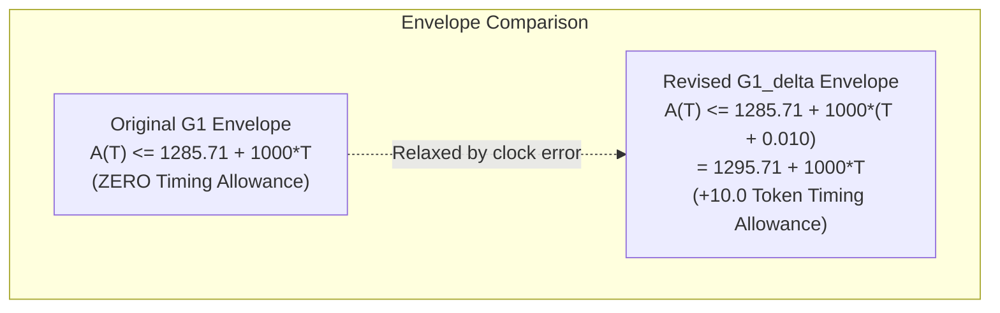

# PHASE 7.3.1: PHYSICAL-TIME G1 INVARIANT AND TIMING ALLOWANCE CORRECTION

**Target System:** DREB-RCA70 Production Redis Adapter (`com.dreb.ratelimit.redis`)  
**Audit Phase:** Phase 7.3.1 Workstream B  
**Repository Branch:** `research/systematic-improvement`  
**Starting Reference Commit:** `c4a857cd371dfb984a44ffee0684176303c84477`  

---

## 1. Executive Summary

A critical finding of Phase 7.3 was that physical-time rate bounds cannot be derived solely from wall-clock bucket caps when clocks are subject to drift or step adjustments. However, Phase 7.3 improperly claimed that an envelope with a drift term represented "strict preservation of G1".

This document provides the formal mathematical correction:
1. **The 5 ms Specification Defined:** We define the 5 ms parameter as an **absolute clock offset bound** from true UTC physical time ($|\tau - t_{\text{physical}}| \le 5\,\text{ms}$).
2. **Two-Point Reading Error Calculation:** If any clock reading has an absolute error of up to $\pm 5\,\text{ms}$, the maximum error in elapsed time between two readings (on the same host or across hosts during failover) is **$10\,\text{ms}$**.
3. **Formal Decoupling of Envelopes:**
   - **Original $G_1$ (Ideal Physical Bound):** $A(T) \le S_{\max} + R \cdot T$.
   - **Revised $G_{1,\delta}$ (Slew-Tolerant Bound):** $A(T) \le S_{\max} + R \cdot (T + \delta_{\text{elapsed}})$.
4. **Honest Scientific Classification:** $G_{1,\delta}$ represents a **relaxed, timing-tolerant envelope**, NOT strict preservation of the original ideal $G_1$.

---

## 2. Definition and Derivation of Clock Reading Errors

### 2.1 The 5 ms Offset Definition
Let $t \in \mathbb{R}$ represent continuous physical time (SI seconds).  
Let $\tau_H(t)$ represent the local timestamp reported by host $H$ at physical time $t$.

We assume host clocks are maintained within an absolute offset bound $\epsilon_{\text{offset}} = 5\,\text{ms} = 0.005\,\text{s}$:

$$\forall t, \quad |\tau_H(t) - t| \le \epsilon_{\text{offset}}$$

$$\tau_H(t) \in [t - \epsilon_{\text{offset}}, \, t + \epsilon_{\text{offset}}]$$

### 2.2 Maximum Error Between Two Clock Readings
Consider two transactions occurring at physical times $t_1$ and $t_2$ ($t_2 \ge t_1$).  
The true physical elapsed time is:

$$T = t_2 - t_1$$

The elapsed time perceived by Redis is:

$$\Delta \tau = \tau_{H_2}(t_2) - \tau_{H_1}(t_1)$$

Subtracting physical time $T$:

$$\Delta \tau - T = \left(\tau_{H_2}(t_2) - t_2\right) - \left(\tau_{H_1}(t_1) - t_1\right)$$

Let $e_2 = \tau_{H_2}(t_2) - t_2 \in [-\epsilon_{\text{offset}}, +\epsilon_{\text{offset}}]$ and $e_1 = \tau_{H_1}(t_1) - t_1 \in [-\epsilon_{\text{offset}}, +\epsilon_{\text{offset}}]$.

$$\Delta \tau - T = e_2 - e_1$$

The maximum possible forward elapsed-time measurement error occurs when $e_2 = +\epsilon_{\text{offset}}$ and $e_1 = -\epsilon_{\text{offset}}$:

$$\delta_{\text{elapsed}}^{\max} = \epsilon_{\text{offset}} - (-\epsilon_{\text{offset}}) = 2 \cdot \epsilon_{\text{offset}} = 2 \times 5\,\text{ms} = \mathbf{10\,\text{ms}}\quad (0.010\,\text{s})$$

> [!IMPORTANT]
> **Key Mathematical Correction:**  
> If individual host clock readings have an absolute error bound of $\pm 5\,\text{ms}$, the maximum elapsed-time error across two readings is **$10\,\text{ms}$**, NOT $5\,\text{ms}$.  
> This holds whether the two readings occur on the same host or cross hosts during a failover between Host 1 and Host 2.

---

## 3. Derivation of the Slew-Tolerant Envelope $G_{1,\delta}$

### 3.1 Refill Invariant Under Perceived Time
Inside the Redis Lua engine, token replenishment is driven by perceived elapsed time $\Delta \tau$:

$$S_{\text{refilled}} = \min(S_{\max}, \, S_{\text{pre}} + R \cdot \Delta \tau)$$

In the worst-case scenario, the clock runs ahead of physical time by $\delta_{\text{elapsed}}^{\max} = 10\,\text{ms}$.  
The maximum tokens refilled over physical duration $T$ is:

$$S_{\text{refill\_max}} \le R \cdot \Delta \tau \le R \cdot \left(T + \delta_{\text{elapsed}}^{\max}\right)$$

### 3.2 Formal Decoupling: $G_1$ vs. $G_{1,\delta}$

$$\mathbf{Original\ Ideal\ Guarantee\ G_1:}\quad A(T) \le S_{\max} + R \cdot T$$

$$\mathbf{Timing-Tolerant\ Guarantee\ G_{1,\delta}:}\quad A(T) \le S_{\max} + R \cdot \left(T + \delta_{\text{elapsed}}^{\max}\right)$$

For $R = 1000.0\,\text{tokens/s}$ and $\delta_{\text{elapsed}}^{\max} = 0.010\,\text{s}$ ($10\,\text{ms}$):

$$G_{1,\delta}(T) = 1285.7143 + 1000.0 \cdot (T + 0.010) = \mathbf{1295.7143 + 1000.0 \cdot T}$$

$$\Delta_{\text{allowance}} = R \cdot \delta_{\text{elapsed}}^{\max} = 1000.0 \times 0.010 = \mathbf{10.0\,\text{tokens}}$$

---

## 4. Workstream B Audit Conclusion

1. **Original $G_1$ Status:** **CONDITIONAL / LAPSED**. Ideal $G_1$ (zero timing allowance) does not hold on physical hardware with nonzero clock error. Any forward clock drift allows up to $+10.0\,\text{tokens}$ of premature refill over physical time.
2. **Revised $G_{1,\delta}$ Status:** **PASS under Slew Bounds**. $G_{1,\delta}$ holds strictly provided host clocks satisfy $|\tau - t| \le 5\,\text{ms}$.
3. **Transparent Reporting:** We explicitly retract claims that $G_{1,\delta}$ is "strict preservation of the original G1". It is a physically realistic relaxation incorporating a $+10.0\,\text{token}$ ($0.78\%$) timing tolerance.
