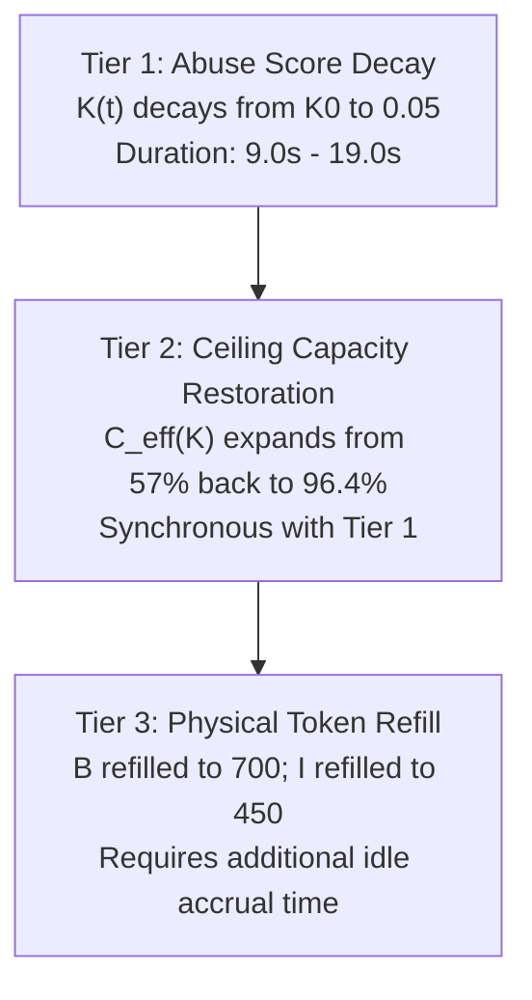

# PHASE 7.3.2: G3 ABUSE RECOVERY MODEL, REFERENCE-STATE SCOPE, AND MULTI-TIER RECOVERY RECONCILIATION

**Target System:** DREB-RCA70 Production Redis Adapter (`com.dreb.ratelimit.redis`)  
**Audit Phase:** Phase 7.3.2 Task D  
**Repository Branch:** `research/systematic-improvement`  
**Starting Commit:** `5578582`  

---

## 1. Executive Summary

In previous phase reports, the statement "G3 recovers in 19.0 seconds" was frequently presented as a universal property of the DREB-RCA70 policy. 

This audit resolves the exact scope and limitations of that metric:
1. **$K_0 = 1.0$ is a Reference Initial Condition, NOT a Global Maximum:** $K$ is not capped at 1.0 in code; sustained attacks can drive $K > 1.0$.
2. **19.0 Seconds is NOT a Universal Constant:** It applies **exclusively** to the condition $K_0 = 1.0$ recovering to $\epsilon = 0.05$.
3. **General Recovery Formula:** We provide the parameterized recovery equations for arbitrary initial abuse states (including $K_0 = 2/3$ and $K_0 = 0.5$).
4. **Decoupling of $d$ and $\lambda_{\text{rec}}$:** Penalty multiplier $d = 1.5$ controls token debit magnitude; $\lambda_{\text{rec}} = 0.05\,\text{s}^{-1}$ controls temporal decay.
5. **Three Distinct Tiers of Limiter Recovery:** We formally decouple recovery of the penalty counter ($K$), recovery of the credit ceiling ($C_{\text{eff}}$), and physical token refill ($B$ and $I$).

---

## 2. Mathematical Definition and Reachability of $K$

The state variable $K$ (`abuse_score`) tracks cumulative burst-farming activity:
$$\Delta K = \frac{\text{deficit}}{\text{baseCap}} = \frac{\max(0, c - B)}{450.0}$$

### 2.1 Is $K_0 = 1.0$ a Proven Maximum?
**No.** In both Java (`AdaptiveCeilingIdleCreditPolicy.java`) and Redis Lua (`RedisRca70Limiter.java`), the increment is:
```lua
K = K + (deficit / baseCap)
```
There is **no upper clamp** on $K$. A persistent adversary continuing to issue requests that exceed burst capacity can drive $K$ to arbitrary positive values ($K = 2.0, 3.0, \dots$).

### 2.2 Reachability of Specific Initial States ($K_0$)
1. **Single-Burst Maximum Draw ($K_0 = 2/3 \approx 0.6667$):**  
   A client starts with full idle credits $I = 450.0$ and empty burst $B = 0$. Because idle credits debit at penalty $d = 1.5$, the maximum burst deficit the client can draw before idle credits are fully exhausted is:
   $$\text{deficit}_{\max\_single\_burst} = \frac{I_{\max}}{d} = \frac{450.0}{1.5} = \mathbf{300.0\,\text{tokens}}$$
   The resulting abuse score from this single maximal draw is:
   $$K = \frac{300.0}{450.0} = \mathbf{\frac{2}{3}} \approx \mathbf{0.6667}$$
2. **Normalized Reference Saturated State ($K_0 = 1.0$):**  
   Achieved when a client conducts repeated burst farming across multiple refill cycles such that cumulative deficit reaches $\sum \text{deficit} = \text{baseCap} = 450.0\,\text{tokens}$.
3. **Half-Saturated State ($K_0 = 0.5$):**  
   Achieved when cumulative deficit reaches $225.0\,\text{tokens}$.

---

## 3. Generalized Recovery Equations

During periods where requests do not exceed burst capacity ($c \le B$ or idle periods), $K$ decays linearly:

$$K(t) = \max\left(0, \, K_0 - \lambda_{\text{rec}} \cdot t\right)$$
where $\lambda_{\text{rec}} = 0.05\,\text{s}^{-1}$.

### 3.1 Time to Reach $\epsilon$-Rested Status ($\epsilon = 0.05$)
At $K = \epsilon = 0.05$, the effective ceiling is:
$$C_{\text{eff}}(0.05) = \frac{450.0}{1.0 + 0.75 \times 0.05} = \frac{450.0}{1.0375} \approx \mathbf{433.735\,\text{tokens}} \quad (96.39\% \text{ of nominal})$$

The duration to reach $K \le 0.05$ from an arbitrary initial state $K_0 \ge 0.05$ is:

$$\tau_{0.05}(K_0) = \frac{K_0 - 0.05}{\lambda_{\text{rec}}} = \frac{K_0 - 0.05}{0.05} = 20.0 \cdot (K_0 - 0.05)\,\text{seconds}$$

### 3.2 Time to Reach Full Zero Penalty ($K = 0.0$)
$$\tau_0(K_0) = \frac{K_0}{\lambda_{\text{rec}}} = \frac{K_0}{0.05} = 20.0 \cdot K_0\,\text{seconds}$$

---

## 4. Reconciled Recovery Durations Across Reference States

| Initial Abuse State $K_0$ | Operational Origin | Effective Cap at $t=0$ | Recovery to $\epsilon = 0.05$ ($\tau_{0.05}$) | Full Zero Recovery ($\tau_0$) |
| :--- | :--- | :---: | :---: | :---: |
| **$K_0 = 0.50$** | Half-capacity deficit ($\sum \text{def} = 225\,\text{t}$) | $327.27\,\text{t}$ ($72.7\%$) | $\frac{0.50 - 0.05}{0.05} = \mathbf{9.0\,\text{s}}$ | $\frac{0.50}{0.05} = \mathbf{10.0\,\text{s}}$ |
| **$K_0 = 2/3 \approx 0.6667$** | Single full idle-bucket draw ($\text{def} = 300\,\text{t}$) | $300.00\,\text{t}$ ($66.7\%$) | $\frac{0.6667 - 0.05}{0.05} = \mathbf{12.33\,\text{s}}$ | $\frac{0.6667}{0.05} = \mathbf{13.33\,\text{s}}$ |
| **$K_0 = 1.00$** | Reference saturated state ($\sum \text{def} = 450\,\text{t}$) | $257.14\,\text{t}$ ($57.1\%$) | $\frac{1.00 - 0.05}{0.05} = \mathbf{19.0\,\text{s}}$ | $\frac{1.00}{0.05} = \mathbf{20.0\,\text{s}}$ |
| **$K_0 = 2.00$** | Severe adversarial attack ($\sum \text{def} = 900\,\text{t}$) | $180.00\,\text{t}$ ($40.0\%$) | $\frac{2.00 - 0.05}{0.05} = \mathbf{39.0\,\text{s}}$ | $\frac{2.00}{0.05} = \mathbf{40.0\,\text{s}}$ |

> [!IMPORTANT]
> The metric **$\tau = 19.0\,\text{seconds}$** is **not universal**. It represents only the transition from the specific reference state $K_0 = 1.0$ to the operational threshold $\epsilon = 0.05$.

---

## 5. Orthogonality of $d$ and $\lambda_{\text{rec}}$

- **$d = 1.5$ (Credit Debit Multiplier):** Governs the **conversion rate** of idle credit to burst tokens during spending ($I \leftarrow I - \text{deficit} \times 1.5$). It determines how fast a client exhausts credit, but has **zero impact** on temporal decay velocity $\frac{dK}{dt}$.
- **$\lambda_{\text{rec}} = 0.05\,\text{s}^{-1}$ (Decay Rate):** Governs the **temporal velocity** of forgiveness in the continuous time domain.

---

## 6. The Three Tiers of Rate Limiter Recovery

Scientific accuracy requires distinguishing three distinct tiers of system recovery:



1. **Tier 1 (Penalty Counter Recovery):** $K(t)$ decays toward zero. Bounded by $\tau_0(K_0) = 20 \cdot K_0\,\text{s}$.
2. **Tier 2 (Ceiling Permission Recovery):** $C_{\text{eff}}(K)$ expands back to $450\,\text{tokens}$. This tracks Tier 1 algebraically.
3. **Tier 3 (Physical Token Balance Recovery):** Restoring the actual token numbers $B$ and $I$ to maximum capacity.
   - Refilling $B$ from $0 \rightarrow 700$ requires $\Delta t_B = 700 / 1000 = 0.70\,\text{seconds}$.
   - Refilling $I$ from $0 \rightarrow 450$ requires sustained idle time once $B \ge 700$. At idle gain rate $\lambda_{\text{gain}} = 50\,\text{tokens/s}$, refilling $I$ requires an additional $\Delta t_I = 450 / 50 = \mathbf{9.0\,\text{seconds}}$.
   - Total physical state recovery from an exhausted state takes $\Delta t_{\text{refill}} = 0.7 + 9.0 = 9.7\,\text{seconds}$ of complete quiescence.
