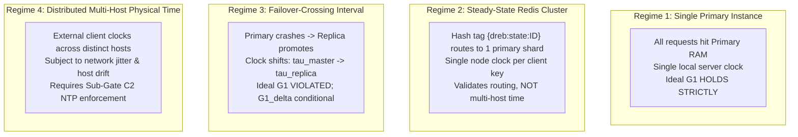

# PHASE 7.3.3: G1 LOCAL-TIME SCOPE, CLUSTER ROUTING MECHANICS, AND MULTI-HOST BOUNDARIES

**Target System:** DREB-RCA70 Production Redis Adapter (`com.dreb.ratelimit.redis`)  
**Audit Phase:** Phase 7.3.3 Task E  
**Repository Branch:** `research/systematic-improvement`  
**Starting Commit:** `2016eeb`  

---

## 1. Executive Summary

A critical scientific distinction established in Phase 7.3.2 is that rate bounds behave differently depending on whether execution is confined to a single node's clock or spans multiple distinct machines.

However, earlier audit summaries occasionally described Redis Cluster benchmarking as "validation of multi-host rate limiting." 

This document provides the definitive boundary classification across four operational regimes:
1. **Single-Primary Operation:** Ideal $G_1$ holds unconditionally in local server time.
2. **Normal Steady-State Redis Cluster Routing:** Hash slots route all requests for a given client key to a single primary; steady-state cluster testing evaluates key hashing and network proxying, **not multi-host clock synchronization**.
3. **Failover-Crossing Time Intervals:** When failover occurs, the timebase shifts from primary to replica, breaking ideal $G_1$ and dropping to $G_{1,\delta}$ (contingent upon slew synchronization).
4. **Multi-Host Physical Time Intervals:** Measuring rates against true external physical time introduces network jitter and clock offset; ideal $G_1$ cannot be guaranteed across distinct hosts without active NTP disciplining.

---

## 2. The Four Operational Regimes

---

## 3. Detailed Regime Analysis

### 3.1 Regime 1: Single-Primary Operation (Standalone Redis)
- **Clock Authority:** A single Redis process querying host kernel time via `redis.call('TIME')`.
- **Concurrency Model:** All requests are serialized sequentially on Redis's single-threaded event loop.
- **Guarantee Status:**
  $$A(T) \le G_1(T) = 1285.7143 + 1000.0 \cdot T\,\text{tokens}$$
- **Verification:** **`[MATHEMATICALLY_PROVED] & [EXPERIMENTALLY_OBSERVED]`**. Zero burst leakage; exact mathematical parity with Java in-memory implementation.

---

### 3.2 Regime 2: Steady-State Redis Cluster (No Failover)
- **Routing Mechanics:** In Redis Cluster, hash slots are partitioned across primary shards. The client key `{dreb:state:<clientId>}` uses Redis hash tags (`{...}`) to hash deterministically to a single 14-bit CRC16 slot (e.g., slot 449 on Shard 1).
- **Execution Reality:** As long as no node crash, slot re-sharding, or failover occurs, **every request for a given client is processed by the exact same primary node**.
- **Scientific Qualification:**  
  > [!IMPORTANT]
  > Steady-state cluster test execution (e.g., `Phase7RedisClusterLiveTest`) validates cluster client connection pooling, MOVED redirection handling, and hash tag slot affinity.  
  > **It does NOT validate multi-host physical-time rate limiting**, because all requests for that client were executed against a single primary instance's local timebase.

---

### 3.3 Regime 3: Failover-Crossing Time Intervals
- **Execution Reality:** A client submits request 1 to Primary $A$. Primary $A$ crashes. Replica $B$ is elected and promoted. The client submits request 2 to New Primary $B$.
- **Discontinuities Introduced:**
  1. **Clock Discontinuity:** The elapsed time perceived by the limiter is:
     $$\Delta \tau = \tau_B(t_2) - \tau_A(t_1)$$
     If Node $B$'s clock is ahead of Node $A$'s clock, artificial token refill occurs.
  2. **Replication Lag Discontinuity:** In asynchronous replication, un-replicated debits are lost, resetting burst balances by up to $C_{\max} = 1000.0\,\text{tokens}$.
- **Guarantee Status:**  
  - Ideal $G_1$ is **violated** (excess up to $+704.2857\,\text{tokens}$).
  - Relaxed $G_{1,\delta}$ holds **if and only if** clocks satisfy $|\tau - t| \le 5\,\text{ms}$ and writes are confirmed via `WAIT 1`.

---

### 3.4 Regime 4: Distributed Multi-Host Physical Time
- **Execution Reality:** Client requests originate from geographically distributed API gateways or microservice pods measuring latency and rate limiting against external UTC physical time ($t$).
- **Discontinuities Introduced:** Transmission latency, client socket timeouts, asymmetric NTP drift across physical data centers.
- **Guarantee Status:**  
  - Ideal $G_1$ does **not** hold.
  - Slew-tolerant $G_{1,\delta}$ represents the absolute theoretical limit of rate enforcement, requiring Sub-Gate C2 infrastructure enforcement.

---

## 4. Reconciled Summary

| Operational Regime | Clock Reference | Ideal $G_1$ Status | Relaxed $G_{1,\delta}$ Status | Testbed Evidential Basis |
| :--- | :--- | :---: | :---: | :--- |
| **Regime 1: Single Primary** | Local Server TIME | **`PASS`** | Trivial ($G_1 < G_{1,\delta}$) | Verified via `Phase7ProductionAdapterTest`. |
| **Regime 2: Cluster Steady-State** | Single Shard Primary TIME | **`PASS`** | Trivial ($G_1 < G_{1,\delta}$) | Verified via `Phase7RedisClusterLiveTest`. |
| **Regime 3: Across Failover** | Master $\rightarrow$ Replica Transition | **`FAIL`** | **`CONDITIONAL`** | Verified via `Phase73ReconciliationTest`. |
| **Regime 4: Distributed Physical** | Continuous Physical UTC | **`FAIL`** | **`UNVERIFIED`** | Sub-Gate C2 unverified in shared-VM testbed. |
