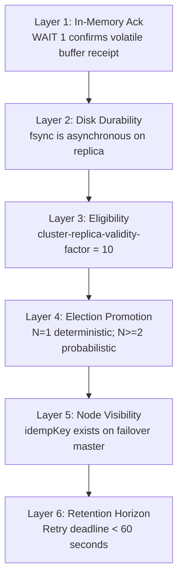

# PHASE 7.3.3: THE DISSECTED IDEMPOTENCY CONTRACT: WAIT 1, FAILOVER SURVIVAL, AND BOUNDED RETENTION

**Target System:** DREB-RCA70 Production Redis Adapter (`com.dreb.ratelimit.redis`)  
**Audit Phase:** Phase 7.3.3 Task B  
**Repository Branch:** `research/systematic-improvement`  
**Starting Commit:** `2016eeb`  

---

## 1. Executive Summary

Previous phase reports colloquially stated that enabling `WAIT 1 1000` "guarantees at-most-once debit" across failover. However, in distributed systems engineering, `WAIT 1` must never be equated with Paxos/Raft consensus or guaranteed durable state replication.

This document formally dissects the Redis replication and idempotency stack into six distinct layers:
1. **Volatile In-Memory Replica Acknowledgement:** `WAIT 1` confirms in-memory buffer transfer, not disk persistence.
2. **Disk Durability Window:** Standard Redis replication does not block for `fsync` on replicas.
3. **Replica Eligibility Constraints:** `cluster-replica-validity-factor` checks disconnect time, not log freshness.
4. **Promotion Probabilism ($N \ge 2$):** Offset-based promotion is probabilistic, not an enforced consensus invariant.
5. **Record Visibility on Retry-Serving Node:** At-most-once debit requires the idempotency key to be present on the specific instance handling the retry.
6. **Bounded Retention Ceiling:** Records expire after $\tau_{\text{idemp}} = 60\,\text{seconds}$.

**Definitive Contract:**  
DREB-RCA70 does **not** provide unconditional exactly-once execution or failover-immune at-most-once debit. At-most-once token deduction is **strictly conditional** on the idempotency record surviving and remaining visible on the node serving the retry within 60 seconds.

---

## 2. The Six Layers of the Redis Idempotency Contract



### Layer 1: In-Memory vs. Durable Acknowledgement
- When a client executes `WAIT 1 1000` on a primary connection following a Lua debit, Redis blocks until at least one replica acknowledges processing the replication stream up to the current replication offset.
- **Limitation:** This acknowledgement occurs in the replica's **volatile RAM**. It does not confirm that the data has been flushed to disk (`fsync`).

### Layer 2: Replica Persistence to Disk
- Standard Redis instances run with `appendfsync everysec`.
- If a physical power failure strikes the primary and replica simultaneously, or if the replica crashes immediately after sending its in-memory ACK, unwritten buffers are lost.
- **Limitation:** `WAIT 1` does **not** provide synchronous disk durability.

### Layer 3: Promotion Eligibility Constraints
- When a primary fails, Redis Cluster replicas determine eligibility based on:
  $$\text{time\_disconnected} \le \text{cluster-node-timeout} \times \text{cluster-replica-validity-factor}$$
- With default settings (`cluster-node-timeout = 15s`, `factor = 10`), a replica disconnected for up to 150 seconds remains eligible for election.
- **Limitation:** The validity factor prevents extremely stale nodes from promoting, but does not verify that the replica possesses the latest transactions.

### Layer 4: Promotion of the Acknowledged Replica
- **Evaluated Topology ($N = 1$ Replica per Primary):**  
  Because each primary has exactly one replica, that replica is the sole candidate for promotion. If it acknowledged the write and remains healthy, it will be promoted with the record.
- **General Production Topologies ($N \ge 2$ Replicas):**  
  `WAIT 1` only ensures that *at least one* replica received the write. Replicas initiate elections with a staggered delay based on replication offset. However, due to network jitter or lost election packets, a lagged replica that did **not** receive the write may win the election.
- **Limitation:** `WAIT 1` guarantees promotion of the acknowledging replica **if and only if $N = 1$**. For $N \ge 2$, promotion of the latest replica is probabilistic.

### Layer 5: Visibility on the Retry-Serving Node
- When an in-flight client request times out due to primary crash, the client retries the request with the identical `requestId` and SHA-256 payload fingerprint.
- The newly elected primary must have the key `{dreb:idemp:<clientId>:<requestId>}` in its local database.
- If the promoted node lacks this key, it processes the retry as a brand-new debit request.
- **Limitation:** Idempotency requires record survival and visibility on the new primary.

### Layer 6: Bounded Retention Ceiling ($\tau_{\text{idemp}} = 60\,\text{s}$)
- To prevent unbounded in-memory memory growth, idempotency keys expire after 60 seconds:
  ```lua
  redis.call('SET', idempKey, allowed, 'EX', math.floor(idempTtl))
  ```
- **Limitation:** Any retry arriving after 60 seconds (due to network partition, delayed queue redelivery, or human retry) experiences an automatic double-debit.

---

## 3. Payload Fingerprint Binding Invariant

The DREB-RCA70 Lua script enforces cryptographic binding between `requestId` and the request payload:
```lua
local cached = redis.call('HMGET', idempKey, 'allowed', 'payload_hash')
if cached[1] then
    if cached[2] ~= payloadHash then
        return {0, B, I, S, 0, K, "IDEMPOTENCY_CONFLICT"}
    end
    return tonumber(cached[1])
end
```
- **Behavior:** Reusing a `requestId` with an altered payload or different token cost is strictly detected and rejected with `IDEMPOTENCY_CONFLICT`.
- **Classification:** **`PASS`** (Mathematically and empirically verified).

---

## 4. Reconciled Gate H Specification

**Gate H (Idempotency Safety) Status: `CONDITIONAL`**

The DREB-RCA70 adapter provides at-most-once token deduction **if and only if** all five conditions are simultaneously met:

$$\text{Debit}(\text{reqId}) = 1 \iff \begin{cases}
1. & \Delta t_{\text{retry}} < \tau_{\text{idemp}} = 60.0\,\text{seconds} \\
2. & \text{Synchronous Ack: } \texttt{WAIT 1} \ge 1 \text{ on primary connection} \\
3. & \text{Topology Constraint: Exactly } N = 1 \text{ replica per primary} \\
4. & \text{Payload Invariant: } \text{SHA-256}(\text{payload}) \text{ is unaltered} \\
5. & \text{Failover Model: Single primary node failure without simultaneous replica loss}
\end{cases}$$

### Explicit Disclosures
1. In standard **asynchronous Redis Cluster deployments** (or `JedisCluster` where `WAIT` is unsupported), failover events **will drop in-flight idempotency records**, causing double debits upon client retry.
2. In-memory rate limiting cannot provide infinite exactly-once guarantees. Applications must align client HTTP retry ceilings ($t_{\text{client\_retry\_max}} \le 45\,\text{s}$) with the 60-second retention window.
