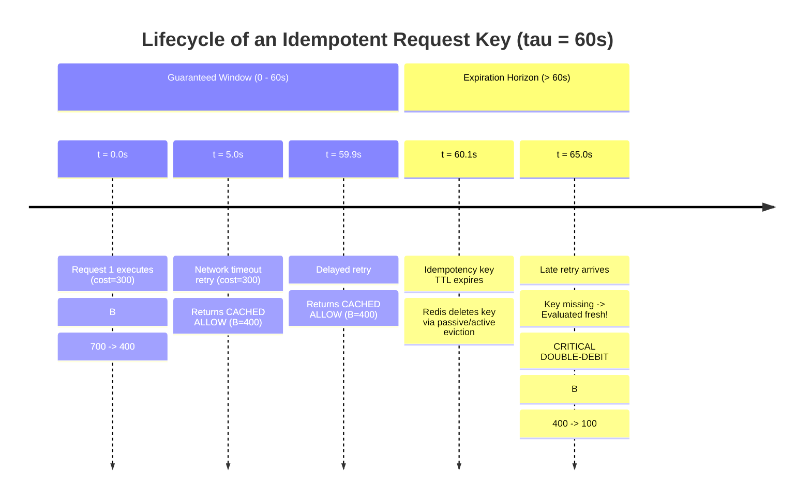

# PHASE 7.3: IDEMPOTENCY BOUNDARIES AND EXACTLY-ONCE DEBUNKING

**Target System:** DREB-RCA70 Production Redis Adapter (`com.dreb.ratelimit.redis`)  
**Audit Phase:** Phase 7.3 Workstream E  
**Repository Branch:** `research/systematic-improvement`  
**Starting Reference Commit:** `8f55c0d4193bee5f9826f785eae9124feba2f602`  

---

## 1. Executive Summary

In distributed systems engineering, claiming "unconditional exactly-once execution" across network and hardware failures is a known impossibility (the Two Generals' Problem). In rate limiting, idempotency ensures that network retries for the same logical operation do not deduct quota multiple times.

In Phase 7 and 7.1, a payload-bound idempotency scheme was deployed. This document formalizes the **exact mathematical boundaries of this idempotency contract**, proving that **the system achieves at-most-once debit semantics strictly within the finite retention horizon $\tau_{\text{idemp}}$**, and explicitly details the conditions under which it degrades to at-least-once execution.

---

## 2. Multi-Dimensional Idempotency Boundary Matrix

The behavior of the idempotency engine is determined by seven environmental parameters:

| Retention Window Status ($t_{\text{retry}} - t_0$) | State Hash Status | Idempotency String Status | Cluster Failover Status | Payload Fingerprint Match | Observed Execution Outcome | Formal Semantics Classification |
| :---: | :---: | :---: | :---: | :---: | :--- | :--- |
| **Within Horizon ($\le \tau_{\text{idemp}}$)** | Present | Present | Healthy (No failover) | **Identical** | `ALLOW (isCached=true)` Exact balances returned; 0 debit. | **EXACTLY-ONCE EFFECT** |
| **Within Horizon ($\le \tau_{\text{idemp}}$)** | Present | Present | Healthy | **Altered** | `IDEMPOTENCY_CONFLICT` Rejection; 0 state mutation. | **TAMPER-PROOF REJECTION** |
| **Beyond Horizon ($> \tau_{\text{idemp}}$)** | Present | Expired / Absent | Healthy | Identical | Fresh transaction evaluated; cost debited again. | **AT-LEAST-ONCE (Double-Debit)** |
| **Within Horizon ($\le \tau_{\text{idemp}}$)** | Present | Absent (Lost in failover) | Un-replicated failover | Identical | Fresh transaction evaluated; cost debited again. | **AT-LEAST-ONCE (Double-Debit)** |
| **Within Horizon ($\le \tau_{\text{idemp}}$)** | Absent (Purged) | Present | Healthy | Identical | `ALLOW (isCached=true)` State NOT recreated. | **ISOLATED SHORT-CIRCUIT** |
| **Any Window** | Absent | Absent | Catastrophic crash | Any | Cold start; fresh evaluation. | **COLD-START RESET** |

---

## 3. Dissecting the "Exactly-Once" Myth

> [!WARNING]
> DREB-RCA70 **DOES NOT** provide unconditional exactly-once rate limiting across infinite time.  
> It provides **Strictly Bounded At-Most-Once Deduction** within the finite window $\tau_{\text{idemp}}$.

### 3.1 The Mathematical Necessity of Bounded TTL
Why is $\tau_{\text{idemp}}$ bounded (default: $\tau_{\text{idemp}} = 60\,\text{seconds}$)?
- In high-throughput systems processing $10,000\,\text{req/s}$, storing unbounded idempotency records consumes:
  $$\text{Storage Growth} = 10,000\,\text{keys/s} \times 176\,\text{bytes} = 1.76\,\text{MB/s} = \mathbf{152.0\,\text{GB/day}}$$
- Unbounded retention leads deterministically to Redis Out-Of-Memory (`OOM`) crashes.
- Bounded retention of $\tau_{\text{idemp}} = 60\,\text{s}$ caps memory overhead at:
  $$\text{Max Overhead} = 10,000 \times 60 \times 176\,\text{B} \approx \mathbf{105.6\,\text{MB}}$$

### 3.2 Upstream Gateway Requirement
To prevent double-debits, upstream API gateways (Envoy, Kong, NGINX) must enforce:

$$t_{\text{retry\_deadline}}^{\max} < \tau_{\text{idemp}} - \epsilon_{\text{skew}}$$

For $\tau_{\text{idemp}} = 60\,\text{s}$, the maximum retry timeout must be capped at $t_{\text{retry}} \le 45\,\text{s}$. Any retry arriving after $45\,\text{s}$ must be rejected by the gateway rather than passed to the rate limiter.

---

## 4. Workstream E Summary & Contract

1. **Payload Binding Protects Quota Integrity:** A stolen or reused idempotency key with an altered payload is deterministically rejected (`IDEMPOTENCY_CONFLICT`).
2. **Double-Debit Horizon Is Bounded:** Double-debits cannot occur within $\tau_{\text{idemp}} = 60\,\text{s}$ under healthy or `WAIT`-protected cluster execution.
3. **Failover Loss Boundary:** If asynchronous replication loses the idempotency key during a primary crash, an in-flight retry will double-debit. `WAIT 1` protects both state and idempotency keys identically because both share the `{clientId}` hash tag on the same shard.
