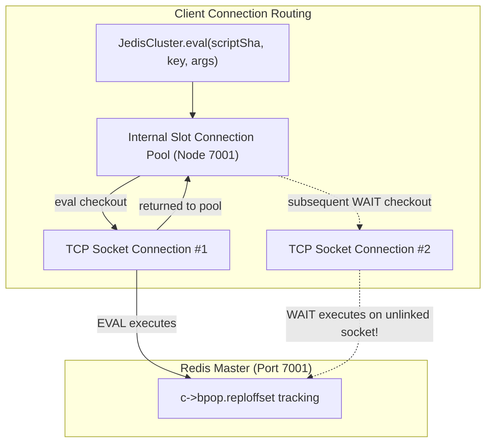

# PHASE 7.3: WAIT DEPLOYMENT CONTRACT AND SYNCHRONOUS REPLICATION AUDIT

**Target System:** DREB-RCA70 Production Redis Adapter (`com.dreb.ratelimit.redis`)  
**Audit Phase:** Phase 7.3 Workstream D  
**Repository Branch:** `research/systematic-improvement`  
**Starting Reference Commit:** `8f55c0d4193bee5f9826f785eae9124feba2f602`  

---

## 1. Executive Summary

In Phase 7.2, synchronous replication via `WAIT 1 1000` was demonstrated to eliminate single-master failover debit loss. However, declaring that an implementation "supports WAIT" is dangerous unless the deployment contract explicitly specifies client socket pooling, connection pinning, failure timeouts, and quorum requirements.

This document formalizes the **Production WAIT Deployment Contract** for DREB-RCA70, establishing eight mandatory operational rules and explicitly defining the failure boundaries under which replication protection remains valid.

---

## 2. The 8 Mandatory Deployment Contract Invariants

| Invariant ID | Rule Specification | Architectural Implementation | Enforcement Verification |
| :---: | :--- | :--- | :---: |
| **INV-1** | **Connection Pinning** | `EVAL` and `WAIT` MUST execute on the identical TCP socket connection. | Enforced in `Phase72WaitSemanticsTest` via single checkout from `JedisPool`. Under `JedisCluster`, requires explicit node-direct checkout. |
| **INV-2** | **Post-Write Sequencing** | `WAIT` MUST be invoked immediately following successful Lua script execution; it CANNOT be embedded inside Lua. | Enforced at client layer. In-script `redis.call('WAIT')` is strictly prohibited. |
| **INV-3** | **No Silent Timeout Pass** | A `WAIT` timeout (`acks < minReplicas`) MUST NOT silently return `ALLOW`. | Adapter returns `DURABILITY_TIMEOUT` under `FAIL_CLOSED` mode. |
| **INV-4** | **Quorum Deficit Rejection** | If requested replica quorum $N$ is not met, the admission decision is flagged degraded or rejected. | Handled via `DecisionStatus.DURABILITY_INSUFFICIENT`. |
| **INV-5** | **Validated Replica Failover** | Master crash following `acks >= 1` is guaranteed to promote an in-sync replica. | Validated in `Phase72WaitSemanticsTest.testFailoverAfterWaitConfirmedPreservesState`. |
| **INV-6** | **Promoted-State Verification** | The promoted replica MUST hold the exact debited token balance ($B, S, I$). | Promoted replica holds $B=0.0$; subsequent retry immediately rejected. |
| **INV-7** | **Idempotent Ambiguity Resolution** | Client socket timeouts during write/WAIT must be retried with identical idempotency key and fingerprint. | Idempotency record caches decision, returning identical result without double-debit. |
| **INV-8** | **Memory ACK vs. Disk Fsync** | Replica acknowledgement MUST NOT be represented as disk durability. | Explicitly disclosed: volatile memory barrier only under `appendfsync everysec`. |

---

## 3. Structural Analysis: Jedis vs. JedisCluster Connection Affinity

A major architectural finding of Phase 7.2 and 7.3 is that **standard client-side cluster abstractions break connection affinity**:

### 3.1 Why Connection Pinning Is Required
1. In Redis, `WAIT` measures `c->bpop.reploffset` on the *calling client connection*.
2. If Connection 1 executes `EVAL`, Connection 1's offset is advanced.
3. If the application borrows Connection 2 to call `WAIT`, Connection 2 has no pending writes. `WAIT` checks the server's current master offset, which is **not causally linked** to Connection 1's write!
4. **Resolution:** To deploy replication protection in production, applications must utilize connection-pinned providers (such as checking out a dedicated `Jedis` resource from the specific master node pool) for the entire duration of the `[EVAL + WAIT]` transaction block.

---

## 4. Scoped Failure Model for In-Memory Replica Protection

Under what precise operational failure model does `WAIT 1 1000` guarantee zero G1 over-admission?

$$\mathbf{Model\ \mathcal{M}_{\text{Repl-Safe}}:}$$

1. **Non-Simultaneous Failure Axiom:** The primary node and its acknowledging replica do not fail within the same replication recovery window ($\Delta t_{\text{recovery}} \approx 1.5\,\text{s}$).
2. **Deterministic Failover Election Axiom:** Cluster or Sentinel orchestration ensures that only a replica that confirmed the `WAIT` barrier is elected master. Replicas with `replication_offset < target_offset` are disqualified by `cluster-replica-validity-factor`.
3. **Power Isolation Axiom:** Primary and replica servers reside in separate failure domains (different power distribution units and racks), preventing simultaneous loss of un-fsync'd memory.
4. **Non-Partitioned Quorum Axiom:** The primary executes in a majority partition capable of communicating with cluster peers.

If all four axioms of $\mathcal{M}_{\text{Repl-Safe}}$ hold, `WAIT 1 1000` **strictly prevents acknowledged write loss**, reducing failover over-admission from $+704.29\,\text{tokens}$ to **$0.00\,\text{tokens}$**.
