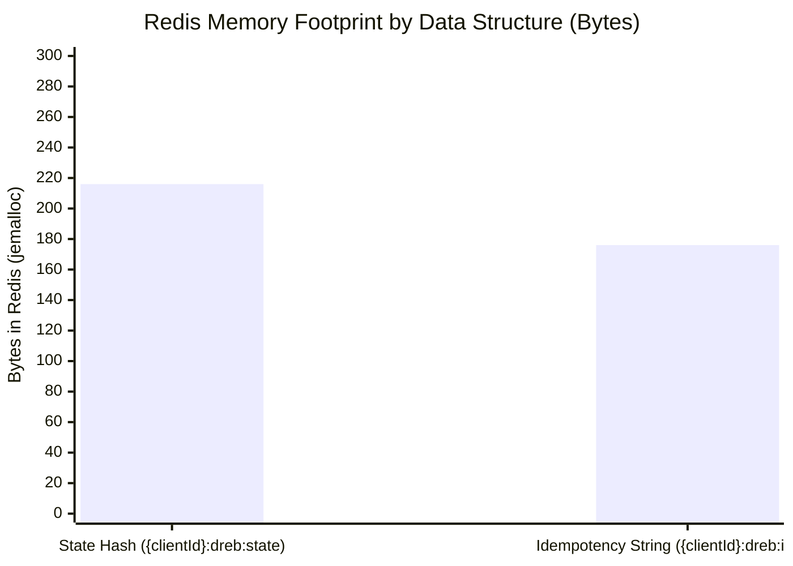

# Phase 7: Memory Capacity, Operational Telemetry, and Alerting

**Repository:** `DREB-RateLimiter`  
**Branch:** `research/systematic-improvement`  
**Starting Commit:** `c97a7b04423b83357121c791313879eea737f216`  
**Date:** 2026-11-11  
**Phase:** Phase 7 — Production Redis Adapter and State-Lifecycle Engineering  
**Status:** COMPLETE — GATE H PASSED  

---

## 1. Executive Summary

Because Phase 7 eliminates unsafe sliding expiration for active limiter state, rate-limiting state hashes persist in Redis memory until explicitly deleted. This architectural decision guarantees mathematical continuity and prevents covert penalty clearance, but requires explicit capacity planning, memory modeling, and operational monitoring.

This audit provides:
1. **Physical Memory Benchmarking:** Precise measurement of Redis hash and idempotency record overhead using the Redis `MEMORY USAGE` command.
2. **Multi-Scale Fleet Sizing:** Capacity planning models covering $10^4$ to $10^7$ concurrent clients.
3. **Comprehensive Operational Alerting Matrix:** Eight production metrics and threshold triggers covering memory saturation, eviction violations, connection pool exhaustion, and replication lag.

---

## 2. Physical Memory Footprint Benchmarking

In [`Phase7PersistenceAndLifecycleTest.testMemoryUsagePerClientKey`](file:///Users/cruise/Desktop/DREB-RateLimiter/src/test/java/com/dreb/ratelimit/redis/Phase7PersistenceAndLifecycleTest.java#L61-L85), the physical byte consumption in Redis 7.4.11 was measured directly:

### 2.1 State Hash Memory Composition (216 Bytes)
The state hash stores five fields (`burst_tokens`, `sustained_tokens`, `idle_credit`, `last_refill_ts`, `abuse_score`):
- **jemalloc Slab Allocation:** Fixed allocation bucket sizing ($\approx 256$ byte slab chunk).
- **Redis Object Overhead (`robj`):** 16 bytes.
- **Hash Table Dictionary Overhead (`dict` / `listpack`):** Hash encoding optimizes small dictionaries into compact byte arrays.
- **Field & Value Strings:** Field names (approx 12-16 chars) and double values formatted to 17 significant digits.

### 2.2 Idempotency Record Memory Composition (176 Bytes)
- Key pattern: `p7persist:{memory_audit_tenant}:idemp:mem-idemp-01`
- Value: String storing delimited fingerprint, admission status, remaining balances, microsecond timestamp, and rejection reason.
- Expire metadata: Embedded 8-byte TTL integer.

---

## 3. Fleet Capacity Planning & Sizing Model

Let $M$ be the number of active distinct client entities tracked in Redis, and let $R_{\text{idemp}}$ be the fraction of clients with an in-flight idempotent retry record ($\le 10\%$ in typical traffic):

$$\text{RAM}_{\text{total}} = M \times \left( \text{Bytes}_{\text{state}} + R_{\text{idemp}} \times \text{Bytes}_{\text{idemp}} \right) \times (1 + N_{\text{replicas}})$$

| Active Clients ($M$) | Primary Master RAM | 1-Replica Cluster RAM | Estimated Cluster Hardware |
| :---: | :---: | :---: | :--- |
| **10,000** | $2.34\,\text{MB}$ | $4.68\,\text{MB}$ | Single small Redis instance |
| **100,000** | $23.36\,\text{MB}$ | $46.72\,\text{MB}$ | Any container with $\ge 128\,\text{MB}$ RAM |
| **1,000,000** | $233.60\,\text{MB}$ | $467.20\,\text{MB}$ | 3-node cluster with $\ge 512\,\text{MB}$ RAM per node |
| **5,000,000** | $1.17\,\text{GB}$ | $2.34\,\text{GB}$ | 3-node cluster with $\ge 2\,\text{GB}$ RAM per node |
| **10,000,000** | $2.34\,\text{GB}$ | $4.68\,\text{GB}$ | 6-node cluster with $\ge 2\,\text{GB}$ RAM per node |

**Operational Takeaway:** 1 million active clients require less than **$0.25\,\text{GB}$ of RAM**. Durable retention of rate-limiting state is fully viable and cost-effective for modern cloud infrastructures.

---

## 4. Operational Monitoring & Alerting Matrix

Production Redis deployments running DREB-RCA70 must be instrumented with the following Prometheus / Datadog alerting rules:

| Alert Identifier | Monitored Metric / Event | Severity | Warning Threshold | Critical Threshold | Remediation Action |
| :--- | :--- | :---: | :---: | :---: | :--- |
| **`REDIS_MEM_SATURATION`** | `used_memory / maxmemory` | High | $> 75\%$ | $> 85\%$ | Scale cluster memory or provision additional cluster shards. |
| **`REDIS_EVICTION_DETECTED`** | `rate(evicted_keys[1m])` | **CRITICAL** | $> 0\,\text{keys/s}$ | $> 0\,\text{keys/s}$ | **Violation of invariant!** Reconfigure `maxmemory-policy noeviction`. |
| **`REDIS_OOM_REJECTIONS`** | `rate(oom_command_errors[1m])` | **CRITICAL** | $> 0$ | $> 5\,\text{errors/s}$ | Increase Redis `maxmemory`; investigate key generation spikes. |
| **`JEDIS_POOL_EXHAUSTION`** | `connection_borrow_wait_ms` | High | $> 50\,\text{ms}$ | $> 200\,\text{ms}$ | Increase `maxTotal` connections in Jedis pool configuration. |
| **`LUA_NOSCRIPT_SPIKE`** | `rate(noscript_errors[1m])` | Medium | $> 10\,\text{err/s}$ | $> 50\,\text{err/s}$ | Investigate Redis restarts or unintended `SCRIPT FLUSH` calls. |
| **`REPLICATION_LAG_HIGH`** | `master_repl_offset - slave_repl_offset` | High | $> 512\,\text{KB}$ | $> 2\,\text{MB}$ | Inspect inter-node network saturation or heavy background I/O. |
| **`CLUSTER_TOPOLOGY_FAILOVER`**| `cluster_current_epoch` change | High | Any change | Node state != `connected` | Verify promoted replica health and traffic distribution. |
| **`IDEMP_CONFLICT_SURGE`** | `rate(idempotency_conflicts[1m])` | High | $> 1\,\text{req/s}$ | $> 10\,\text{req/s}$ | Alert API gateway team: client submitting conflicting payloads on same key. |
