# Phase 7: Production Redis Adapter Architecture & Engineering

**Repository:** `DREB-RateLimiter`  
**Branch:** `research/systematic-improvement`  
**Starting Commit:** `c97a7b04423b83357121c791313879eea737f216`  
**Date:** 2026-11-11  
**Phase:** Phase 7 — Production Redis Adapter and State-Lifecycle Engineering  
**Status:** COMPLETE — GATE A PASSED  

---

## 1. Executive Summary

Phase 7 promotes the validated **DREB-RCA70** distributed algorithm into a production-structured Java library located under `src/main/java/com/dreb/ratelimit/redis/`. This architecture resolves the primary blocker identified in Phase 6.1 (where the Redis limiter existed solely as a test fixture under `src/test/java`).

### Architecture Highlights:
1. **Zero Impact on Baseline Package:** The original baseline implementation under [`com.dreb.ratelimit`](file:///Users/cruise/Desktop/DREB-RateLimiter/src/main/java/com/dreb/ratelimit/) remains 100% frozen and untouched.
2. **Compile-Scope Dependency Management:** In [`pom.xml`](file:///Users/cruise/Desktop/DREB-RateLimiter/pom.xml), `redis.clients:jedis` was promoted from `<scope>test</scope>` to compile scope, making Redis connectivity natively available to production consumers.
3. **Decoupled Architecture:** Connection management, configuration, Lua script execution, state serialization, and rate-limiting decision contracts are partitioned into distinct, single-responsibility components.
4. **Topology Agnostic:** A unified [`RedisConnectionProvider`](file:///Users/cruise/Desktop/DREB-RateLimiter/src/main/java/com/dreb/ratelimit/redis/RedisConnectionProvider.java) interface provides identical rate-limiting semantics over both standalone Redis instances (`JedisPool`) and distributed Redis clusters (`JedisCluster`).
5. **Configurable Infrastructure Failure Semantics:** Fail-closed (secure default) and Fail-open policies are explicitly configurable. Redis outages never result in accidental or unhandled exceptions.

---

## 2. Component Taxonomy & Source Layout

```mermaid
classDiagram
    direction TB
    
    class DistributedRateLimiter {
        <<interface>>
        +tryAcquire(clientId, cost) LimiterDecision
        +tryAcquire(clientId, cost, idempKey) LimiterDecision
        +tryAcquire(clientId, cost, idempKey, fingerprint) LimiterDecision
        +getState(clientId) ClientStateSnapshot
        +resetState(clientId) void
        +isHealthy() boolean
        +close() void
    }

    class ProductionRedisRca70Limiter {
        -RedisConnectionProvider connectionProvider
        -RedisLimiterConfig config
        -String scriptSha
        +tryAcquire(...) LimiterDecision
        +getState(...) ClientStateSnapshot
    }

    class RedisConnectionProvider {
        <<interface>>
        +evalLua(sha, text, keys, args) Object
        +hgetAll(key) Map
        +ttl(key) long
        +del(keys) void
        +ping() boolean
    }

    class StandaloneProvider {
        -JedisPool jedisPool
    }

    class ClusterProvider {
        -JedisCluster jedisCluster
    }

    class RedisLimiterConfig {
        +double burstMax
        +double sustainedMax
        +long activeStateTtlSeconds
        +ColdStartPolicy coldStartPolicy
        +FailureMode failureMode
    }

    class LimiterDecision {
        +DecisionStatus status
        +int cost
        +double burstTokensRemaining
        +double sustainedTokensRemaining
        +double idleCreditRemaining
        +double abuseScore
        +long decisionTimestampMicros
        +boolean isCached
        +String rejectionReason
    }

    DistributedRateLimiter <|.. ProductionRedisRca70Limiter
    ProductionRedisRca70Limiter --> RedisConnectionProvider
    ProductionRedisRca70Limiter --> RedisLimiterConfig
    ProductionRedisRca70Limiter ..> LimiterDecision
    RedisConnectionProvider <|.. StandaloneProvider
    RedisConnectionProvider <|.. ClusterProvider
```



### 2.1 Component Specifications

| Class / Component | Source Path | Architectural Responsibility |
| :--- | :--- | :--- |
| [`DistributedRateLimiter`](file:///Users/cruise/Desktop/DREB-RateLimiter/src/main/java/com/dreb/ratelimit/redis/DistributedRateLimiter.java) | `src/main/java/com/dreb/ratelimit/redis/` | Public application interface providing `tryAcquire`, state query, administrative reset, and health check contracts. |
| [`ProductionRedisRca70Limiter`](file:///Users/cruise/Desktop/DREB-RateLimiter/src/main/java/com/dreb/ratelimit/redis/ProductionRedisRca70Limiter.java) | `src/main/java/com/dreb/ratelimit/redis/` | Core rate-limiting engine. Embeds atomic `RCA70_PRODUCTION_LUA`, coordinates payload fingerprints, and translates Redis outputs into rich decisions. |
| [`RedisLimiterConfig`](file:///Users/cruise/Desktop/DREB-RateLimiter/src/main/java/com/dreb/ratelimit/redis/RedisLimiterConfig.java) | `src/main/java/com/dreb/ratelimit/redis/` | Immutable configuration container for RCA70 parameters, cold-start policy, failure mode, and TTL boundaries. |
| [`RedisConnectionProvider`](file:///Users/cruise/Desktop/DREB-RateLimiter/src/main/java/com/dreb/ratelimit/redis/RedisConnectionProvider.java) | `src/main/java/com/dreb/ratelimit/redis/` | Connection abstraction isolating Jedis pool/cluster mechanics from rate-limiting logic. Includes `Standalone` and `Cluster` implementations. |
| [`LimiterDecision`](file:///Users/cruise/Desktop/DREB-RateLimiter/src/main/java/com/dreb/ratelimit/redis/LimiterDecision.java) | `src/main/java/com/dreb/ratelimit/redis/` | Production decision record containing explicit status (`ALLOW`, `DENY`, `IDEMPOTENCY_CONFLICT`, `INFRASTRUCTURE_ERROR`), exact balances, microsecond timestamp, and rejection reason. |
| [`ClientStateSnapshot`](file:///Users/cruise/Desktop/DREB-RateLimiter/src/main/java/com/dreb/ratelimit/redis/ClientStateSnapshot.java) | `src/main/java/com/dreb/ratelimit/redis/` | Read-only state snapshot representing Redis hash fields (`burst`, `sustained`, `idle`, `abuse`, `lastRefill`, `ttl`). |
| [`ProductionLimiterExample`](file:///Users/cruise/Desktop/DREB-RateLimiter/src/main/java/com/dreb/ratelimit/redis/example/ProductionLimiterExample.java) | `src/main/java/com/dreb/ratelimit/redis/example/` | Reference integration code demonstrating standalone and cluster initialization, dependency injection, and decision handling. |

---

## 3. Infrastructure Error Handling & Failure Policies

In a distributed microservice environment, Redis instances may experience transient network partitions, socket timeouts, master failovers, or pool exhaustion. The adapter provides an explicit `FailureMode` policy:

### 3.1 Policy Definitions
1. **`FailureMode.FAIL_CLOSED` (Default Security Policy):**
   - When a Redis network or command exception occurs, the adapter returns `LimiterDecision.infrastructureError(cost, errorReason, false)`.
   - `decision.isAllowed()` returns **`false`**.
   - `decision.status()` is `INFRASTRUCTURE_ERROR`.
   - Protects downstream services from unbounded traffic surges when the rate limiter is unavailable.
2. **`FailureMode.FAIL_OPEN` (High-Availability Policy):**
   - When Redis is unavailable, the adapter returns `LimiterDecision.infrastructureError(cost, errorReason, true)`.
   - `decision.isAllowed()` returns **`true`**.
   - `decision.status()` is `ALLOW`, with `rejectionReason` containing the captured infrastructure exception for metrics and alerting.
   - Prioritizes service availability over strict traffic shedding during Redis infrastructure outages.

### 3.2 Empirical Validation
In [`Phase7ProductionAdapterTest.testInfrastructureFailurePolicies`](file:///Users/cruise/Desktop/DREB-RateLimiter/src/test/java/com/dreb/ratelimit/redis/Phase7ProductionAdapterTest.java#L161-L188):
- Simulated connection failures against an unreachable host were tested under both policies.
- `FAIL_CLOSED` deterministically rejected requests with `status = INFRASTRUCTURE_ERROR`.
- `FAIL_OPEN` safely admitted requests with `status = ALLOW` while populating error diagnostics.

---

## 4. Lua Script Lifecycle & Atomicity

The production adapter executes `RCA70_PRODUCTION_LUA` inside Redis via SHA-1 digest pre-loading (`EVALSHA`):
1. **Sha1 Computation:** Precomputed using standard Java `MessageDigest.getInstance("SHA-1")`.
2. **NOSCRIPT Resilience:** If Redis flushes scripts (`SCRIPT FLUSH`) or restarts, Jedis catches `JedisNoScriptException`, automatically invokes `SCRIPT LOAD`, and re-executes the transaction transparently.
3. **Cluster Execution:** When targeting Redis Cluster, `evalsha` is executed against the specific node owning the key slot (derived from the `{clientId}` hash tag).

---

## 5. Application Integration Walkthrough

Below is a production example demonstrating how an application constructs, injects, and invokes the adapter:

```java
// 1. Configure Connection Pool
JedisPoolConfig poolConfig = new JedisPoolConfig();
poolConfig.setMaxTotal(32);
poolConfig.setMaxIdle(16);
poolConfig.setMinIdle(4);
JedisPool pool = new JedisPool(poolConfig, "10.0.0.1", 6379, 2000);

// 2. Configure Limiter with Durable State
RedisLimiterConfig config = new RedisLimiterConfig.Builder()
        .activeStateTtlSeconds(0) // No TTL on active state
        .idempotencyTtlSeconds(60) // 60s idempotency horizon
        .coldStartPolicy(ColdStartPolicy.SECURE_CONSERVATIVE)
        .failureMode(FailureMode.FAIL_CLOSED)
        .build();

// 3. Instantiate Limiter
try (DistributedRateLimiter limiter = new ProductionRedisRca70Limiter(
        new RedisConnectionProvider.Standalone(pool), config)) {

    // 4. Evaluate Request with Idempotency Key & Payload Fingerprint
    LimiterDecision decision = limiter.tryAcquire(
            "tenant_user_42", 10, "req-uuid-101", "cost=10;op=charge");

    if (decision.isAllowed()) {
        // Proceed with request processing
    } else if (decision.status() == DecisionStatus.IDEMPOTENCY_CONFLICT) {
        // Reject ambiguous retry with mismatched payload
    } else {
        // Reject rate-limited request
    }
}
```
