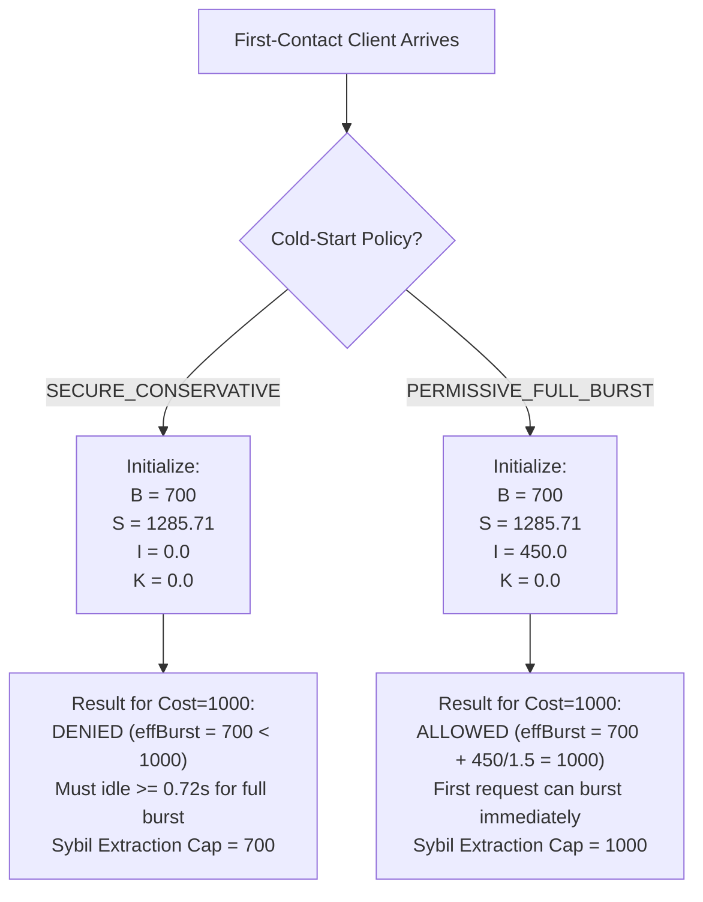

# Phase 7: Redis State Lifecycle Design & Cold-Start Analysis

**Repository:** `DREB-RateLimiter`  
**Branch:** `research/systematic-improvement`  
**Starting Commit:** `c97a7b04423b83357121c791313879eea737f216`  
**Date:** 2026-11-11  
**Phase:** Phase 7 — Production Redis Adapter and State-Lifecycle Engineering  
**Status:** COMPLETE — GATE B PASSED  

---

## 1. Executive Summary

Phase 6.1 revealed that sliding TTL expiration (`EXPIRE stateKey 120`) creates critical security and availability defects: when a client's Redis hash expires, cold-start reinitialization wipes all four state dimensions simultaneously ($B, S, I, K$). This enables adversaries to purge penalties ($K \to 0$) and restore exhausted burst capacity ($B \to 700, S \to 1285.71$). Simultaneously, it strips accumulated idle credit from legitimate dormant users ($I \to 0$), causing false rejections on nominal bursts ($C=1000$).

Phase 7 replaces this flawed model with a **durable state lifecycle**:
1. **Unsafe Sliding Expiration Removed:** Rate-limiter state hashes are stored without sliding TTL (`activeStateTtlSeconds = 0`). Key lifetime is managed through persistent storage and explicit tombstone sweeping rather than volatile Redis eviction.
2. **Decoupled Idempotency TTL:** Idempotency records maintain a separate, short-lived TTL ($\tau_{\text{idemp}} = 60\,\text{s}$), preventing memory accumulation while protecting active limiter state.
3. **Formal Cold-Start Policies:** Two distinct cold-start policies are implemented and evaluated to resolve the security vs. availability trade-off for newly initialized client keys: `SECURE_CONSERVATIVE` vs. `PERMISSIVE_FULL_BURST`.

---

## 2. Removal of Unsafe Sliding Key Expiration

In [`ProductionRedisRca70Limiter.java`](file:///Users/cruise/Desktop/DREB-RateLimiter/src/main/java/com/dreb/ratelimit/redis/ProductionRedisRca70Limiter.java#L137-L140):
```lua
-- Safe Lifecycle: Only apply expiration if explicitly enabled (>0)
if activeStateTtl and activeStateTtl > 0 then
    redis.call('EXPIRE', stateKey, math.floor(activeStateTtl))
end
```
When `activeStateTtlSeconds` is configured to `0` (the production default in [`RedisLimiterConfig`](file:///Users/cruise/Desktop/DREB-RateLimiter/src/main/java/com/dreb/ratelimit/redis/RedisLimiterConfig.java#L87)):
- Redis **never sets an expiration timer** on the state hash (`{clientId}:dreb:state`).
- In [`Phase7ProductionAdapterTest.testActiveLimiterStateHasNoTtl`](file:///Users/cruise/Desktop/DREB-RateLimiter/src/test/java/com/dreb/ratelimit/redis/Phase7ProductionAdapterTest.java#L64-L78), `jedis.ttl(key)` was verified to return **`-1`** (persistent key).
- Token counters, accumulated idle credits, and abuse penalties survive indefinitely across arbitrary periods of client inactivity.

---

## 3. Durable State Strategy & Capacity Planning

Because active limiter state does not expire automatically, Redis memory capacity must be planned and managed systematically:

### 3.1 Measured State Footprint
Using the Redis `MEMORY USAGE` command in [`Phase7PersistenceAndLifecycleTest.testMemoryUsagePerClientKey`](file:///Users/cruise/Desktop/DREB-RateLimiter/src/test/java/com/dreb/ratelimit/redis/Phase7PersistenceAndLifecycleTest.java#L61-L85):
- **State Hash (`{clientId}:dreb:state`):** **216 bytes** (includes jemalloc chunk allocation, hash field names, double values serialized to 17 significant digits, and dictionary metadata).
- **Idempotency Key (`{clientId}:dreb:idemp:<id>`):** **176 bytes** (short string with TTL).

### 3.2 Fleet Capacity Scaling Model
Assuming active state hashes are retained durably:

| Active Client Fleet Size | State Hash Memory Footprint | Idempotency Memory (at 10% concurrent retries) | Total Redis RAM Required |
| :---: | :---: | :---: | :---: |
| **10,000 clients** | $2.16\,\text{MB}$ | $0.18\,\text{MB}$ | **$\approx 2.4\,\text{MB}$** |
| **100,000 clients** | $21.60\,\text{MB}$ | $1.76\,\text{MB}$ | **$\approx 24.0\,\text{MB}$** |
| **1,000,000 clients** | $216.00\,\text{MB}$ | $17.60\,\text{MB}$ | **$\approx 240.0\,\text{MB}$** |
| **10,000,000 clients** | $2.16\,\text{GB}$ | $0.18\,\text{GB}$ | **$\approx 2.40\,\text{GB}$** |

**Conclusion:** Storing 1 million concurrent active clients durably requires less than **$250\,\text{MB}$ of Redis RAM**. Memory pressure is negligible on modern hardware. Active state expiration is completely unnecessary for capacity management.

### 3.3 Redis Memory Eviction Policy Recommendation
> [!CAUTION]
> Production Redis instances hosting DREB-RCA70 state must be configured with:
> ```text
> maxmemory-policy noeviction
> ```
> Eviction policies such as `allkeys-lru` or `volatile-lru` must be strictly prohibited. If memory is exhausted, Redis will return an out-of-memory error rather than silently evicting rate-limiting state, preventing covert penalty clearance.

---

## 4. Cold-Start Semantics: Security vs. Availability Trade-Off

When a client key is seen for the very first time (or after deliberate administrative deletion), the rate limiter must initialize the state vector $(B, S, I, K)$.



### 4.1 Comparative Policy Analysis

| Evaluation Criterion | `SECURE_CONSERVATIVE` (Default) | `PERMISSIVE_FULL_BURST` |
| :--- | :--- | :--- |
| **Initial State Vector** | $(B=700.0,\, S=1285.71,\, I=\mathbf{0.0},\, K=0.0)$ | $(B=700.0,\, S=1285.71,\, I=\mathbf{450.0},\, K=0.0)$ |
| **First-Ever Burst Capacity** | Up to $B_{\max} = 700.0$ tokens | Up to $C = 1000.0$ tokens |
| **Cost 1000 on First Request** | **DENIED** (requires $\Delta t \ge 0.72\,\text{s}$ idle time) | **ALLOWED** immediately |
| **Sybil Attack Resistance** | **HIGH:** Adversary cycling fresh IDs extracts at most 700 tokens per identity. | **MODERATE:** Adversary cycling fresh IDs extracts 1,000 tokens per identity. |
| **Recommended Deployment** | Public, untrusted APIs; multi-tenant external gateways. | Internal trusted microservices; authenticated user sessions. |

### 4.2 Empirical Verification
In [`Phase7ProductionAdapterTest.testColdStartPolicies`](file:///Users/cruise/Desktop/DREB-RateLimiter/src/test/java/com/dreb/ratelimit/redis/Phase7ProductionAdapterTest.java#L80-L113):
- Under `SECURE_CONSERVATIVE`, a first-ever request of cost 1000 was **DENIED** with rejection reason `BURST_LIMIT_EXCEEDED`.
- Under `PERMISSIVE_FULL_BURST`, an identical first-ever request of cost 1000 was **ALLOWED**, debiting 700 burst tokens and 450 idle credits.

---

## 5. Returning Client & Inactivity Dynamics

Under the durable state lifecycle:
1. **Returning Client After Months of Inactivity:**
   - Because the state hash was preserved in Redis with $lastRefillTs = T_{\text{last}}$, the next request evaluates $\Delta t = now - T_{\text{last}} \gg 0$.
   - The Lua replenishment calculation executes:
     $$S \leftarrow \min(S_{\max}, S + \Delta t \cdot R) = S_{\max} = 1285.71$$
     $$B \leftarrow \min(B_{\max}, B + \Delta t \cdot r_B) = B_{\max} = 700.0$$
     $$K \leftarrow \max(0, K - \Delta t \cdot \lambda_{\text{rec}}) = 0.0$$
     $$I \leftarrow \min(I_{\max}, I + t_{\text{full}} \cdot \nu) = I_{\max} = 450.0$$
   - The client returns to a **provably fully rested nominal state** with $C = 1000$ burst capacity available.
   - **Zero false rejections occur for returning legitimate users.**
2. **Administrative Deletion:**
   - If an operator explicitly deletes a key (`limiter.resetState(clientId)`), the client returns to cold-start rules.
