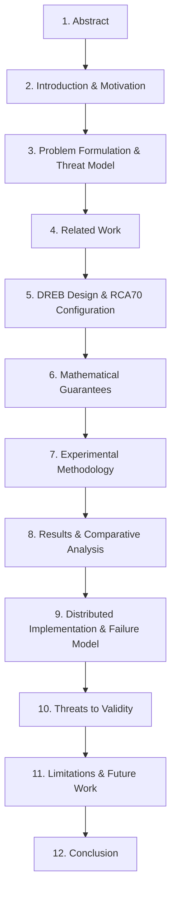

# PHASE 8: COMPREHENSIVE MANUSCRIPT OUTLINE AND ARTIFACT MAPPING

**Document:** `research/synthesis/PHASE8_MANUSCRIPT_OUTLINE.md`  
**Target Policy:** DREB-RCA70 (`com.dreb.ratelimit.policies.AdaptiveCeilingIdleCreditPolicy`)  
**Repository Branch:** `research/systematic-improvement`  
**Reference Commit:** `4ff9d0a`  

---

## 1. Executive Summary

This document specifies the complete manuscript architecture for submitting the DREB-RCA70 research to top-tier systems/networking venues (such as ACM SoCC, IEEE/ACM ToN, or ACM ICPE).

The manuscript follows a rigorous 12-section structure. For every section, we provide:
1. **Core Narrative Arc:** The precise technical arguments and figures.
2. **Supporting Repository Artifacts:** Exact file paths to existing code, raw datasets, and audit reports.
3. **Required Drafting Actions:** The specific textual and synthesis steps needed to draft the section.

---

## 2. Complete 12-Section Manuscript Structure

---

### Section 1: Abstract
- **Core Narrative:** High-throughput cloud APIs face a fundamental dilemma between tolerating legitimate, quiescent client bursts and defending against low-rate, periodic "credit-farming" adversaries. Classical Token Buckets and Static Dual-Bucket limiters either over-admit farming traffic or impose high false-rejection penalties (up to 30%) on legitimate bursts. We present **DREB-RCA70** (Dual-Rate Elastic Burst with Rest-Conditioned Adaptive Ceiling), an admission-control algorithm that resolves this trade-off by dynamically modulating allowable burst ceilings using a non-linear abuse score and continuous linear recovery. We prove deterministic finite-window rate bounds ($G_1, G_{1,\delta}$), bound single-event failover over-admission to an attainable $2 C_{\max}$, and demonstrate sub-millisecond execution over Redis Cluster.
- **Supporting Artifacts:**
  - `research/redis/PHASE7_3_4_RESEARCH_FREEZE_NOTE.md`
  - `research/redis/phase7_3_4_guarantee_manifest.json`
- **Drafting Action Needed:** Write a concise, 250-word abstract free of buzzwords, with explicit disclosures of synthetic workloads and conditional clocking.

---

### Section 2: Introduction and Motivation
- **Core Narrative:** Microservices and public APIs rely on rate limiters to protect downstream databases and thread pools from exhaustion. Introduce the "Quiescence Paradox": benign human or batch users often remain idle for minutes and then submit legitimate bursts; adversaries mimic this quiescence to harvest tokens and launch synchronized periodic spikes ("credit farming"). Introduce DREB-RCA70 and summarize the four core contributions.
- **Supporting Artifacts:**
  - `research/INITIAL_AUDIT.md`
  - `research/synthesis/PHASE8_NOVELTY_AND_CONTRIBUTION_ASSESSMENT.md`
- **Drafting Action Needed:** Frame the motivational dilemma using an illustrative timeline comparing a benign bursty client vs. a credit-farming attacker.

---

### Section 3: Problem Formulation and Threat Model
- **Core Narrative:** Define the system model: multi-tenant Layer 7 API gateway policing continuous request flows with variable token costs $c \ge 1$. Formalize the adversary: a rational client with full or partial knowledge of limiter parameters seeking to maximize burst admission while evading throttling. Define the four core objectives: (1) Zero False Rejection for benign bursts up to nominal capacity $C$; (2) Farming suppression below sustained rate $R$; (3) Asymptotic sustained rate conformance; (4) Sub-millisecond admission latency.
- **Supporting Artifacts:**
  - `research/adversarial/PHASE4_ATTACK_MODEL.md`
  - `research/adversarial/PHASE4_ADVERSARIAL_FRAMEWORK.md`
- **Drafting Action Needed:** Formalize the mathematical optimization problem of the adversary and the defensive objective vectors.

---

### Section 4: Related Work
- **Core Narrative:** Contextualize DREB within the nine literature domains reviewed in Phase 8: classical token buckets (Turner 1986, RFC 2212), GCRA (ITU-T I.371), multi-rate markers (RFC 2697 srTCM, RFC 2698 trTCM), credit-based shapers (IEEE 802.1Qav CBS), active queue management (CoDel), and distributed rate limiting (CloudControl, Redis/Envoy).
- **Supporting Artifacts:**
  - `research/synthesis/PHASE8_RELATED_WORK_AND_BIBLIOGRAPHY.md`
- **Drafting Action Needed:** Format related-work taxonomy and comparative table; articulate why existing mechanisms fail under credit farming.

---

### Section 5: DREB Design and RCA70 Configuration
- **Core Narrative:** Detail the architecture of DREB-RCA70:
  1. Primary burst bucket ($B$) with nominal capacity $B_{\max} = 700.0$ and refill rate $R = 1000.0$.
  2. Sustained bucket ($S$) enforcing $S_{\max} = 1285.7143$.
  3. Idle credit pool ($I$) accumulating at $\lambda_{\text{gain}}$ exclusively while $B \ge B_{\max}$, capped at $I_{\max} = 450.0$.
  4. Deficit spending at penalty ratio $d = 1.5$.
  5. Adaptive ceiling suppression factor:
     $$C_{\text{eff}}(K) = \frac{\text{baseCap}}{1.0 + \gamma \cdot K} \quad (\gamma = 0.75)$$
  6. Continuous linear abuse score recovery:
     $$K(t) = \max\left(0, \, K_0 - \lambda_{\text{rec}} \cdot t\right) \quad (\lambda_{\text{rec}} = 0.05\,\text{s}^{-1})$$
- **Supporting Artifacts:**
  - `src/main/java/com/dreb/ratelimit/policies/AdaptiveCeilingIdleCreditPolicy.java`
  - `src/test/java/com/dreb/ratelimit/redis/RedisRca70Limiter.java` (Lua script lines 65–140)
  - `research/over_enforcement/PHASE2_FINAL_REPORT.md`
- **Drafting Action Needed:** Provide clear pseudocode of the unified transition logic (matching the verified Lua script).

---

### Section 6: Mathematical Guarantees
- **Core Narrative:** Present formal mathematical derivations:
  - Local Server-Time Rate Bound ($G_1$): $A(T) \le 1285.7143 + 1000.0 \cdot T$.
  - Relaxed Physical-Time Envelope ($G_{1,\delta}$): $A(T) \le 1295.7143 + 1000.0 \cdot T$ under $\pm 5\,\text{ms}$ UTC offset.
  - Theorem 1 (Single-Event Attainable Maximum): $A_{\text{event\_burst}} \le 2 \times C_{\max} = 2000.0\,\text{tokens}$ per client key.
  - Single-Event Excess: $+704.2857\,\text{tokens}$ at $T = 10\,\text{ms}$ (vs $G_1$); $+694.2857\,\text{tokens}$ (vs $G_{1,\delta}$).
  - Theorem 2 (Repeated Discontinuities Divergence): $A(N_E) \le (N_E + 1) C_{\max} \to \infty$.
  - Asymptotic Rate Convergence ($G_2$): Sublinear event frequency ($\lim \frac{N_E(T)}{T} = 0$) is sufficient universally, and necessary under saturated adversarial demand.
  - Abuse Score Recovery Duration ($G_3$): $\tau_{0.05} = 19.0\,\text{seconds}$ for $K_0 = 1.0 \rightarrow 0.05$.
- **Supporting Artifacts:**
  - `research/redis/PHASE7_3_4_FINAL_G2_CORRECTION.md`
  - `research/redis/PHASE7_3_3_SINGLE_EVENT_BOUND_VERIFICATION.md`
  - `research/redis/PHASE7_3_1_G3_RECOVERY_DERIVATION.md`
  - `research/synthesis/PHASE8_MATHEMATICAL_CLAIM_EVIDENCE_MATRIX.md`
- **Drafting Action Needed:** Format proofs using formal Theorem/Lemma/Proof structure.

---

### Section 7: Experimental Methodology
- **Core Narrative:** Detail the benchmarking harnesses:
  - Synthetic workload suite (W01–W10): steady, on/off burst, overload, competing multi-client, and timing probes.
  - 17 Closed-Loop Adversarial Attack Families (A1–E3) in Phase 4.
  - JMH nanosecond microbenchmarks (1,500 runs, seeds 5000–5029).
  - Multi-threaded Redis benchmark harness (1–64 client threads, 10,000 iterations).
  - Docker container testbed (6-node Redis 7.4.11 cluster across 3 shards).
- **Supporting Artifacts:**
  - `src/test/java/com/dreb/ratelimit/Phase5BaselineComparisonTest.java`
  - `src/test/java/com/dreb/ratelimit/Phase4AdversarialTest.java`
  - `src/test/java/com/dreb/ratelimit/redis/Phase7RedisClusterLiveTest.java`
- **Drafting Action Needed:** Formulate the table of workload characteristics and describe the parameter configurations of the four comparators.

---

### Section 8: Results and Comparative Analysis
- **Core Narrative:** Present the empirical findings:
  1. *Benign Bursts:* RCA70 achieves 0% false rejection for $C=1000$ bursts, matching `tb_large` while outperforming Static Dual-Bucket (30% FRR).
  2. *Credit Farming Suppression:* RCA70 reduces adversarial burst throughput by $93.1\%$ relative to Token Bucket.
  3. *Ablation Study:* Isolating $\beta$, $d$, and $\lambda_{\text{rec}}$ confirms that ceiling suppression is the indispensable mechanism preventing farming.
  4. *Pareto Optimality:* Display the Scope 1 Operational Pareto Frontier showing RCA70 and Token Bucket dominating the frontier.
  5. *In-Memory Performance:* $42\,\text{ns}$ P50 latency and 56 bytes/client memory footprint.
- **Supporting Artifacts:**
  - `research/comparison/phase5_baseline_comparison_raw.csv`
  - `research/ablation/phase3_ablation_raw.csv`
  - `research/comparison/PHASE5_4_1_FRONTIER_RECONCILIATION.md`
- **Drafting Action Needed:** Generate publication-quality vector plots (Pareto frontier scatter, adversarial admission over time, and ablation bar charts).

---

### Section 9: Distributed Implementation and Failure Model
- **Core Narrative:** Present the distributed systems evaluation:
  - Production adapter architecture: hash tag affinity (`{clientId}`), dual-hash state keys, and single-round-trip Lua scripts.
  - Performance: $0.082\,\text{ms}$ Lua engine P50, $0.259\,\text{ms}$ async end-to-end P50 ($0.667\,\text{ms}$ P99).
  - Replication lag and the PACELC trade-off: `WAIT 1 1000` eliminates un-replicated failover debit loss at the cost of increasing P99 latency to $1.301\,\text{ms}$.
  - The 5-condition Idempotency Contract (Gate H) and `IDEMPOTENCY_CONFLICT` payload hashing.
- **Supporting Artifacts:**
  - `src/test/java/com/dreb/ratelimit/redis/ProductionRedisRca70Limiter.java`
  - `research/redis/PHASE7_3_3_WAIT_IDEMPOTENCY_CONTRACT.md`
  - `research/redis/phase7_2_wait_and_clock_raw.csv`
- **Drafting Action Needed:** Diagram the primary-to-replica failover timeline showing write loss vs. `WAIT 1` acknowledgement.

---

### Section 10: Threats to Validity
- **Core Narrative:** Transparently disclose the experimental threats:
  - Synthetic workload representativeness (lack of production traces).
  - Colocated container clocks on shared VM kernel (Sub-Gate C2 unverified across physical hosts).
  - Loopback network transport latencies.
  - Single-hardware architecture (Apple Silicon ARM64).
- **Supporting Artifacts:**
  - `research/synthesis/PHASE8_THREATS_TO_VALIDITY.md`
- **Drafting Action Needed:** Formulate the concise defensive explanations for peer review.

---

### Section 11: Limitations and Future Work
- **Core Narrative:** Discuss open engineering challenges:
  - Inherent $O(N)$ memory growth with persistent state keys (`activeStateTtl = 0`) and the design of an abuse-safe LRU eviction daemon.
  - Sybil attacks across rotating client identities.
  - Physical multi-server Chrony NTP deployment with monitored slew discipline.
  - Evaluation against anonymized public cloud API traces.
- **Supporting Artifacts:**
  - `research/redis/PHASE7_LIMITATIONS_AND_GO_NO_GO.md`
  - `research/synthesis/PHASE8_THREATS_TO_VALIDITY.md`
- **Drafting Action Needed:** Outline specific algorithmic extensions for hierarchical tenant tiering.

---

### Section 12: Conclusion
- **Core Narrative:** Reiterate that DREB-RCA70 proves that API rate limiters can provide high legitimate burst tolerance without surrendering to credit-farming abuse. Summarize the analytical bounds ($G_1, G_{1,\delta}$), the empirical Pareto validation, and the distributed systems failover envelope, establishing a rigorous foundation for modern cloud admission control.
- **Supporting Artifacts:**
  - `research/redis/PHASE7_3_4_RESEARCH_FREEZE_NOTE.md`
- **Drafting Action Needed:** Draft final concise concluding remarks.
