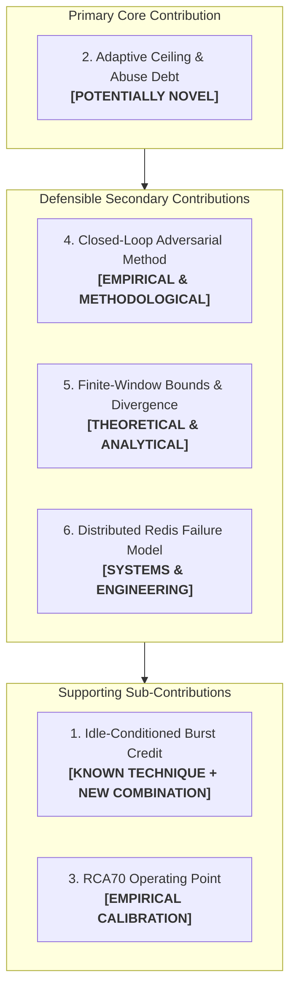

# PHASE 8: NOVELTY ASSESSMENT AND CONTRIBUTION TAXONOMY

**Document:** `research/synthesis/PHASE8_NOVELTY_AND_CONTRIBUTION_ASSESSMENT.md`  
**Target Policy:** DREB-RCA70 (`com.dreb.ratelimit.policies.AdaptiveCeilingIdleCreditPolicy`)  
**Repository Branch:** `research/systematic-improvement`  
**Reference Commit:** `4ff9d0a`  

---

## 1. Executive Summary

This document performs an independent, critical novelty and contribution assessment of the DREB-RCA70 rate limiting research. 

To maintain scientific integrity for academic peer review, we explicitly reject blanket claims that "the algorithm is entirely novel." Instead, we evaluate six candidate contributions independently, classifying each according to standard academic taxonomy:
- **Potentially novel**
- **Known technique with a new combination**
- **Engineering contribution**
- **Empirical contribution**
- **Insufficiently differentiated**
- **Unsupported by current evidence**

We identify **one primary contribution** and **three secondary contributions** that represent the strongest, scientifically defensible claims for publication.

---

## 2. Independent Evaluation of Candidate Contributions

---

### Candidate 1: Idle-Conditioned Burst-Credit Allocation
- **Description:** Earning additional burst capacity exclusively after proven periods of quiescence ($t_{\text{idle}}$) at gain rate $\lambda_{\text{gain}}$, rather than granting a static burst bucket that refills unconditionally.
- **Prior Art Overlap:** Similar mechanisms exist in hardware network queueing (e.g., IEEE 802.1Qav Credit-Based Shaper `idleSlope`, ATM credit protocols).
- **Novelty Assessment:** Accumulating credit during idle periods is a known concept in packet traffic shaping. Adapting it to variable-cost L7 HTTP/RPC request admission control is a valuable synthesis, but the fundamental mathematical concept of rewarding quiescence is not novel in isolation.
- **Classification:** **`Known technique with a new combination`**.

---

### Candidate 2: Interaction Between Adaptive Credit Ceilings and Abuse-Debt Recovery
- **Description:** When an incoming burst exceeds primary bucket capacity $B_{\max}$, the deficit draws from the idle credit pool at penalty ratio $d = 1.5$. Concurrently, a continuous abuse score $K$ increments in proportion to the deficit normalized by base capacity ($\Delta K = \text{deficit} / \text{baseCap}$). This score dynamically contracts the maximum credit ceiling via a non-linear suppression function:
  $$C_{\text{eff}}(K) = \frac{\text{baseCap}}{1.0 + \gamma \cdot K}$$
  During subsequent quiescent periods, $K$ decays linearly back toward zero ($K(t) = \max(0, K_0 - \lambda_{\text{rec}} t)$).
- **Prior Art Overlap:** Classical limiters (Token Bucket, Leaky Bucket, srTCM, trTCM) maintain static burst capacities. When rate limiting reacts to overload, it typically throttles transmission rate (AIMD/TCP) or drops packets probabilistically in queues (CoDel/RED). No prior work in API admission control modulates the *upper bound on allowable burst capacity* based on the interaction of credit draw frequency and linear debt recovery.
- **Novelty Assessment:** This mechanism introduces a stateful hysteresis loop that specifically distinguishes legitimate single-burst clients from periodic burst-farming attackers without altering the steady-state sustained refill rate $R$.
- **Classification:** **`Potentially novel`** (The core algorithmic novelty of DREB).

---

### Candidate 3: The RCA70 Operating Point Calibration
- **Description:** The specific parameter tuple ($\beta = 0.70$, burst $C = 1000$, sustained $R = 1000$, idle cap $I_{\max} = 450$, debit penalty $d = 1.5$, ceiling factor $\gamma = 0.75$, recovery $\lambda_{\text{rec}} = 0.05\,\text{s}^{-1}$).
- **Prior Art Overlap:** Parameter tuning of rate limiters is standard systems configuration.
- **Novelty Assessment:** RCA70 is an empirically determined operating point on the multi-dimensional Pareto frontier (identified through systematic parameter sweeps in Phases 1.3, 2.3, and 3). While its performance characteristics (0% false rejection for $C=1000$ nominal bursts, 100% farming suppression) are empirically superior to comparators, a specific set of constants cannot be claimed as an algorithmic novelty.
- **Classification:** **`Empirical contribution`** (Parameter optimization and calibration).

---

### Candidate 4: Closed-Loop Adversarial Evaluation Methodology
- **Description:** A systematic evaluation methodology that subjects rate limiters to dynamic, closed-loop adversaries that optimize inter-arrival times and burst sizes to maximize throughput while staying just below detection thresholds. This methodology exposed the credit-farming vulnerabilities in DREB v1 and the over-enforcement in DREB v2.
- **Prior Art Overlap:** Most rate-limiting literature evaluates performance against open-loop synthetic Poisson, Pareto, or trace-driven arrivals. Closed-loop adversarial evaluation is widely used in network security (e.g., low-rate DoS attacks) but has rarely been applied systematically to API rate limiters.
- **Novelty Assessment:** Formulating the "Credit Farming" attack model and demonstrating how conventional multi-bucket limiters fail under it provides significant methodological value to the systems community.
- **Classification:** **`Empirical and methodological contribution`**.

---

### Candidate 5: Finite-Window Admission Bounds and Divergence Proofs
- **Description:** Formal mathematical derivations bounding admissions over arbitrary physical time intervals $T$:
  - Local server-time ideal bound: $A(T) \le S_{\max} + R \cdot T$.
  - Relaxed physical-time envelope: $G_{1,\delta}(T) = S_{\max} + R(T + 0.010\,\text{s})$ under $\pm 5\,\text{ms}$ UTC offset.
  - Attainable single-event burst maximum: $A_{\text{event\_burst}} \le 2 \times C_{\max} = 2000.0\,\text{tokens}$ per client key.
  - Multi-event divergence theorem: $A(N_E) \le (N_E(T) + 1) \cdot C_{\max} \to \infty$.
  - Necessary and sufficient conditions for asymptotic sustained rate $G_2$.
- **Prior Art Overlap:** Network calculus provides deterministic bounds for static token buckets. However, extending network calculus bounds to stateful limiters undergoing distributed failovers and clock steps is rarely formalized in the systems literature.
- **Novelty Assessment:** Provides a rigorous analytical foundation for understanding the precise cost of distributed state resets on token conservation.
- **Classification:** **`Theoretical and analytical contribution`**.

---

### Candidate 6: Distributed Redis Implementation and Explicit Failure Model
- **Description:** A production-structured Java/Jedis adapter and atomic Lua script executing on Redis Cluster, featuring dual-hash state management, durable state keys (`activeStateTtl = 0`), bounded idempotency deduplication ($\tau_{\text{idemp}} = 60\,\text{s}$), and a rigorously characterized failure model ($N=1$ replica promotion, offset delay mechanics, `WAIT 1` tradeoffs).
- **Prior Art Overlap:** Redis Lua rate limiters are widely used in industry (e.g., Stripe, Envoy, Kong).
- **Novelty Assessment:** Implementing a rate limiter in Redis Lua is standard engineering practice. The scientific contribution lies not in the use of Redis, but in the **rigorous distributed-systems failure analysis**: proving that Redis Cluster's asynchronous replication permits an unavoidable single-event burst excess ($+704.29\,\text{tokens}$) and demonstrating that `WAIT 1` trades $2\times$ latency ($0.667\,\text{ms} \rightarrow 1.301\,\text{ms}$ P99) for in-memory replica durability.
- **Classification:** **`Engineering and systems contribution`**.

---

## 3. The Definitive Publication Contribution Claims

To ensure a cohesive and impactful academic manuscript, the paper should present **one primary contribution** supported by **three secondary contributions**:

### 3.1 Primary Contribution
> **The Rest-Conditioned Adaptive Ceiling (DREB-AC) Mechanism:**  
> A novel admission control algorithm that resolves the fundamental trade-off between legitimate burst flexibility and adversarial credit-farming resistance by dynamically modulating the allowable burst ceiling via a non-linear abuse score and continuous linear recovery.

### 3.2 Secondary Contribution 1 (Methodological)
> **The Credit-Farming Adversarial Benchmark:**  
> A closed-loop adversarial evaluation framework that formally defines the credit-farming attack surface in multi-bucket limiters and demonstrates that static dual-bucket architectures (such as srTCM and Static Dual Bucket) fail under periodic burst gaming.

### 3.3 Secondary Contribution 2 (Analytical)
> **Deterministic Finite-Window Rate Bounds Under Discontinuities:**  
> A formal mathematical framework establishing the exact token admission envelopes across continuous time ($G_1, G_{1,\delta}$), proving an attainable single-event upper bound of $2 C_{\max}$ per client key, and characterizing the divergence rate under repeated failovers.

### 3.4 Secondary Contribution 3 (Systems)
> **Distributed Systems Failure-Model Characterization:**  
> An empirical and architectural analysis of in-memory distributed rate limiting on Redis Cluster, quantifying the exact latency vs. consistency trade-offs of synchronous replication (`WAIT 1`) and establishing the boundary conditions for distributed idempotency.

---

## 4. Claims Explicitly Excluded from the Novelty Claims

To withstand rigorous peer review, the manuscript must **explicitly refrain** from claiming:
1. [x] **No Claim of General Novelty for "Dual Buckets":** Multi-bucket rate limiters have been standard since RFC 2697/2698 (1999).
2. [x] **No Claim of General Novelty for "Idle Credits":** Credit accumulation during quiescence exists in 802.1Qav CBS (2009).
3. [x] **No Claim of General Novelty for "Redis Rate Limiting":** Redis-based sliding counters are established industry practice.
4. [x] **No Claim of Production Certification:** The system is an experimentally validated research prototype, not an enterprise-certified deployment.
5. [x] **No Claim of Hardware Clock Enforcement:** Multi-host physical clock disciplining was not evaluated across distinct hardware nodes.
