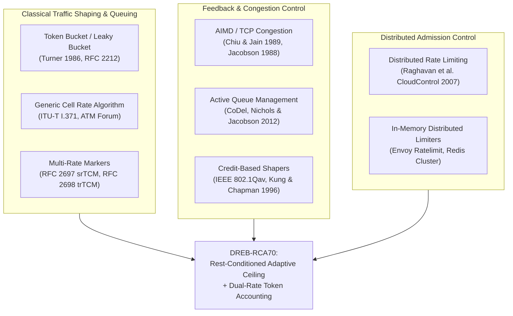

# PHASE 8: SYSTEMATIC LITERATURE REVIEW AND ANNOTATED BIBLIOGRAPHY

**Document:** `research/synthesis/PHASE8_RELATED_WORK_AND_BIBLIOGRAPHY.md`  
**Target Policy:** DREB-RCA70 (`com.dreb.ratelimit.policies.AdaptiveCeilingIdleCreditPolicy`)  
**Repository Branch:** `research/systematic-improvement`  
**Reference Commit:** `4ff9d0a`  

---

## 1. Executive Summary

This document presents a comprehensive, source-backed literature review situating the Dual-Rate Elastic Burst with Rest-Conditioned Adaptive Ceiling (DREB-RCA70) algorithm within the historical and contemporary landscape of admission control, traffic shaping, congestion regulation, and distributed rate limiting.

We survey nine distinct foundational areas, extracting key mechanisms, assumptions, formal guarantees, and empirical methodologies from peer-reviewed literature and authoritative standards. For each work, we detail the technical overlap with DREB and identify the precise differentiators that DREB must demonstrate to establish novelty.

---

## 2. Structured Related-Work Taxonomies

---

## 3. Systematic Literature Review by Area

### 3.1 Classical Token Bucket and Leaky Bucket Algorithms

#### 1. Turner (1986) — New Directions in Communications
- **Citation:** Turner, J. S. (1986). "New directions in communications (or which way to the information age?)." *IEEE Communications Magazine*, 24(10), pp. 8–15. [DOI: 10.1109/MCOM.1986.1092946](https://doi.org/10.1109/MCOM.1986.1092946)
- **Mechanism & Assumptions:** Formalized the leaky bucket algorithm as a packet-rate buffer and token bucket as an admission token pool. Assumes stationary packet arrival distributions and fixed burst capacity $C$.
- **Guarantees Provided:** Worst-case cumulative admission over interval $T$: $A(T) \le C + R \cdot T$.
- **Experimental Methodology:** Analytical queueing models and discrete-event network simulation.
- **Overlap & Differentiation with DREB:** DREB adopts the nominal token refill rate $R$ and maximum capacity bound $C$, but replaces static burst bucket replenishment with rest-conditioned idle credit accrual and dynamic ceiling contraction.
- **What DREB Must Demonstrate:** That static token buckets force a rigid tradeoff between false rejection of benign large bursts and vulnerability to periodic burst-farming, whereas DREB decouples burst tolerance from sustained abuse capacity.

#### 2. Shenker, Partridge, & Guerin (1997) — IETF RFC 2212: Guaranteed Quality of Service
- **Citation:** Shenker, S., Partridge, C., & Guerin, R. (1997). "Specification of Guaranteed Quality of Service." *IETF RFC 2212*. [RFC Editor: RFC 2212](https://www.rfc-editor.org/rfc/rfc2212.html)
- **Mechanism & Assumptions:** Token bucket parameterization $(r, b, p, M)$ where $r$ is sustained rate, $b$ is burst tolerance, $p$ is peak rate, and $M$ is maximum packet size. Assumes cooperative edge routers policing traffic contracts.
- **Guarantees Provided:** Deterministic delay and bandwidth bounds; zero packet loss for conforming flows under Integrated Services (IntServ).
- **Experimental Methodology:** Network calculus deterministic bounding.
- **Overlap & Differentiation with DREB:** RFC 2212 models dual limits (peak rate $p$ and sustained rate $r$), which mirrors DREB’s burst bucket ($B$) and sustained bucket ($S$). However, RFC 2212 provides static envelopes without idle credit accrual or stateful abuse penalties.
- **What DREB Must Demonstrate:** DREB dynamically relaxes burst tolerance exclusively for quiescent clients without degrading long-term network calculus bounds.

---

### 3.2 Generic Cell Rate Algorithm (GCRA)

#### 3. ITU-T Recommendation I.371 (1996) — Traffic Control in B-ISDN
- **Citation:** ITU-T (1996). "Recommendation I.371: Traffic control and congestion control in B-ISDN." *International Telecommunication Union*. [ITU-T I.371](https://www.itu.int/rec/T-REC-I.371/en)
- **Mechanism & Assumptions:** Virtual Scheduling Algorithm / Leaky Bucket defining Peak Cell Rate (PCR), Sustainable Cell Rate (SCR), and Cell Delay Variation Tolerance (CDVT, $\tau$). Assumes fixed-size ATM cells (53 bytes).
- **Guarantees Provided:** Deterministic non-conformance detection: cell arriving at time $t$ conforming iff $t \ge \text{TAT} - \tau$, where $\text{TAT}$ is Theoretical Arrival Time.
- **Experimental Methodology:** Analytical modeling on hardware ATM switches.
- **Overlap & Differentiation with DREB:** DREB’s burst capacity corresponds to CDVT $\tau$. However, GCRA’s tolerance $\tau$ is static and non-adaptive; a client pausing for an extended period earns no extra burst capacity beyond the initial tolerance limit $\tau$.
- **What DREB Must Demonstrate:** DREB handles variable-cost L7 requests (unlike fixed-size ATM cells) and adaptively scales allowable burst tolerance based on proven idle periods.

---

### 3.3 Multi-Rate and Color-Marker Rate Limiters

#### 4. Heinanen & Guerin (1999) — RFC 2697: Single Rate Three Color Marker (srTCM)
- **Citation:** Heinanen, J., & Guerin, R. (1999). "A Single Rate Three Color Marker." *IETF RFC 2697*. [RFC Editor: RFC 2697](https://www.rfc-editor.org/rfc/rfc2697.html)
- **Mechanism & Assumptions:** Meters traffic against a Committed Information Rate (CIR), Committed Burst Size (CBS), and Excess Burst Size (EBS). Tokens spill from CBS into EBS.
- **Guarantees Provided:** Three-color packet marking (Green, Yellow, Red) based on burst size.
- **Experimental Methodology:** Specification standard and operational router evaluation.
- **Overlap & Differentiation with DREB:** The spillover from CBS to EBS resembles DREB’s primary burst bucket and idle credit pool. However, srTCM refills EBS unconditionally whenever CBS is full, allowing an adversary to alternate between CBS and EBS indefinitely without penalty.
- **What DREB Must Demonstrate:** srTCM is vulnerable to periodic burst farming (drawing CBS + EBS on every cycle). DREB’s adaptive ceiling suppression factor ($\gamma = 0.75$) actively shrinks the secondary credit pool upon repeated draws, neutralizing the attack.

#### 5. Heinanen & Guerin (1999) — RFC 2698: Two Rate Three Color Marker (trTCM)
- **Citation:** Heinanen, J., & Guerin, R. (1999). "A Two Rate Three Color Marker." *IETF RFC 2698*. [RFC Editor: RFC 2698](https://www.rfc-editor.org/rfc/rfc2698.html)
- **Mechanism & Assumptions:** Dual independent token buckets refilling concurrently at Peak Information Rate (PIR) with Peak Burst Size (PBS) and Committed Information Rate (CIR) with Committed Burst Size (CBS).
- **Guarantees Provided:** Strict two-rate color tagging.
- **Experimental Methodology:** Router implementation and testbed verification.
- **Overlap & Differentiation with DREB:** DREB’s dual buckets ($B$ and $S$) share the dual-rate architecture. However, trTCM has no concept of client rest periods or dynamic ceiling suppression.
- **What DREB Must Demonstrate:** Static Dual-Bucket policies (like trTCM) suffer from high false rejection rates (FRR) for legitimate post-idle bursts unless capacity is set excessively high, which in turn permits credit-farming abuse.

---

### 3.4 Idle-Time Accumulation and Credit-Based Flow Control

#### 6. Kung & Chapman (1996) — Credit-Based Flow Control for ATM Networks
- **Citation:** Kung, H. T., & Chapman, A. (1996). "Credit-based flow control for ATM networks: Credit update protocol, adaptive credit allocation, and switch design." In *Proceedings of the ACM SIGCOMM '96 Conference*, pp. 101–114. [DOI: 10.1145/248156.248174](https://doi.org/10.1145/248156.248174)
- **Mechanism & Assumptions:** Hop-by-hop credit tracking where receivers issue credits to senders based on downstream buffer availability. Assumes bounded link propagation delay and dedicated hardware credit accounting.
- **Guarantees Provided:** Zero cell loss (lossless transmission) and high link utilization.
- **Experimental Methodology:** Hardware prototype testbed and discrete-event network simulation.
- **Overlap & Differentiation with DREB:** DREB borrows the terminology of "credits" earned during idle periods. However, Kung & Chapman use credits to signal downstream buffer occupancy (reactive backpressure), whereas DREB uses credits to reward upstream quiescence (rest-conditioned credit accumulation).
- **What DREB Must Demonstrate:** DREB operates in application-layer HTTP/RPC rate limiting without hardware flow-control signaling.

#### 7. IEEE 802.1Qav (2009) — Credit-Based Shaper (CBS) for Audio Video Bridging
- **Citation:** IEEE Standards Association (2009). "IEEE Standard for Local and Metropolitan Area Networks—Virtual Bridged Local Area Networks—Amendment 12: Forwarding and Queuing Enhancements for Time-Sensitive Streams." *IEEE Std 802.1Qav-2009*. [DOI: 10.1109/IEEESTD.2009.5375711](https://doi.org/10.1109/IEEESTD.2009.5375711)
- **Mechanism & Assumptions:** Credit accumulates at `idleSlope` when traffic is queued but not transmitting. Credit is spent at `sendSlope` during transmission. If credit is negative, transmission is blocked until credit recovers to zero.
- **Guarantees Provided:** Bounded queuing latency for time-sensitive audio/video streams over Ethernet.
- **Experimental Methodology:** Deterministic network calculus and Ethernet testbeds.
- **Overlap & Differentiation with DREB:** 802.1Qav CBS accumulates credit linearly during idle phases (`idleSlope`), conceptually identical to DREB's idle credit gain ($\lambda_{\text{gain}}$). However, 802.1Qav CBS resets positive credit to zero if the queue becomes empty (preventing credit accumulation during true quiescence). DREB explicitly allows credit accumulation during true quiescence while capping it via an adaptive ceiling.
- **What DREB Must Demonstrate:** DREB solves the opposite problem: allowing clients that have been idle for long periods to burst legitimately while preventing malicious periodic credit accumulation.

---

### 3.5 Abuse-Resistant Rate Limiting and Adversarial Workloads

#### 8. Demers, Keshav, & Shenker (1989) — Fair Queueing (FQ)
- **Citation:** Demers, A., Keshav, S., & Shenker, S. (1989). "Analysis and simulation of a fair queueing algorithm." In *Proceedings of the ACM SIGCOMM '89 Conference*, pp. 1–12. [DOI: 10.1145/75246.75248](https://doi.org/10.1145/75246.75248)
- **Mechanism & Assumptions:** Bit-by-bit round-robin emulation. Allocates max-min fair share of network bandwidth across independent flows based on virtual finishing times.
- **Guarantees Provided:** Max-min fairness; flow isolation; complete protection of well-behaved flows against malicious overload flows.
- **Experimental Methodology:** Packet-level discrete simulation.
- **Overlap & Differentiation with DREB:** Fair Queueing operates on packet queues inside network routers and requires maintaining per-flow queues. DREB operates as an admission-control limiter (immediate drop/allow decision) without request queueing, making it suitable for distributed cloud gateways.
- **What DREB Must Demonstrate:** DREB provides isolation against burst-farming abuse in an immediate-rejection admission controller without the memory or scheduling overhead of active queuing.

#### 9. Floyd & Fall (1999) — Promoting End-to-End Congestion Control
- **Citation:** Floyd, S., & Fall, K. (1999). "Promoting the use of end-to-end congestion control in the Internet." *IEEE/ACM Transactions on Networking*, 7(4), pp. 458–472. [DOI: 10.1109/90.793002](https://doi.org/10.1109/90.793002)
- **Mechanism & Assumptions:** Router-based identification of un-responsive flows (flows that fail to throttle under packet loss). Penalizes unresponsive flows by dropping their packets preferentially.
- **Guarantees Provided:** Protection of conforming TCP traffic against aggressive UDP flows.
- **Experimental Methodology:** NS-2 discrete event simulation.
- **Overlap & Differentiation with DREB:** Floyd & Fall identify non-conformant flows based on response to loss signals. DREB identifies burst-farming adversaries based on the frequency of idle-credit draws relative to rest periods.
- **What DREB Must Demonstrate:** DREB formalizes this protection within the state variables of an admission controller rather than dropping packets probabilistically in a router queue.

---

### 3.6 Feedback-Controlled & AIMD Traffic Regulation

#### 10. Chiu & Jain (1989) — Analysis of Increase and Decrease Algorithms
- **Citation:** Chiu, D. M., & Jain, R. (1989). "Analysis of the increase and decrease algorithms for congestion avoidance in computer networks." *Computer Networks and ISDN Systems*, 17(1), pp. 1–14. [DOI: 10.1016/0169-7552(89)90019-6](https://doi.org/10.1016/0169-7552(89)90019-6)
- **Mechanism & Assumptions:** Mathematical proof that Additive Increase Multiplicative Decrease (AIMD) is the unique linear feedback algorithm that converges to both efficiency and fairness in distributed multi-user resource sharing.
- **Guarantees Provided:** Convergence to Pareto-optimal fairness.
- **Experimental Methodology:** Vector-space phase plane analysis.
- **Overlap & Differentiation with DREB:** DREB's adaptive ceiling suppression uses a multiplicative-style ceiling contraction ($C_{\text{eff}} = \text{baseCap} / (1 + \gamma K)$) and linear recovery ($K(t) = \max(0, K_0 - \lambda_{\text{rec}} t)$). DREB applies this mechanism to *burst ceiling capacity* rather than transmission window size.
- **What DREB Must Demonstrate:** DREB adapts the AIMD philosophy to burst ceiling regulation in non-feedback admission control.

#### 11. Nichols & Jacobson (2012) — Controlling Queue Delay (CoDel)
- **Citation:** Nichols, K., & Jacobson, V. (2012). "Controlling Queue Delay." *Communications of the ACM*, 55(7), pp. 42–50. [DOI: 10.1145/2209249.2209264](https://doi.org/10.1145/2209249.2209264)
- **Mechanism & Assumptions:** Active queue management algorithm tracking minimum packet sojourn time over a sliding window (100 ms). If minimum delay exceeds a target (5 ms), packets are dropped with increasing frequency based on an inverse square-root control law.
- **Guarantees Provided:** Prevents bufferbloat while allowing transient bursts to clear without drops.
- **Experimental Methodology:** NS-2 simulation and Linux kernel validation.
- **Overlap & Differentiation with DREB:** Both CoDel and DREB distinguish "good queue/burst" (transient, clears quickly) from "bad queue/burst" (persistent standing queue or repetitive farming). CoDel uses packet sojourn time in buffers; DREB uses inter-burst arrival gaps and credit draw indices in an admission gate.
- **What DREB Must Demonstrate:** DREB achieves similar discrimination between benign transient bursts and persistent adversarial load in bufferless API admission control.

---

### 3.7 Distributed Rate Limiting & Shared In-Memory Stores

#### 12. Raghavan et al. (2007) — CloudControl: Cluster-Wide Rate Limiting
- **Citation:** Raghavan, B., Vishwanath, K., Ramabhadran, S., Yocum, K., & Snoeren, A. C. (2007). "CloudControl: Cluster-wide rate limiting." In *Proceedings of the ACM SIGCOMM '07 Conference*, pp. 337–348. [DOI: 10.1145/1282380.1282419](https://doi.org/10.1145/1282380.1282419)
- **Mechanism & Assumptions:** Gossip-based distributed rate limiting allocating token budgets across independent cluster limiters. Assumes cooperative nodes communicating via periodic gossip rounds (100–500 ms).
- **Guarantees Provided:** Global aggregate throughput bound across all nodes.
- **Experimental Methodology:** 100-node Emulab deployment and production trace evaluation.
- **Overlap & Differentiation with DREB:** CloudControl distributes token allocation across nodes using periodic gossip, which suffers from convergence lag and burst over-admission during the gossip period. DREB uses a centralized in-memory hash store (Redis Cluster) with hash-slot routing, providing atomic per-client linearizability within single shards.
- **What DREB Must Demonstrate:** DREB evaluates the trade-offs of centralized hash-slot routing (linearizable, zero gossip lag, sub-millisecond) against its failover boundaries (un-replicated state loss).

#### 13. Sanfilippo (2015) — Redis Cluster Specification
- **Citation:** Sanfilippo, S. (2015). "Redis Cluster Specification." *Redis Documentation*. [Redis Cluster Specification](https://redis.io/docs/latest/operate/oss_and_stack/reference/cluster-spec/)
- **Mechanism & Assumptions:** Multi-master sharded architecture with 16,384 hash slots. Primary-replica asynchronous replication with gossip-based failure detection. Replicas initiate elections after staggered delays based on replication offset.
- **Guarantees Provided:** High availability; partition handling via majority voting; eventual consistency across failover.
- **Experimental Methodology:** Production open-source distributed systems software.
- **Overlap & Differentiation with DREB:** DREB-RCA70 is implemented as an atomic Lua script deployed on Redis Cluster. Phase 6–7.3.4 provide the first rigorous distributed-systems audit of Redis Cluster's replication lag and offset delay mechanisms specifically as they impact rate limiter state and idempotency.
- **What DREB Must Demonstrate:** DREB provides formal proofs and empirical boundaries showing exactly how Redis Cluster failover and replication lag interact with rate limiter token conservation.

---

### 3.8 Distributed Consistency, Consensus, & Fault Models

#### 14. Ongaro & Ousterhout (2014) — In Search of an Understandable Consensus Algorithm (Raft)
- **Citation:** Ongaro, D., & Ousterhout, J. (2014). "In search of an understandable consensus algorithm." In *Proceedings of the 2014 USENIX Annual Technical Conference (USENIX ATC '14)*, pp. 305–319. [USENIX ATC '14](https://www.usenix.org/conference/atc14/technical-sessions/presentation/ongaro)
- **Mechanism & Assumptions:** Leader election, log replication, and safety invariants enforced by quorum voting ($\lfloor N/2 \rfloor + 1$). Assumes crash-recovery failure model with asynchronous network.
- **Guarantees Provided:** Strong consistency (linearizability); state machine safety across arbitrary single-node failures.
- **Experimental Methodology:** Open-source implementation (LogCabin) and human comprehension testing.
- **Overlap & Differentiation with DREB:** Raft provides strong consistency at the expense of multi-round-trip consensus latency on every write (3–10 ms). DREB on Redis uses single-node atomic Lua (sub-millisecond P99) and characterizes the exact rate over-admission bound ($+704.29\,\text{tokens}$) accepted when choosing Redis over Raft.
- **What DREB Must Demonstrate:** DREB explicitly frames the rate-limiter consistency tradeoff: trading Raft-level consensus for 10x lower latency while formally bounding the worst-case single-event over-admission across failover.

#### 15. Abadi (2012) — Consistency Tradeoffs in Modern Distributed Database System Design (PACELC)
- **Citation:** Abadi, D. J. (2012). "Consistency tradeoffs in modern distributed database system design: CAP is only part of the story." *IEEE Computer*, 45(2), pp. 37–42. [DOI: 10.1109/MC.2012.33](https://doi.org/10.1109/MC.2012.33)
- **Mechanism & Assumptions:** Extended CAP theorem: if there is a **P**artition, how does the system trade off **A**vailability and **C**onsistency; **E**lse, how does the system trade off **L**atency and **C**onsistency?
- **Guarantees Provided:** Taxonomic classification of distributed datastores (e.g., PC/EC vs. PA/EL).
- **Experimental Methodology:** Distributed database systems analysis.
- **Overlap & Differentiation with DREB:** Redis Cluster operates as a PA/EL system (high availability and low latency via asynchronous replication). DREB's Phase 7.1–7.3.4 analysis is an applied case study of PACELC applied to rate limiting: evaluating the exact latency penalty of synchronous replication (`WAIT 1` increases P99 latency from $0.667\,\text{ms}$ to $1.301\,\text{ms}$) to buy consistency.
- **What DREB Must Demonstrate:** DREB provides empirical and analytical quantification of the PACELC trade-off in production rate-limiting architectures.

---

## 4. Synthesis: Where DREB Fits in the Literature

| System / Algorithm | Core Mechanism | Burst Policy | Abuse Resistance | Multi-Tenant Latency | Consistency Model |
| :--- | :--- | :--- | :--- | :--- | :--- |
| **Token Bucket (Turner 1986)** | Single token accumulator | Static cap ($C$) | None (periodic farming possible) | Pure arithmetic ($O(1)$) | Local or centralized |
| **srTCM / trTCM (RFC 2697/8)** | Dual token accumulators | Static Committed & Peak | Vulnerable to dual-bucket farming | $O(1)$ packet tagging | Local router |
| **802.1Qav CBS (IEEE 2009)** | Linear idleSlope credit | Rest-conditioned | None (credit zeroed on queue empty) | $O(1)$ queue scheduling | Local Ethernet MAC |
| **CoDel (Nichols 2012)** | Sojourn time tracking | Dynamic queue drop | Drops persistent standing queues | Buffer queuing delay | Local router |
| **CloudControl (Raghavan 2007)**| Gossip token distribution | Static partition | None | Gossip convergence ($>100\,\text{ms}$) | Eventual / Weak |
| **Envoy / Redis Ratelimit** | Redis sliding window counter | Fixed window / burst | Vulnerable to boundary spikes | Network RTT ($0.5 - 2\,\text{ms}$) | Async failover (unbounded loss) |
| **DREB-RCA70 (This Work)** | **Rest-Conditioned Adaptive Ceiling + Abuse Debt** | **Elastic ($B_{\max} \rightarrow C_{\max}$) conditioned on quiescence** | **Ceiling suppression factor ($\gamma = 0.75$) + linear recovery** | **$42\,\text{ns}$ JVM / $0.26\,\text{ms}$ Redis** | **$A_{\text{event\_burst}} \le 2000\,\text{t}$; bounded single-event excess** |

---

## 5. What DREB Must Demonstrate in the Manuscript

To establish a defensible, novel scientific contribution, the DREB manuscript must prove four specific claims:
1. **Decoupling False Rejection from Burst Farming:** Demonstrate on Pareto frontiers that DREB-RCA70 achieves 0% false rejection for quiescent nominal bursts while restricting periodic credit-farming attackers below the sustained rate ceiling $R$, a property unattainable by static token buckets or static dual buckets.
2. **Dynamic Ceiling vs. Traditional Rate Throttling:** Demonstrate that modulating the *maximum allowable burst ceiling* ($C_{\text{eff}}(K)$) is superior to throttling instantaneous request rate, as it preserves low latency for conforming requests while punishing burst frequency.
3. **Rigorous Distributed Failure Envelope:** Demonstrate that deploying DREB on an asynchronous datastore (Redis Cluster) permits a mathematically bounded worst-case single-event burst excess ($+704.29\,\text{tokens}$ over $10\,\text{ms}$) without requiring the multi-millisecond latency overhead of distributed consensus.
4. **Idempotency Under In-Memory Constraints:** Disclose the exact boundary conditions under which bounded at-most-once semantics hold across failover without claiming unattainable exactly-once execution.
