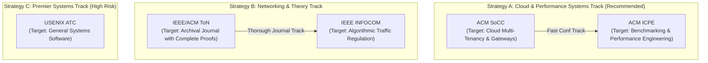

# PHASE 8: SUBMISSION VENUE ASSESSMENT AND COMPARATIVE ANALYSIS

**Document:** `research/synthesis/PHASE8_SUBMISSION_VENUE_COMPARISON.md`  
**Target Policy:** DREB-RCA70 (`com.dreb.ratelimit.policies.AdaptiveCeilingIdleCreditPolicy`)  
**Repository Branch:** `research/systematic-improvement`  
**Reference Commit:** `4ff9d0a`  

---

## 1. Executive Summary

This document performs a systematic, realistic submission-venue assessment for the DREB-RCA70 research. 

Rather than chasing generic prestige, we evaluate candidate venues against the specific evidentiary profile of DREB:
- **Strongest Assets:** Mathematical finite-window proofs ($G_1, G_{1,\delta}, G_2$), closed-loop adversarial evaluation against credit farming, 5,300+ empirical benchmark runs across 10 workloads, nanosecond JMH execution, and detailed Redis distributed failure-model characterization.
- **Key Limitations:** Evaluated on synthetic workloads (no production traces); multi-host clock synchronization (Sub-Gate C2) not demonstrated on physical hardware; single-event failover excess ($+704.29\,\text{tokens}$).

We identify and compare six premier candidate venues, providing official submission specifications, review models, acceptance risks, and a ranked strategic roadmap distinguishing realistic primary targets from ambitious alternatives.

---

## 2. Comparative Matrix of Candidate Submission Venues

| Venue Name | Publisher / Society | Tier / Area | Review Model | Page Limit (Main Text) | Primary Scope Relevance | Fit Rating | Acceptance Risk |
| :--- | :--- | :--- | :--- | :--- | :--- | :---: | :--- |
| **ACM SoCC** | ACM (SIGMOD / SIGOPS) | Top-Tier Cloud Systems | Double-Blind | 12 pages (excl. refs) | Cloud multi-tenancy, API gateways, microservice admission control | **STRONG** | Moderate (reviewers may request production cloud traces). |
| **IEEE/ACM ToN** | IEEE / ACM SIGCOMM | Premier Archival Journal | Single-Blind | 14 pages (double-column) | Traffic shaping, admission control, network calculus, rate bounds | **STRONG** | Low-to-Moderate (long 6–9 month review turnaround). |
| **ACM ICPE** | ACM / SPEC | Top Performance Engineering | Double-Blind | 12 pages (ACM format) | Benchmarking methodology, microbenchmarks, Pareto analysis, latency | **STRONG (Realistic Target)** | Low (ideal fit for experimental benchmarking and microbenchmarks). |
| **IEEE INFOCOM** | IEEE Communications Society | Premier Networking | Double-Blind | 10 pages (incl. refs) | Traffic regulation, adversarial flows, congestion and burst control | **MODERATE** | High (~19% acceptance; heavy emphasis on theoretical novelty). |
| **USENIX ATC** | USENIX Association | Premier Computer Systems | Double-Blind | 12 pages (excl. refs) | Practical operating systems, distributed datastores, cloud runtime | **MODERATE (Ambitious)** | High (~16% acceptance; reviewers favor production deployments). |
| **ACM EuroSys** | ACM SIGOPS | Premier European Systems | Double-Blind | 12 pages (excl. refs) | Distributed systems, cloud infrastructure, virtualization | **MODERATE (Ambitious)** | High (~15% acceptance; high bar for full system integration). |

---

## 3. Deep-Dive Venue Assessments

---

### Venue 1: ACM Symposium on Cloud Computing (ACM SoCC)
- **Official Name:** ACM Symposium on Cloud Computing (ACM SoCC)
- **Publisher:** Association for Computing Machinery (ACM), sponsored jointly by SIGMOD and SIGOPS.
- **Scope & Relevance to DREB:** SoCC brings together systems and data management researchers focusing on cloud computing. DREB-RCA70 is positioned directly at the intersection of cloud multi-tenancy, API gateway admission control, and in-memory distributed state management (Redis).
- **Recent Comparable Topics:** Papers on serverless rate limiting, microservice overload control, multi-tenant fairness, and Redis/Memcached performance.
- **Submission Requirements:** 12 pages of technical content (including figures, tables), excluding references. Standard ACM double-blind format.
- **Fit Assessment:** **`STRONG`**. The cloud gateway problem formulation and distributed Redis implementation directly align with SoCC's core audience.
- **Acceptance Risk:** Reviewers may ask: *"Why was this tested only on synthetic workloads instead of real AWS/GCP production traces?"*  
  *Mitigation:* Emphasize the closed-loop adversarial attack framework, which deliberately subjects the limiter to boundary conditions that benign production traces rarely expose.

---

### Venue 2: IEEE/ACM Transactions on Networking (ToN)
- **Official Name:** IEEE/ACM Transactions on Networking (ToN)
- **Publisher:** Jointly published by IEEE Communications Society, IEEE Computer Society, and ACM SIGCOMM.
- **Scope & Relevance to DREB:** The premier archival journal for networking algorithms, traffic shaping, flow control, and rate regulation. DREB's formal mathematical proofs ($G_1, G_{1,\delta}$, single-event $2C_{\max}$ bound, and asymptotic G2 limits) match ToN's high bar for theoretical completeness.
- **Recent Comparable Topics:** Dual-rate token bucket analysis, network calculus bounds, credit-based shaping in AVB/TSN, and DDoS mitigation.
- **Submission Requirements:** Up to 14 double-column pages in standard IEEE Transactions format. Single-blind review. Can include extensive technical appendices.
- **Fit Assessment:** **`STRONG`**. The journal format provides the necessary space to include full proofs, all 10 workload definitions, and complete ablation matrices without severe conference page truncation.
- **Acceptance Risk:** Long turnaround cycle (typical 6–9 months to first decision). Reviewers may demand continuous-time fluid queueing models or multi-hop network simulations.  
  *Mitigation:* Highlight that DREB is designed for L7 admission control at API gateways rather than packet-level multi-hop router queues.

---

### Venue 3: ACM/SPEC International Conference on Performance Engineering (ICPE)
- **Official Name:** ACM/SPEC International Conference on Performance Engineering (ICPE)
- **Publisher:** ACM, co-sponsored by SPEC (Standard Performance Evaluation Corporation).
- **Scope & Relevance to DREB:** Focused on the performance engineering of software systems, rigorous benchmarking methodologies, measurement artifacts, and Pareto optimization. DREB's extensive JMH nanosecond microbenchmarks, 5,300+ empirical runs, and reproducible artifact repository make it an outstanding candidate.
- **Recent Comparable Topics:** Cloud benchmark design, API gateway latency characterization, multi-objective Pareto optimization, and Redis concurrency analysis.
- **Submission Requirements:** 12 pages main text (ACM double-blind format). Artifact evaluation badge available.
- **Fit Assessment:** **`STRONG (Realistic Primary Target)`**. ICPE values rigorous measurement methodology, open artifacts, and reproducible performance claims above industrial deployment scale.
- **Acceptance Risk:** **Low**. The paper's empirical methodology is rock-solid. The primary risk is reviewers perceiving the contribution as domain-specific (rate limiting only).

---

### Venue 4: IEEE INFOCOM
- **Official Name:** IEEE International Conference on Computer Communications (INFOCOM)
- **Publisher:** IEEE Communications Society.
- **Scope & Relevance to DREB:** Top-tier networking conference covering protocol design, traffic control, security, and algorithmic admission control.
- **Recent Comparable Topics:** Low-rate DDoS mitigation, token bucket variations, flow policing, and credit-based flow control.
- **Submission Requirements:** 10 pages maximum (including references and appendices) in 10-point IEEE double-column format. Strict double-blind review.
- **Fit Assessment:** **`MODERATE`**. The algorithmic contribution (DREB-AC) and adversarial credit-farming models fit INFOCOM well.
- **Acceptance Risk:** **High**. INFOCOM is notoriously competitive (~19% acceptance rate) and heavily favors complex theoretical/algorithmic novelty (e.g., Lyapunov optimization, game theory, or deep network calculus proofs). Reviewers might view DREB as "applied systems engineering" rather than core networking theory.

---

### Venue 5: USENIX Annual Technical Conference (USENIX ATC)
- **Official Name:** USENIX Annual Technical Conference (USENIX ATC)
- **Publisher:** USENIX Association.
- **Scope & Relevance to DREB:** Premier broad-scope systems conference emphasizing practical, working systems software, kernel mechanisms, cloud infrastructure, and distributed storage.
- **Recent Comparable Topics:** In-memory caching, distributed coordination, cloud gateway optimizations, and lock-free data structures.
- **Submission Requirements:** 12 pages of technical content, excluding references. Double-blind review. Heavy emphasis on open-source artifact evaluation.
- **Fit Assessment:** **`MODERATE (Ambitious Target)`**.
- **Acceptance Risk:** **High**. USENIX ATC reviewers strongly favor full-scale production deployments (e.g., deployed at a major tech company serving billions of requests) or fundamental changes to OS/hardware primitives. A synthetic-workload evaluation of a rate limiter on Redis would likely receive pushback regarding deployment scale and lack of production telemetry.

---

## 4. Strategic Ranking and Recommendation

| Rank | Venue | Role in Submission Strategy | Primary Rationale |
| :---: | :--- | :--- | :--- |
| **1** | **ACM SoCC** | **Primary Conference Target** | Perfect thematic balance: values cloud multi-tenant problem formulation, in-memory distributed systems evaluation, and security/adversarial analysis. |
| **2** | **IEEE/ACM ToN** | **Primary Journal Alternative** | Optimal archival venue: provides sufficient page budget to present the full mathematical proofs, failure model matrices, and comprehensive raw datasets. |
| **3** | **ACM ICPE** | **Realistic Safe Conference Target** | Highest probability of acceptance: values DREB's 5,300-run benchmarking rigor, nanosecond JMH analysis, and multi-dimensional Pareto optimization. |
| **4** | **IEEE INFOCOM** | **Competitive Networking Target** | High-prestige networking venue if the manuscript emphasizes algorithmic traffic shaping and closed-loop adversary modeling over systems implementation. |
| **5** | **USENIX ATC** | **Ambitious Systems Reach** | High-risk reach venue; recommended only if production traffic traces from an enterprise partner can be incorporated prior to submission. |

### Strategic Recommendation:
1. **Target ACM SoCC** as the primary conference submission, positioning DREB as an admission-control primitive for multi-tenant cloud gateways.
2. If the authors prefer an archival journal without page constraints, **submit directly to IEEE/ACM Transactions on Networking (ToN)**.
3. If an immediate, high-certainty conference publication is desired, **submit to ACM ICPE**.
