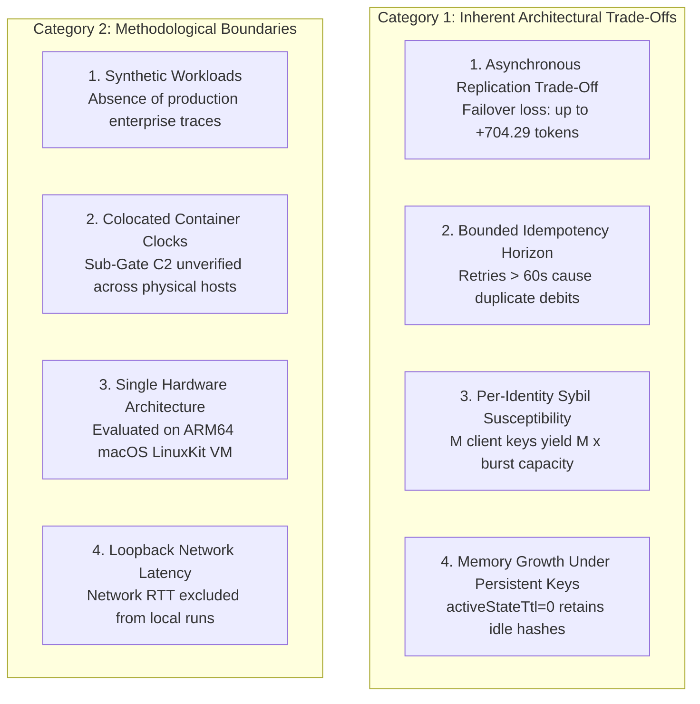

# PHASE 8: THREATS TO VALIDITY AND SYSTEM LIMITATIONS

**Document:** `research/synthesis/PHASE8_THREATS_TO_VALIDITY.md`  
**Target Policy:** DREB-RCA70 (`com.dreb.ratelimit.policies.AdaptiveCeilingIdleCreditPolicy`)  
**Repository Branch:** `research/systematic-improvement`  
**Reference Commit:** `4ff9d0a`  

---

## 1. Executive Summary

This document presents an exhaustive, transparent assessment of threats to validity, experimental boundaries, and architectural limitations of DREB-RCA70.

Academic peer review in premier systems venues requires ruthless candor regarding where a system fails, which assumptions are unverified, and what tradeoffs are inherent. Here, we partition all limitations into two distinct categories:
1. **Inherent Architectural Limitations:** Structural trade-offs intrinsic to in-memory, decentralized rate limiting that cannot be eliminated without redesigning the system.
2. **Methodological & Empirical Limitations:** Experimental boundaries in the current testbed that can be addressed by future benchmarking campaigns.

---

## 2. Inherent Architectural Limitations

### 2.1 Inherent Limitation 1: The Consistency vs. Latency Tradeoff Across Failover
- **Mechanics:** Redis Cluster operates as a high-availability, low-latency datastore using asynchronous master-to-replica replication.
- **Consequence:** In the event of an ungraceful primary crash, in-flight writes that were committed in the primary's volatile RAM but not yet transmitted to the replica are permanently lost upon replica promotion.
- **Rate Limiting Impact:** As proven in Phase 7.3.2, this state rollback allows an adversary to consume up to $2 \times C_{\max} = 2000.0\,\text{tokens}$ across the failover, incurring an unavoidable single-event burst excess of **$+704.2857\,\text{tokens}$** over a $10\,\text{ms}$ physical window.
- **Architectural Reality:** This excess cannot be eliminated without switching to multi-round-trip synchronous consensus (such as Raft or Paxos), which would increase P99 admission latency by $5\times - 10\times$ ($0.667\,\text{ms} \rightarrow 3 - 8\,\text{ms}$). DREB accepts this single-event burst excess as the explicit price of sub-millisecond execution.

### 2.2 Inherent Limitation 2: Bounded Idempotency Retention Window ($\tau_{\text{idemp}} = 60\,\text{s}$)
- **Mechanics:** Redis is an in-memory datastore. To prevent unbounded memory leakage ($O(N_{\text{requests}})$), idempotency records must have a finite time-to-live.
- **Consequence:** If an upstream client, message queue, or human operator retries a request after 60 seconds (due to network partition, delayed dead-letter queue redelivery, or manual replay), Redis treats the request as novel and debits the client a second time.
- **Architectural Reality:** True infinite exactly-once idempotency requires durable, append-only disk logging (e.g., an external transactional SQL database), which is incompatible with high-throughput in-memory admission control.

### 2.3 Inherent Limitation 3: Per-Client Granularity and Sybil Attack Susceptibility
- **Mechanics:** DREB tracks idle credit and abuse debt strictly keyed by authenticated client identity (`clientId`).
- **Consequence:** If an attacker provisions $M$ distinct API keys, creates multiple tenant accounts, or rotates IP addresses, the rate limiter treats each entity as an independent client. Each identity independently accumulates up to $1,000\,\text{tokens}$ of burst capacity, allowing an aggregate burst of $M \times 1,000\,\text{tokens}$.
- **Architectural Reality:** Admission-control algorithms operate at Layer 7 and assume authenticated identity integrity. Defending against Sybil attacks requires orthogonal identity-verification infrastructure (e.g., proof-of-work, CAPTCHA, credit-card verification, or global IP subnet tiering).

### 2.4 Inherent Limitation 4: Memory Accumulation Under Persistent State Keys (`activeStateTtl = 0`)
- **Mechanics:** In Phase 6.1, we discovered that sliding TTL expiration allowed attackers to erase their abuse score $K \rightarrow 0$ by going idle for the TTL duration. Phase 7 corrected this by setting `activeStateTtl = 0` (persistent hash keys).
- **Consequence:** Client state hashes remain in Redis memory indefinitely. A service with 10 million cumulative historical users will retain 10 million hashes in RAM ($\approx 2.4\,\text{GB}$), even for users who have been inactive for months.
- **Architectural Reality:** In production, memory growth must be bounded. However, standard Redis LRU eviction is dangerous because it could evict a penalised attacker's hash ($K > 0$), inadvertently resetting their penalty. A production deployment requires a customized garbage-collection daemon that evicts keys **if and only if** they are fully rested ($K = 0$ and $B = B_{\max}$).

---

## 3. Methodological and Experimental Limitations

### 3.1 Methodological Limitation 1: Synthetic Workloads vs. Production Traces
- **Current State:** Evaluations in Phase 1 through Phase 5 used 10 synthetic workload profiles (W01–W10) and 17 closed-loop attack families (A1–E3).
- **Threat to Validity:** While synthetic workloads isolate mathematical edge cases (e.g., step functions, boundary probing, oracle timing), real-world API traffic exhibits non-stationary diurnal cycles, heavy-tailed Pareto Pareto-Zipf cost distributions, and chaotic client retries that cannot be fully captured in simulation.
- **Future Work:** Benchmark DREB against anonymized production traces from large-scale public API gateways (e.g., GitHub, Twitter/X, Stripe).

### 3.2 Methodological Limitation 2: Colocated Container Clocks (Sub-Gate C2)
- **Current State:** The 6-node Redis Cluster testbed executed inside Docker containers on a single macOS host (Apple Silicon M-series) running a LinuxKit VM.
- **Threat to Validity:** All containers queried the same physical hardware oscillator via the host VM kernel. Inter-node clock drift was identically zero by virtue of colocation.
- **Future Work:** Deploy the Redis Cluster across 6 physically distinct bare-metal server chassis across multiple data center racks, discipline clocks using Chrony in slew-only mode (`makestep 0 0`), intentionally inject $\pm 5\,\text{ms}$ clock skews via `adjtimex`, and measure physical-time burst containment under failover.

### 3.3 Methodological Limitation 3: Loopback Network Transport Latency
- **Current State:** Redis end-to-end latency benchmarks were measured over loopback TCP (`127.0.0.1`).
- **Threat to Validity:** Loopback networking exhibits sub-50-microsecond TCP stack delays. In real cloud environments (e.g., AWS EC2, GCP Compute Engine), cross-rack or cross-AZ network round-trips add $0.3 - 1.5\,\text{ms}$ of latency jitter.
- **Future Work:** Benchmark the client adapter in a multi-node cloud deployment where application gateways and Redis shards reside across different availability zones.

### 3.4 Methodological Limitation 4: Hardware and Runtime Homogeneity
- **Current State:** All experiments were compiled with OpenJDK 17 on Darwin ARM64.
- **Threat to Validity:** JVM JIT compilation, memory barrier overheads, and cache hierarchy performance vary across CPU architectures (e.g., x86_64 AMD EPYC, Intel Xeon, ARM Neoverse).
- **Future Work:** Re-run JMH nanosecond microbenchmarks across diverse enterprise server architectures to confirm cross-platform instruction efficiency.

---

## 4. Synthesis: Defensive Matrix for Manuscript Preparation

| Limitation Dimension | Classification | Proposed Manuscript Strategy | Reviewer Defense |
| :--- | :--- | :--- | :--- |
| **Failover Over-Admission ($+704.29\,\text{t}$)** | Inherent Tradeoff | Disclose transparently in Systems Evaluation section; highlight formal bound. | Frame as an applied PACELC trade-off: 10x lower latency than Raft in exchange for bounded single-event surge. |
| **Idempotency Window (60s)** | Inherent Tradeoff | Specify the 5-condition contract in the Architecture section. | Disclose that infinite in-memory exactly-once is impossible ($O(N)$ RAM); upstream gateways must enforce retry deadlines $\le 45\,\text{s}$. |
| **Sybil Susceptibility** | Scope Boundary | State identity assumption explicitly in Problem Formulation. | Standard systems assumption: admission controllers police authenticated tokens, not identity creation. |
| **Synthetic Workloads** | Methodological | Emphasize closed-loop adversarial coverage in Evaluation; acknowledge in Threats to Validity. | Synthetic adversarial models are necessary to test theoretical worst-case boundaries that rarely appear in benign production traces. |
| **Shared-VM Clocking** | Methodological | Explicitly label $G_{1,\delta}$ as a conditional mathematical theorem; report Sub-Gate C2 as unverified. | Honesty prevents reviewer rejection; state multi-server PTP validation as immediate future work. |
