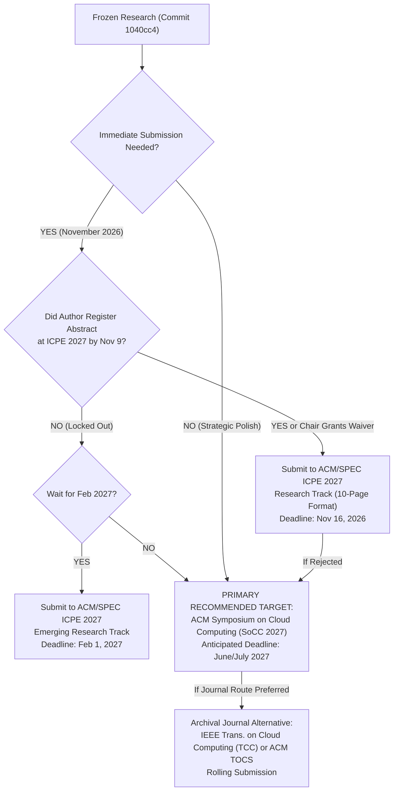

# PHASE 10: FORMAL PUBLICATION AND SUBMISSION STRATEGY

**Repository:** `DREB-RateLimiter`  
**Branch:** `submission/phase10-preparation`  
**Reference Commit:** `1040cc4`  
**Canonical Manuscript:** [`DREB_RCA70_MANUSCRIPT_FINAL_REVIEW.md`](file:///Users/cruise/Desktop/DREB-RateLimiter/DREB_RCA70_MANUSCRIPT_FINAL_REVIEW.md)  
**Auditor:** Publication Preparation Review Panel  

---

## 1. Executive Summary

This document establishes the strategic submission roadmap for the frozen DREB-RCA70 research foundation. It defines the recommended submission sequencing, contingency decision pathways, and publication ethics compliance (strictly barring simultaneous submissions).

---

## 2. Ranked Submission Pathways

---

## 3. Detailed Strategy by Target

### 3.1 Primary Recommendation: ACM Symposium on Cloud Computing (SoCC 2027)
- **Positioning:** The primary venue for cloud infrastructure systems. DREB-RCA70's focus on cloud API gateways, Redis Cluster distributed state, and PACELC latency trade-offs is a direct fit for the SoCC audience.
- **Timing:** Anticipated Call for Papers in February/March 2027, with submissions due in late June or early July 2027.
- **Preparation Horizon (6–8 Months):**
  - Conduct thorough human co-author review.
  - Package the turnkey reproducibility artifact for ACM Artifact Evaluation badges.
  - Maintain the canonical 12-page manuscript layout without truncating proofs or methodology.

### 3.2 Contingency Option: ACM/SPEC ICPE 2027 Research Track (Immediate Decision)
- **Immediate Author Action (November 12–13, 2026):**
  - The human authors must independently check whether an abstract ID was registered in HotCRP before November 9, 2026.
  - If registered, or if the program chairs grant a late-registration exception, proceed with the condensed 10-page layout ([`submission/phase10/icpe/ICPE_10PAGE_LAYOUT_PLAN.md`](file:///Users/cruise/Desktop/DREB-RateLimiter/submission/phase10/icpe/ICPE_10PAGE_LAYOUT_PLAN.md)) for submission by **November 16, 2026 (AoE)**.
  - If the HotCRP portal is locked and no exception is granted, **do not attempt to submit**.

### 3.3 Intermediate Conference Option: ICPE 2027 Emerging Research Track
- **Deadline:** **February 1, 2027**.
- **Fit:** If the Research Track is inaccessible and the authors do not wish to wait for SoCC 2027, the Emerging Research Track accepts short papers (typically 4–6 pages) presenting new ideas and empirical models.

### 3.4 Archival Journal Alternative: IEEE TCC or ACM TOCS
- If the authors prefer an archival journal publication without travel requirements, **avoid IEEE/ACM ToN** due to out-of-scope networking rejection risks.
- Instead, submit to **IEEE Transactions on Cloud Computing (TCC)** or **ACM Transactions on Computer Systems (TOCS)**, where API admission control, Redis cluster routing, and cloud microservice reliability are primary core topics.

---

## 4. Strict Prohibition on Double-Submission

Academic publication ethics (governed by ACM and IEEE policies) strictly prohibit simultaneous submission of the same or substantially overlapping manuscript to multiple venues:
1. **Single Active Submission Rule:** The DREB-RCA70 manuscript may be under review at **at most one venue at any given time**.
2. **Explicit Sequence:** If submitted to ICPE 2027, the paper cannot be submitted to SoCC 2027 or any journal until an official notification of rejection is issued by ICPE, or until the authors formally withdraw the manuscript.
3. **Resubmission Transparency:** If submitted to SoCC after an ICPE review cycle, all reviewer comments should be addressed, and prior review history should be disclosed if requested by the venue.
